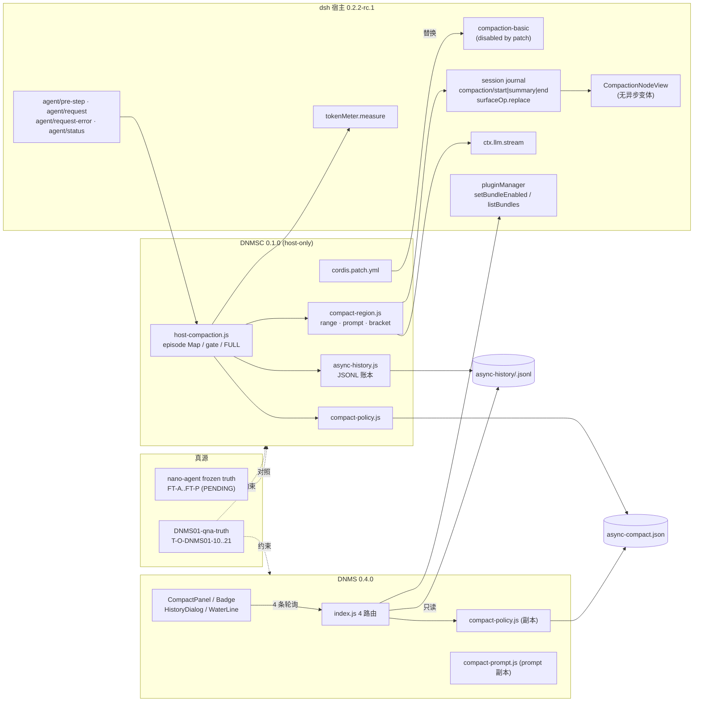
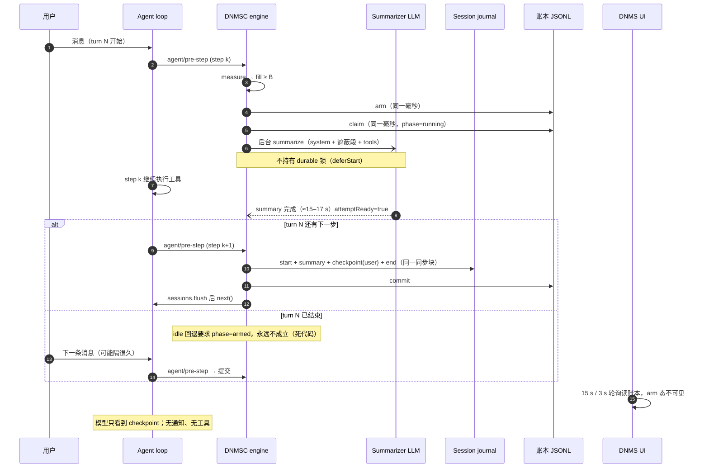
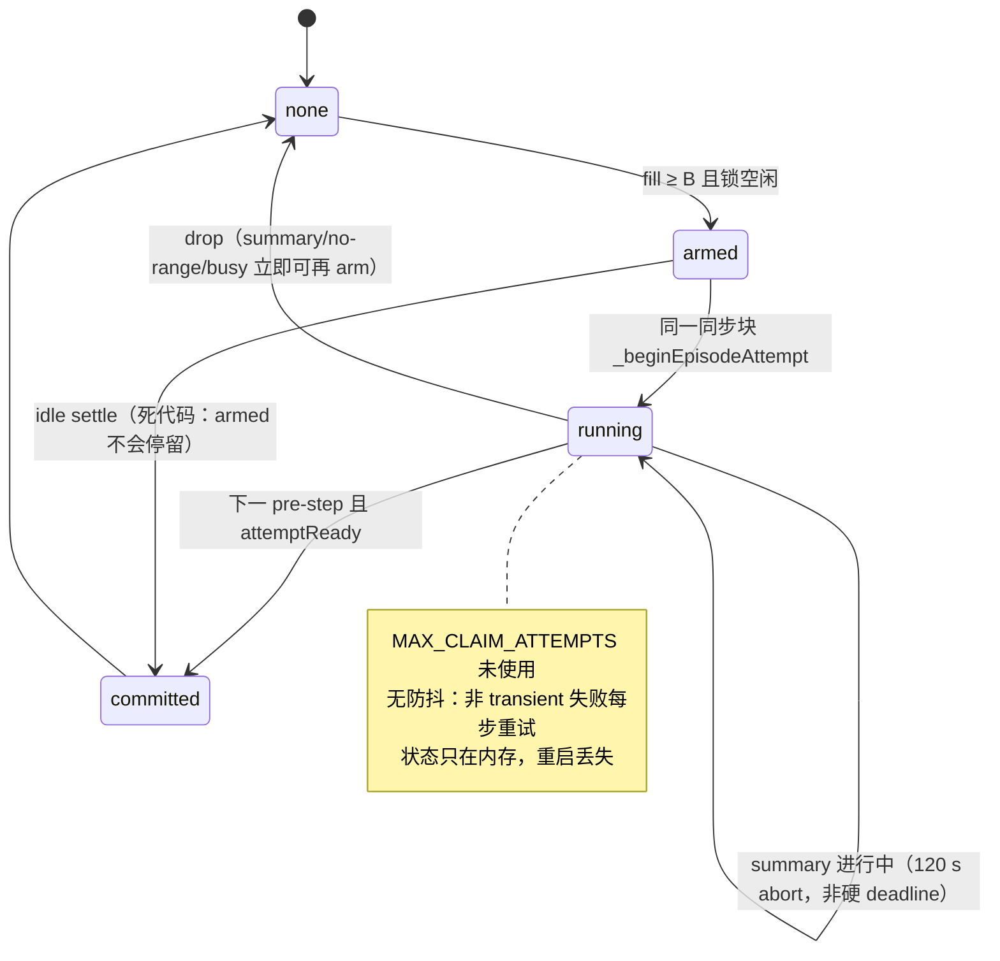

# ACE-1117 风险评估：异步压缩增强（async-compact-enhancement）

> 文档类型：risk assessment（只读评估，未改代码）
> 日期：2026-11-17
> 对象：[DNMSC] `dsh-nano-model-selector-compaction@0.1.0`、[DNMS] `dsh-nano-model-selector@0.4.0` 的异步压缩面
> 对照真源：[nano-agent] `neo` 分支 HEAD `8e0c13d26`，`docs/truth/context/frozen/`（状态 `DRAFT · REBUILD`，Owner freeze **PENDING**）；dsh 侧真源 `docs/specs/dsh-nano-model-selector/qna/DNMS01-qna-truth.md`（`T-O-DNMS01-*`）
> 宿主：[dsh] `@deepseek-ai/dsh@0.2.2-rc.1`
> 证据：desktop profile `~/.dsh-desktop`，174 个会话、308,985 条记录；脚本与中间数据在 `/tmp/dnms-evidence/`（`extract.mjs`、`retain.mjs`、`turnsplit.mjs`、`armcheck.mjs`）
> 锚点约定：dsh 仓路径相对仓根；`NA/` = `/Users/seanz/Documents/nano-agent/`；宿主包路径写作 `dsh-compaction-basic/lib/index.js` 等（位于全局 `@deepseek-ai/dsh@0.2.2-rc.1` 的依赖树）
> 修复时间线（UTC，11-16）：`b1b8948` 04:01Z 引入账本；`8f47c0e` 09:43Z deferStart + pre-step 提交；`e3acd35` 13:19Z range 改为 min/max。desktop 当前运行构建 `e271a76`，压缩代码与 HEAD 一致。

---

## 0. 一页结论

1. **能用，但不是"语义压缩"**。当前构建上，异步压缩的触发准确（7 次 arm 全部落在首次越过 B 的那一步，重算 fill 与账本一致到 6 位小数），提交正确（260 次提交后 orphan tool pair 为 0，摘要期间新追加消息 0 丢失），成功率 98.1%（265 次中 260 次提交）。
2. **[业主] 担心的"按 token 硬裁切"属实**。保留尾部按 token 从后往前累加，越过预算的那个节点就是切点，之后只回退到 tool-pair 平衡点，没有 turn 或 user 消息边界（`dsh-nano-model-selector-compaction/lib/compact-region.js:357-386`）。实测 260 次提交中 **242 次（93%）切在一个 turn 的中间**，**39 次（15%）保留尾部里一条 user 消息都没有**。
3. **AGENT 对压缩"无感知"是设计出来的，不是遗漏**。arm/running 期间模型零信号；提交后模型只看到一条 user 角色的 checkpoint，前言要求"不要承认这个 checkpoint"（`compact-region.js:248-249`），摘要 prompt 还禁止提到压缩（`compact-region.js:222`）。没有任何 inspection 工具。
4. **摘要 prompt 是宿主通用 prompt 的逐字拷贝**（`compact-region.js:190-225` = `dsh-compaction-basic/lib/index.js:243-278`），不知道有保留尾部存在，"Current Work / Next Step"两节会和保留尾部打架。仓里还有三份副本。
5. **UI 心跳与真源相反**。真源 `T-O-DNMS01-21④` 要求客户端零轮询，代码里有 4 条轮询（15 s 常驻、15 s/3 s 徽标、30 s 面板、3 s 对话框）；`armed` 态在 UI 上不可达；同步 FULL 阻塞 31–194 s 时 UI 显示 idle。
6. **有 9 处未登记的合同漂移**（S 0.80→0.90、阈值允许相等、`summaryPrompt` 第 8 字段、审计账本文件、轮询、runMaintenance 调度、adoption wake、rail 入口、18 key），按"不得擅自扩约"必须先由 [业主] 裁决登记，再动代码。
7. **工作量**：P0 7 项、P1 8 项、P2 7 项，见 §7。P0 不依赖 UI，可先行。

---

## 1. 异步压缩机制与 [nano-agent] 真源

### 1.1 真源位置

| 层 | 位置 | 说明 |
|---|---|---|
| 冻结真相（草案） | `NA/docs/truth/context/frozen/`：`compaction_modes.md`、`compaction_decision_law.md`、`pinned_threshold.md`、`checkpoint_and_episode.md`、`async_failure_and_successor.md`、`context_shape.md`、`compact_wire_policy.md`、`compaction_llm.md`、`discipline_and_invariants.md`、`micro_preflight.md`、`tool_result_prompt_visibility.md` | FT-A..FT-P 组；Owner freeze PENDING |
| 核验台账 | `NA/docs/truth/context/frozen/code-verification-ledger.md:78` | 核验 checkout 为 `9a47bae33`（09-19），早于 HEAD |
| MLRX2 实现真相 | `NA/docs/eval/message-layer-refactor/MLRX2-qna-truth.md:249,255,261,271` | turn 距离、调试面删除、owner arm、客户端 timeline 增量读 |
| dsh 侧真源 | `docs/specs/dsh-nano-model-selector/qna/DNMS01-qna-truth.md`（`T-O-DNMS01-10..21`） | DNMS01 冻结真相，本仓唯一合同来源 |

### 1.2 三模式与判定律（nano）

- 三模式 micro / async / full（`compaction_modes.md`）；async 在**每次 provider dispatch 前**判定（`NA/workers/agent-core/src/host/llm-bridge/runtime-mainline-runner/assemble-request.ts:836-869`）。
- fill = max(完整估算, provider 真值) / 标称窗口（FT-O10，`compaction_decision_law.md:88`）。
- 水位 B 0.65 / H 0.50 / S 0.80，严格递增，DC-3 拒绝 B≥0.80；pin = min(100K, 15%W)，tail 预算再受 H 约束（`pinned_threshold.md:29,39`；`NA/workers/orchestrator-core/src/control-plane/context-control-plane/async-health-plan.ts:292-314`）。
- 没有 alarm/cron 负责 arm，"no alarm, cron or self-wake"（`NA/.../compact-state-plane/dispatch-watchdog.ts:1-20`）。

### 1.3 协议层与接口（nano）

nano 没有统一的"compaction lifecycle"事件族，生命周期由五套面拼成：

| 面 | 位置 | 形状 | HEAD 状态 |
|---|---|---|---|
| NACP 消息 | `NA/packages/nacp-core/src/messages/context.ts:5-25` | `context.compact.request/response` | 已注册，auto 主链不走 |
| tool-control RPC | `NA/packages/nacp-session/src/event/tool-control-rpc.ts:94-117` | `gate/claim/settle` | **无生产调用**（声明大于实现） |
| boundary truth record | 同文件 `:147-204` | `w2.context-compact-truth.v1`（job/checkpoint/snapshot/status/tokens/generation_token/arm_checkpoint_uuid/episode_uuid/summary_ref…） | 活 |
| trigger response | 同文件 `:211-264` | `superRefine` 钉死"成功必须有 relief 且 reason=null" | 活 |
| FULL settle | 同文件 `:275-303` | `w2.full-compact-settle.v1` | 活 |
| stream event | `NA/packages/nacp-session/src/stream-event.ts:183-229` | `compact.notify`（started/completed/failed/degraded/recovered/noop），禁止正文与百分比 | 活，唯一客户端生命周期事件 |
| micro event | 同文件 `:231-248` | `compact.micro` | 活 |
| 观测合同 | `NA/packages/nacp-session/src/observability/observability-domain-registry.ts:143,263-283,341-354` | `observability-compact.v1` | 活 |

引擎阶段：

| 阶段 | nano 实现 | 要点 |
|---|---|---|
| arm | `NA/.../compact-state-plane/arm-freeze.ts:15-147` | 同一 `db.batch` 写 `async-arm-freeze` checkpoint + pending job（checkpoint-first） |
| claim | `NA/.../compact-state-plane/job-lifecycle.ts:105-119,232-289` | 两次 generation CAS：pending→prepare→running |
| summary | `NA/workers/orchestrator-core/src/executor-runtime/compact.ts:370-455`；`NA/.../compact-state-plane/prepare.ts:50-251` | 180 s deadline、一 episode 一次物理调用（`:66`）、inflation guard |
| commit | `NA/.../commit-plane.ts:40-143`；`commit-plane/boundary-plan.ts:60-95,218-264` | 4 条 INSERT 原子 batch；generation 不匹配 → conflict |
| landing | `NA/workers/orchestrator-core/src/cross-turn-truth.ts:72-107,146-201` | 下一请求读 `seq > landing_cut_seq`；必须 ready + 同 generation |
| failure | `NA/.../context-health-boundary.ts:510-598`；`compact-status.ts:379-423` | 失败码闭集；durable lineage：第一次 transient 可重试，第二次断路；无 wall-clock |
| FULL 互斥 | `NA/.../full-episode-plane.ts:12-15,176-253`；`full-compact-plane/settle.ts:45-76` | D1 偏唯一索引；provider dispatch 前等待 settle |

### 1.4 保留切点语义（nano，回应担心 1 的真源鉴定）

- **async：turn 原子 + 严格不超预算**。`atomic_group = turn:${turn_uuid}`，无 turn 才退化为 `tool:${tool_call_id}`（`NA/.../frozen-package.ts:278-282`）；`selectNewestAtomicSuffix` 先判超后收组 `if (kept + groupTokens > budget) break;`（`async-health-plan.ts:399-409`），**overshoot = 0**。
- **单组超预算**：整组交给摘要、逐字尾为 0，不切半条消息（同上）；全被 pin 时 `whole-span-pinned` → 结构 FULL（`frozen-package.ts:727-729`；`NA/workers/orchestrator-core/src/entrypoint/context-rpc/auto-arm.ts:808-827`）。
- **FULL：行级 + tool-pair 对齐，可切 turn**（`NA/.../full-compact-plane/retention.ts:220-244`）。冻结真相 FT-B1 定义 pinned 为 token 窗口而非 turn 窗口；**turn 原子是 MLRX2 的 async 实现选择，不是冻结义务**。
- **当前 turn 前缀证人** `current_turn_cut`（FNV-1a64），landing 时复核（`NA/.../cross-turn-truth-read-helpers.ts:207-223`）。
- **摘要器输入只含 windowOut**，pinned tail 不进摘要器（`frozen-package.ts:730-758`）。

### 1.5 AGENT 感知与 inspection（nano，回应担心 2 的真源鉴定）

| 能力 | nano | 锚点 | 是否冻结义务 |
|---|---|---|---|
| 压缩后的模型可见帧 | `role:system`，`[Context summary — replaces the conversation before <boundary_at>]` / `[Deterministic full-compaction fallback …]` / `[Previous compact boundary at <at>]` 三态 | `NA/workers/agent-core/src/host/llm-bridge/runtime-mainline-runner/cross-turn-provider-projection.ts:32-110`；文本 SSOT `NA/packages/nacp-core/src/system-text/source.ts:151-174` | 否（实现一致性设计，`T-O-SLR-02`） |
| 保留了什么 | 摘要末尾 `<retained>` 块（decision/constraint/task/thread/artifact），跨次逐字继承 | `NA/workers/agent-core/src/host/llm-bridge/compaction-summarize/prompt.ts:17-37` | 否 |
| 引用清单 | `reference.block` | `system-text/source.ts:368-376` | 否 |
| 摘要权威纪律 | `steering.compact_summary_authority`（仅 `glm-5.3-flash`） | `system-text/source.ts:350-358` | 否 |
| mid-turn 前缀稳定 | `boundaryAtBeforeTurn` | `cross-turn-truth-read-helpers.ts:255-270` | 否 |
| arm/running 期间通知模型 | **无**；`compact.notify.started` 只给客户端 | `assemble-request.ts:836-869` | — |
| agent 工具 `context_inspect` | 读 usage + 最近 20 条 fragment（`include_fragments` 未生效） | `NA/workers/bash-core/src/tool-contract/source.ts:333-353`；`NA/workers/orchestrator-core/src/entrypoint/context-rpc/tools.ts:34-66` | 否 |
| 手动压缩工具 | `micro_compact` 已退役 | `generated-tool-contract.ts:340-343` | — |
| operator 面 | preview / dry-run / status / jobs / inspect（`/landing,/window,/read-set…`）/ revert / checkpoints list/diff/restore | `NA/.../session-context.public-capability.ts:14-24`；`NA/.../session-truth/checkpoints.ts:96-623` | 部分（FT-C 组） |

结论：**nano 也没有"压缩发生时必须告诉模型"的冻结义务**，但实现层有完整的"边界帧 + retained 清单 + inspect 工具 + checkpoint 读面"。dsh 侧这些全部空缺，见 §5.2。

### 1.6 摘要 prompt（nano，回应担心 4 的真源鉴定）

- 两个专用 prompt：`ASYNC_COMPACT_PROMPT`（prose + `<retained>`）与 `FULL_COMPACT_PROMPT`（五节 + `<retained>`）（`prompt.ts:39-64`）。
- richness 指令：目标约为输入的 10%，"Cover the ENTIRE span evenly… do NOT over-weight recency"（`prompt.ts:118-145`）。
- 验收器 `summary-acceptor.v3`，拒绝分类 empty/scale/structure/incomplete/policy/provider（`compaction-summarize/contract.ts:65-105`）。
- 不发 `max_tokens`（FT-N2，`compact_wire_policy.md:52`）；prompt 不可由用户改写，没有 promptVersion 指纹。

---

## 2. [DNMSC] 落地现状与近期实测

### 2.1 落地形态

- [DNMSC] 通过 `cordis.patch.yml` 在 4 个 preset（standard/ptc/minimal/cordis）里禁用 `compaction-basic`、替换为本包 Provider（`dsh-nano-model-selector-compaction/cordis.patch.yml:124-129,297-300,387-390,567-570`）；生成器 `scripts/gen-mutex-patch.mjs:20,97-108`。
- 入口 `index.js:2,8-9`，inject `llm/tokenMeter/sessions`。
- 引擎 `lib/host-compaction.js`（787 行）+ 宿主私有实现的逐字移植 `lib/compact-region.js`（753 行）+ seam `lib/compaction-seam.js`（171 行）。
- 策略 `lib/compact-policy.js`：B 默认 0.65、H 0.50、S **0.90**（`:23`）、pinnedAsync 100000、pinnedFull 20000、8 字段（含 `summaryPrompt`，`:37,47`）。desktop 当前策略：B=0.7、H=0.35、S=0.9、pinnedAsync 140000、pinnedFull 20000，模型 `auto/deepseek-v4.1-flash-1017`。
- [DNMS] 侧：4 条路由（`dsh-nano-model-selector/index.js:37-48`）、面板 `src/client/CompactPanel.jsx`、徽标 `AsyncStatusBadge.jsx`、历史对话框 `AsyncHistoryDialog.jsx`、水位尺 `WaterLine.jsx`。

### 2.2 实际公式

| 量 | 代码 | 与 nano 对照 |
|---|---|---|
| fill | `tokenMeter.totalTokens / W`（`host-compaction.js:599`；`compact-policy.js:62-64`） | nano 取 max(估算, provider 真值) |
| retain（async） | `min(pinnedAsync, floor(0.15W))`（`host-compaction.js:649`；`compact-policy.js:89`） | nano 还受 H 约束；本包 H 不参与 retain，只在 `:413,:621` 设标记 |
| S 线 | `fill ≥ 0.90` → 同步 FULL，压到 B 以下（`:619-624,559,582`） | nano S 0.80 |
| 切点 | `accumulated >= retainTokens` 即 break，再回退到 tool-pair 平衡（`compact-region.js:368-380`） | nano async turn 原子、严格 ≤ |

### 2.3 近期实测（desktop，按修复时间线分组）

**总量**：265 次压缩括号，260 次提交，5 次失败，成功率 98.1%。没有宿主原生压缩，`CONTEXT_WINDOW_EXCEEDED` 0 次，最高 fill 0.80，从未到达 S=0.9。

| lane | 次数 | 提交 | 成功率 |
|---|---|---|---|
| 异步 | 10 | 9 | 90% |
| 手动 `/compact` | 37 | 37 | 100% |
| 同步 FULL | 218 | 214 | 98.2% |

**异步 claim→commit**：

| 构建段 | 样本 | 说明 |
|---|---|---|
| 账本之前（04:01Z 前） | 492bca44 最长 56 min | 旧逻辑等整轮结束才 claim |
| 账本后、8f47c0e 前 | 132 s、115 s | 同上 |
| 8f47c0e 后（当前） | 17 s、76 s、17 s、15 s、340 s | 摘要后台跑，下一 pre-step 提交；340 s 为 c57ad516，上游返回格式错误 SSE 使该 step 卡住，提交推迟到下一轮 |

arm→claim 只有几毫秒，因为两者在同一个同步块里（`host-compaction.js:650-663`）；真正的压缩耗时在 claim→commit。7 次异步摘要全部是真实 LLM 调用（`llmStreamCall=true`），输入 100,910–165,416 tokens（system + 被遮蔽段 + tools schema，`compact-region.js:526-537`），输出 3,011–4,182 tokens，摘要 9,686–13,298 字符。旧构建可见的 start→summary 间隔 10 s（bf8f9d21）、16 s（cde73c43），与 15–17 s 量级吻合。

**保留与切点**：
- 实际保留尾部 ≥ retain，多 0.1%–2.0%（`>=` 收尾导致），一例 −0.4% 由 pruner 先裁造成。checkpoint 2.5k–3.7k tokens。
- 260 次提交后 orphan tool pair = 0。
- **242/260（93.1%）切在 turn 中间**：保留尾部第一条是 `assistant/message`（工具调用步），只有 18 次从 `user/message` 开始。异步 7 例中 6 例切在 turn 中间。
- **39/260（15%）保留尾部里没有任何 user 消息**，当前 turn 的用户诉求只存在于摘要里。
- 被切开的 turn：被遮蔽部分 p50 8,863 / p90 27,507 / 最大 66,510 tokens；保留部分 p50 5,482 / p90 20,152 / 最大 32,771 tokens。例：c57ad516 当前 turn 有 42,139 tokens 被摘要、4,753 tokens 原样保留。
- 首次压缩后 prompt 降到原值的 26%–59%。

**同步 FULL 阻塞**：p50 31 s，最长 194 s，失败一例 597 s；其中 6 例由模型切换触发。

**零样本分支**：drop、timeout、circuit、idle 提交在 desktop 数据里都没有发生。

---

## 3. 视图：文件、真源、接口、协议与时序

### 3.1 拓扑视图

问题标注：
- 同一份策略逻辑有两份（`dsh-nano-model-selector/lib/compact-policy.js` 与 [DNMSC] 同名文件逐字相同），prompt 有三份（`compact-region.js:190-225`、`dsh-nano-model-selector/lib/compact-prompt.js:2`、宿主 `dsh-compaction-basic/lib/index.js:243-278`），"必须保持一致"只靠注释。
- 账本文件与真源 `-19②`"不新建 audit 文件"直接冲突。
- UI→路由是轮询，真源 `-21④` 要求零轮询。

### 3.2 异步 episode 时序（当前构建）

### 3.3 episode 状态机与死路径

### 3.4 合同与接口对照

| 维度 | nano | DNMS01 真源 | DNMSC 代码 | 判定 |
|---|---|---|---|---|
| S | 0.80 | 0.80 只读（`-15`、`-18⑤`） | 0.90（`compact-policy.js:23`） | 未登记漂移 |
| 阈值顺序 | 严格 | `effectivePin/W < H < B < S < 1`（`-15`） | 允许相等（`compact-policy.js:81,83`） | 未登记漂移 |
| 字段 | — | 7 字段 | 8 字段（`summaryPrompt`） | 未登记扩约 |
| 调度 | 每次 dispatch 前判定 | pre-step 只计量，idle 后 `runMaintenance`，下一请求 adoption（`-18①`） | pre-step 直接起摘要，下一 pre-step 提交 | 未登记漂移 |
| 锁 | D1 CAS | `compaction/start` 未配对锁（`-18②`） | 摘要期间不持锁（deferStart） | 违背真源 |
| 观测 | durable audit + hook lifecycle | 五类闭集，不建 audit（`-19①②`） | JSONL 账本 | 违背真源 |
| 客户端 | timeline 增量读，`compact.notify` 后才 settle | 零轮询（`-21④`） | 4 条轮询 | 违背真源 |
| 切点 | async turn 原子、≤ 预算 | 未规定 | token 硬切 + tool-pair | 真源空白 |
| 模型告知 | system 边界帧 + retained | 未规定（spec 声称有 adoption wake） | 只有 checkpoint 前言，要求不承认 | 真源空白 + spec 漂移 |
| inspection 工具 | `context_inspect` + operator 读面 | 未规定 | 无 | 真源空白 |
| prompt | 专用 ASYNC/FULL + `<retained>` + richness | 未规定（无 `summaryPrompt`） | 宿主通用 prompt 逐字拷贝，可覆盖 | 真源空白 + 扩约 |
| failure lineage | durable，重启不丢 | ephemeral（`-18⑧`） | ephemeral，且非 transient 无防抖 | 部分违背 |

---

## 4. 风险全清单与业务簇

### 4.1 风险全清单

来源标记：**O** = [业主] 本轮提出；**R** = 上轮报告已提出；**N** = 本轮排查新发现。

| ID | 风险 | 来源 | 锚点 | 簇 |
|---|---|---|---|---|
| R01 | 保留尾部按 token 硬切，只回退到 tool-pair，无 turn/user 边界 | O1 | `compact-region.js:357-386` | C1 |
| R02 | 93% 切在 turn 中间，15% 尾部无 user 消息 | N | `/tmp/dnms-evidence/turnsplit.json` | C1 |
| R03 | `>=` 收尾，保留量超预算一个节点；单节点超预算时整节点保留 | N | `compact-region.js:373` | C1 |
| R04 | retain 不受 H 约束，文档写"压到 H"与代码不符 | R | `compact-policy.js:89`；`DETAIL.zh.md:21` | C1 |
| R05 | 手动 / overflow 路径 retain=0，仍保留最后一个节点；safetyOnly 丢掉全部 pinned 尾部 | N | `host-compaction.js:537,569,692-696` | C1 |
| R06 | gate 用带 header 计价测量，选区用不带 header 测量，多模态时两者不一致 | N | `host-compaction.js:367,598` | C1 |
| R07 | arm/running 期间模型零信号 | O2 | `host-compaction.js:141-144,651-663` | C2 |
| R08 | checkpoint 前言要求"不承认"，摘要 prompt 禁止提到压缩，模型不知道上下文已被替换 | O2 | `compact-region.js:222,248-249` | C2 |
| R09 | 没有告诉模型"什么变了、什么没变"（遮蔽范围、保留起点、当前 turn 是否被切） | O2 | `compact-region.js:442-445,489-507` | C2 |
| R10 | 无 checkpoint inspection / 遮蔽原文召回工具 | O2 | `cordis.patch.yml`（无 inspect 工具行） | C2 |
| R11 | spec 与 closure 声称存在 `compaction-adoption-wake` 消息，代码中不存在 | N | `docs/specs/dsh-nano-model-selector/async-compaction.md:684`；`closure/DNMS01-closure.md:20` | C2 |
| R12 | 4 条客户端轮询，违背 `-21④` | O3/R | `ModelSelector.jsx:273-300`；`AsyncStatusBadge.jsx:22,24,51-52`；`CompactPanel.jsx:102`；`AsyncHistoryDialog.jsx:37,99-103` | C3 |
| R13 | `armed` 态在 UI 上不可达（arm 与 claim 同一时刻写入） | N | `host-compaction.js:651,663`；`dsh-nano-model-selector/index.js:373-375`；`i18n.js:110` | C3 |
| R14 | 账本只覆盖异步 lane，同步 FULL / 手动 / overflow 时 UI 显示 idle | R | `host-compaction.js:266,305,349,429,501,632,651` | C3 |
| R15 | `?sessionId=` 不约束 runtime 块，对话框可能显示别的会话的 fill | N | `dsh-nano-model-selector/index.js:428`；`lib/compact-runtime.js:160` | C3 |
| R16 | DC-1 `fullOnly` 不在 UI 上显示 | N | `CompactPanel.jsx:364-368`（`src/client` 无 `dcs`） | C3 |
| R17 | 宿主压缩行 `CompactionNodeView` 无异步变体，对话内无异步心流标记 | N | `dsh-nano-model-selector/AGENTS.md`（徽标节） | C3 |
| R18 | nano-ui 违规：8 个原生按钮无豁免、`✕` 作图标、5 个未定义类（live 圆点不可见）、十六进制兜底、i18n 硬编码 | N | `CompactPanel.jsx:240,246,371,464,485,493,498,499`；`AsyncHistoryDialog.jsx:51,52`；`WaterLine.jsx:51-52`；`styles.js:133,147,183-265`；`history-format.js:88` | C3 |
| R19 | 压缩 UI 未进 perf 声明与 lab 场景，基线过期 | N | `dsh-nano-model-selector/src/perf/declaration.json`；`lab/drivers/model-open.mjs:1-14`；`lab/baseline/baseline.json` | C3 |
| R20 | 摘要 prompt 是宿主通用 prompt 拷贝，不知道保留尾部存在 | O4 | `compact-region.js:190-225` | C4 |
| R21 | "Current Work / Next Step"在切 turn 时与保留尾部冲突 | O4/N | `compact-region.js:210-214` | C4 |
| R22 | 无 `<retained>` 式跨次逐字继承，多次压缩后决策会漂 | O4 | `compact-region.js:224` | C4 |
| R23 | prompt 三份副本，同步靠注释 | N | `compact-region.js:190-225`；`dsh-nano-model-selector/lib/compact-prompt.js:2` | C4 |
| R24 | `summaryPrompt` 是未登记的第 8 字段 | R | `compact-policy.js:37,47,117-119` | C4/C7 |
| R25 | 无摘要验收器（只有"比原文小"检查） | N | `compact-region.js:447-451` | C4 |
| R26 | idle 回退是死代码，单步 turn 的摘要要等下一条用户消息 | R | `host-compaction.js:177,304` | C5 |
| R27 | step 卡住时提交被推迟（340 s 例） | R | `host-compaction.js:146-152` | C5 |
| R28 | 摘要期间不持 durable 锁，与手动 `/compact` / 同步 FULL 竞争 | R | `host-compaction.js:376`；`compact-region.js:592-595,609-645,663` | C5 |
| R29 | `EPISODE_TIMEOUT` 只发 abort，无硬 deadline，adapter 不响应时 episode 永久 running | N | `host-compaction.js:315,381,391` | C5 |
| R30 | `MAX_CLAIM_ATTEMPTS` 死常量 | R | `host-compaction.js:68,280,307` | C5 |
| R31 | 非 transient 失败无防抖，`no-range` 每步一次完整 LLM 调用的热循环 | R | `host-compaction.js:484,488-495,626-664` | C5 |
| R32 | episode 只在内存，Map 永不删除，重启丢失 | R | `host-compaction.js:95,108-123` | C5 |
| R33 | 同步 FULL 阻塞整轮（p50 31 s，最长 194 s，失败 597 s） | R | `host-compaction.js:154,199,559,582` | C5 |
| R34 | 模型切换 = 阻塞 FULL 并可否决 | R | `host-compaction.js:192-213` | C5 |
| R35 | 损坏 surface（永不应答的 tool-call）导致每步 `no-range` 并 warn 刷屏 | N | `compaction-seam.js:36-38,69`；`host-compaction.js:166-168` | C5 |
| R36 | `info.context` 为 undefined 时静默不压缩（宿主行为是抛错） | R | `host-compaction.js:596`；`dsh-compaction-basic/lib/index.js:844-849,958` | C6 |
| R37 | fill 只用本地 meter，不合并 provider 真值 | N | `host-compaction.js:599` | C6 |
| R38 | S 0.90 与真源 0.80 冲突 | R | `compact-policy.js:23`；`DNMS01-qna-truth.md:200` | C6 |
| R39 | 阈值允许相等；B==S 时 async 永不 arm | N | `compact-policy.js:81,83`；`host-compaction.js:619-626` | C6 |
| R40 | pinnedAsync=140000 在实际窗口下无效（被 15%W 压住） | R | `compact-policy.js:89` | C6 |
| R41 | 无模型时 PUT 用假窗口 W=1,000,000 校验顺序 | N | `dsh-nano-model-selector/index.js:452-454` | C6 |
| R42 | 状态文件缺失时内存默认会 arm（真源 `-17` 首跑不创建，语义有分歧） | N | `compact-policy.js:225`；`test/async-takeover.test.mjs:617-621` | C6 |
| R43 | 审计账本文件违背 `-19②` | R | `lib/async-history.js:24,48-58` | C7 |
| R44 | 账本未登记进 `security/feature-contract.json` 的 `dataLocations` | N | `security/feature-contract.json`（`dataLocations['dsh-nano-model-selector']`） | C7 |
| R45 | 调度、rail 入口、18 key、localStorage 键等与 `-18①`、`-20` 不符且未登记 | R | `DNMS01-qna-truth.md:200,223`；`ModelSelector.jsx:791-805` | C7 |
| R46 | spec / closure / 文件头注释过时（runMaintenance、starved、测试计数、`header.actions`） | N | `host-compaction.js:9,67`；`closure/DNMS01-closure.md:35`；`AsyncStatusBadge.jsx:3` | C7 |
| R47 | 宿主私有实现逐字分叉，无上游 hash 钉 | N | `compact-region.js:6-15`；`compaction-seam.js:12-131` | C7 |
| R48 | patch 只覆盖 4 个 preset，不覆盖 base flat row；非 web profile 会保留原生 provider | N | `scripts/gen-mutex-patch.mjs:20,91-109` | C7 |
| R49 | 策略模块两份逐字副本 | N | `dsh-nano-model-selector/lib/compact-policy.js` | C7 |
| R50 | 测试缺口：idle settle、timeout、no-range、`info.context`、锁竞争、S 线压到 B、`compactNow` 正路径、UI 组件、无轮询断言 | N | `test/async-takeover.test.mjs:491-493,700-705` | C7 |

### 4.2 业务簇

| 簇 | 名称 | 包含风险 | 一句话 |
|---|---|---|---|
| **C1** | 保留切点与语义边界 | R01–R06 | 切在哪里、留多少 |
| **C2** | AGENT 心跳与上下文可检视性 | R07–R11 | 模型知道什么、能查什么 |
| **C3** | UI 心跳与可观测心流 | R12–R19 | 人看到什么、花多少成本 |
| **C4** | 摘要 prompt 专用化 | R20–R25 | 摘要写成什么样 |
| **C5** | episode 生命周期与调度正确性 | R26–R35 | 何时跑、何时落、失败怎么办 |
| **C6** | 计量与阈值合同 | R36–R42 | 什么时候算"满" |
| **C7** | 真源治理与观测登记 | R43–R50 | 合同、文档、账本、测试是否一致 |

簇间依赖：C1 决定 C2 的"什么变了"内容与 C4 prompt 的输入边界；C5 决定 C3 能显示哪些状态；C7 中的裁决（Q-ACE-01..08）是 C1–C6 动代码的前置。

---

## 5. 分簇剖析

### 5.1 C1 保留切点与语义边界

**现状**
- 算法：从最后一个节点往前累加 `pricedNodes[i].tokens`，`accumulated >= retainTokens` 时 break，切点就是越线节点（`compact-region.js:368-374`）；然后只在 `toolPairingBalancedBefore` 为假时往前退（`:377-380`）。这和宿主 `dsh-compaction-basic/lib/index.js:410-433` 一模一样，是宿主行为的忠实移植。
- 保护范围：tool-call / tool-result 不会被拆开（balance 为 0 才可切）；**turn、user 消息、assistant 回合都不在考虑范围内**。
- 实测：242/260 切在 turn 中间；39/260 尾部无 user 消息；被切 turn 的被遮蔽部分 p90 27.5k tokens。

**真源鉴定**
- [nano-agent] 冻结真相 FT-B1：pinned 是 token 窗口，不是 turn 窗口 → FULL 允许切 turn。
- [nano-agent] MLRX2 实现：async 用 turn 原子组、严格 ≤ 预算、单组超预算整组摘要（`async-health-plan.ts:399-409`；`frozen-package.ts:278-282`）。这是实现选择，不是冻结义务。
- DNMS01：只规定 `effectivePin` 数值（`-15`），**没有规定切点语义**。
- 结论：**真源空白**。按"不得擅自扩约"，切点语义要先由 [业主] 定，再实现。

**需求分解**（对应 [业主] 担心 1）
1. 切点优先落在语义边界：首选 turn 边界（`user/message` 之前），其次是 step 边界（一组 assistant tool-call + 对应 results 之后），最后才是 tool-pair 平衡点。
2. 在 token 限额边界上做"语义截取"：允许在 `[retain × (1 − α), retain × (1 + β)]` 的窗口里找最近的语义边界；找不到时退回下一级边界。
3. 当前 turn 的用户诉求必须原样可见：要么 turn 原子不切，要么把当前 turn 的 `user/message` 作为固定 pin 一起保留。
4. 不能把单条消息切成两半（当前已满足：节点不可分）。
5. retain 是否受 H 约束要和文档统一。

**消融方案**
- 方案 A（对齐 nano async）：turn 原子 + 严格 ≤ 预算。优点是语义最干净；缺点是长 turn（实测单个被切 turn 的被遮蔽部分最多 66.5k tokens，超过多数窗口下的 15%W）会让保留尾部降到 0，只剩摘要。
- 方案 B（推荐，分级回退）：在预算窗口内按 turn → step → tool-pair 三级寻找边界；若当前 turn 被切，额外 pin 当前 turn 的首条 `user/message`；超预算上限 β（例如 10%）。保留"永远有当前诉求原文"的性质，同时不让长 turn 退化成全摘要。
- 方案 C（维持现状 + 告知）：不改切点，只在 C2 的边界帧里明确告诉模型"当前 turn 前半段已被摘要"。成本最低，但不解决 [业主] 的核心担心。
- 配套：`selectCompactableRange` 是宿主私有实现的移植（R47），改切点即与宿主行为分叉，需要在 C7 登记"本包切点语义独立于 compaction-basic"。
- 验收：在 desktop 会话重放上统计"尾部首条是 user/message 的比例""尾部含当前 turn user 消息的比例""保留量 / retain 的分布"，作为前后对照（复用 `/tmp/dnms-evidence/turnsplit.mjs` 思路，落成仓内只读脚本需 [业主] 同意，避免过度仪式）。

### 5.2 C2 AGENT 心跳与上下文可检视性

**现状**
- arm/running：只写账本，不写 session event，不唤醒（`host-compaction.js:141-144,651-663`）。
- 提交：追加 `compaction/summary` + 一条 `role:user` 的 checkpoint，内容为 `CHECKPOINT_PREAMBLE` + `<compacted-summary>…</compacted-summary>`（`compact-region.js:442-445,489-507,248-258`）。前言原文："Continue the task directly from the messages that follow, without acknowledging this checkpoint."
- 摘要 prompt："Do NOT mention this summarization request or that the context was compacted."（`compact-region.js:222`）
- 没有任何注入、followup、工具（两包内无 `tools.register` / `agent.inject`；测试断言 `agent.followups.length === 0`，`test/async-takeover.test.mjs:335-337`）。
- spec 声称有 `(Context compacted asynchronously; continuing.)` adoption wake，代码不存在（R11）。

**真源鉴定**
- [nano-agent]：没有"告诉模型"的冻结义务，但实现层有：system 边界帧三态、`boundary_at`、`<retained>` 清单、`reference.block`、模型专属 authority steering、`context_inspect` 工具、operator checkpoint list/diff/restore/inspect 路由（§1.5）。
- DNMS01：`-18①` 写的是 `agent.followup()` 唤醒，但没写模型可见内容；没有 inspection 条款。
- 结论：**真源空白**；dsh 侧比 nano 实现少一整层。

**需求分解**（对应 [业主] 担心 2）
1. 提交时告诉模型三件事：上下文已被替换；替换了什么（遮蔽范围、条数、tokens、时间点，当前 turn 是否被切）；没变什么（系统提示、保留尾部从哪条开始、工具状态）。
2. 心跳时序：arm 时不打扰模型（与 nano 一致，避免干扰当前 step）；提交时在 checkpoint 帧内一次性说明；不新增额外 turn。
3. checkpoint inspection：给模型一个只读工具，能读当前 checkpoint 全文与元数据、列出被遮蔽的 seq 范围、按 seq 召回原文片段（有上限）。
4. 给人看的 inspection 与 C3 合并：在历史对话框里显示 checkpoint 正文与遮蔽范围。

**消融方案**
- C2-a 边界帧重写（P1）：把前言改成显式的"压缩边界帧"，带 `compactionId`、遮蔽 `seq` 范围、`shadowedTokenCount`、保留尾部起点、是否切 turn、prompt 版本；删掉"without acknowledging"，改为"把下方摘要当权威记录；保留尾部是原文；需要细节时用 inspect 工具"。角色：宿主 surface 只允许 user/system 等既有类型，需 P0 探针确认插件能否追加 `system/message` 节点；不能则保留 user 角色但改写内容。
- C2-b 摘要 prompt 同步修改（与 C4 合并）：去掉"不许提压缩"，改为"摘要的读者知道这是压缩边界"。
- C2-c inspection 工具（P2）：先探针确认 host-only bundle 能否在 preset realm 注册 agent 工具（本包 inject 只有 `llm/tokenMeter/sessions`，`index.js:8`）；能则注册只读 `compaction_inspect`（读 journal 的 `compaction/summary.shadowedSeqs` 与 `session.eventAt(seq)`，正文有上限），不能则登记为宿主缺口。新工具是公共合同变更，必须先由 [业主] 登记。
- C2-d 修正 spec 与 closure 中不存在的 adoption wake（并入 C7）。
- 验收：提交后第一个请求的 messages 里可见边界帧字段；模型在下一步能正确回答"上下文何时被压缩、当前 turn 是否完整"；工具调用读到的 seq 范围与 journal 一致。

### 5.3 C3 UI 心跳与可观测心流

**现状**
- 4 条轮询（R12）：composer 常驻 `setInterval(pull, 15000)`，同时拉策略面和库存面（`ModelSelector.jsx:281,298`）；每个会话头部徽标 15 s / 3 s（`AsyncStatusBadge.jsx:22,24,51-52`）；面板 30 s（`CompactPanel.jsx:102`）；对话框 3 s（`AsyncHistoryDialog.jsx:37,99-103`）。都没有 `document.visibilityState` 门控，都没有声明为 perf track。
- 宿主成本：每次 GET 同步读状态文件 + `resolveModelInfo` + meter（`dsh-nano-model-selector/index.js:419-434`），带 `sessionId` 时整文件读账本并全量解析后 `slice(-200)`（`:312-349`，账本上限 256 KiB）。
- 状态可达性：`armed` 不可达（R13）；同步 FULL / 手动 / overflow 不入账本（R14）；对话框 fill 可能是别的会话（R15）；DC-1 不显示（R16）。
- 对话内心流：宿主压缩行没有异步变体（R17），异步归属只靠徽标保留 10 分钟。

**真源鉴定**
- DNMS01 `-21④`：零轮询，只在打开面板 / 切换后 / PUT 成功后各 fetch 一次，不订阅 `session/event`。`-21⑦` 要求 grep 断言无 `setInterval`。
- DNMS01 `-20①`：rail 第 4 图标；实际是顶栏按钮（`ModelSelector.jsx:791-805`）。
- [nano-agent]：客户端只在每 turn 终态后增量读一次 timeline，读到 `compact.notify` 后再读状态，间隔 ≥1000 ms，遵守 `Retry-After`（`MLRX2-qna-truth.md:271`）。
- 包内 `AGENTS.md`"轮询空闲 15s、armed/running 3s"是在真源之外自行授权，属漂移。

**需求分解**（对应 [业主] 担心 3）
1. async 设置：阈值、模型、prompt 版本、DC-1 状态、effective pin 都要可见；不可编辑项要说明来源。
2. async 诊断：一个会话的完整决策链（arm/claim/commit/drop/skip + 同步 FULL / 手动 / overflow），每次提交的遮蔽范围与 checkpoint 正文。
3. 对话内心流：用户在对话里能看到"正在异步压缩 / 已异步压缩（第几次，遮蔽多少）/ 正在同步压缩（会阻塞）"。
4. 成本：零常驻轮询，或在 [业主] 重新授权下的可见性门控 + 事件驱动。

**消融方案**
- C3-a（P1）去轮询：先裁决 Q-ACE-04（维持 `-21④` 还是改为"可见性门控的有界轮询"）。维持 `-21④` 时：面板 / 对话框只在打开、切换、PUT、手动刷新时取一次；徽标改为"turn 结束后取一次"（需要客户端能拿到 turn 结束事件，若宿主 slot 不提供则登记缺口）。
- C3-b（P1）状态完整：账本记录 arm 与 claim 的真实先后（或合并为一条 `start`）；同步 FULL / 手动 / overflow 也写记录（需先裁决账本去留，Q-ACE-03）；runtime 按 `sessionId` 取；面板显示 `dcs`。
- C3-c（P1）nano-ui 合规：见 §6.2。
- C3-d（P2）对话内标记：宿主 `CompactionNodeView` 无异步变体，属于"上层建筑归 host"，登记宿主缺口；插件侧只保留徽标。
- 验收：`grep setInterval` 在压缩 UI 为 0（或符合新裁决）；同步 FULL 期间徽标显示"正在同步压缩"；对话框 fill 与所看会话一致。

### 5.4 C4 摘要 prompt 专用化

**现状**
- 内置 prompt 与宿主逐字相同（`compact-region.js:190-225`），8 个固定小节，"Do NOT mention … compacted"。
- 摘要器输入 = system + 被遮蔽段 + tools schema（`compact-region.js:526-537`），**看不到保留尾部**（这一点与 nano 一致），但 prompt 没说"后面还有原文保留"。
- "Current Work: precisely what was in progress at this checkpoint"与"Next Step: the single next action … most recent request"（`:210-214`）：在 93% 切 turn 的情况下，摘要看到的"最近"是切点处，而保留尾部已经往后走了几步甚至几万 tokens，这两节会给出过期的下一步。
- 跨次合并：只说"保留仍然成立的事实、丢弃过时的"（`:224`），没有逐字继承机制，多次压缩后决策与约束会被重新措辞并漂移。
- 可覆盖：`summaryPrompt` ≤12000 字符，sha256 前 8 位作 `promptVersion`（`compact-policy.js:117-119`；`compact-region.js:244-246`），这是 nano 没有的能力，但未登记。
- 验收：只有"摘要比原文小"（`compact-region.js:447-451`），没有结构 / 完整性检查。实测输出 3.0k–4.2k tokens，压缩比约 3%–4%。
- 副本：三份（R23），面板编辑器默认值来自 [DNMS] 副本。

**真源鉴定**
- [nano-agent]：专用 ASYNC / FULL prompt、`<retained>` 逐字继承、richness 覆盖全段、acceptor v3（§1.6）；prompt 不可覆盖。
- DNMS01：无 prompt 条款；`summaryPrompt` 不在 7 字段内。
- 结论：**真源空白 + 已有扩约未登记**。

**需求分解**（对应 [业主] 担心 4）
1. 专用 async prompt：明确"你只总结边界之前的部分，边界之后的原文会原样保留"；"Current Work / Next Step"改为"边界处的进行中状态"，并要求在边界切开 turn 时写出"当前用户诉求原文"。
2. 心流控制：摘要的读者知道这是压缩边界；输出要能和 C2 边界帧配合（谁写元数据、谁写语义）。
3. 跨次继承：机器可读的保留清单（决策 / 约束 / 待办 / 工件 / 用户偏好），仍然成立的逐字继承。
4. 单一真源：内置 prompt 只存一份，[DNMS] 编辑器读同一份（通过路由返回而不是副本）。
5. 验收器：至少检查小节完整、清单块存在、长度在合理区间；失败归入既有失败码，不新增第七码。

**消融方案**
- C4-a（P1）写专用 `ASYNC_CHECKPOINT_INSTRUCTION` 与 `FULL_CHECKPOINT_INSTRUCTION` 两份，参照 nano 的结构但保持本包 Markdown 小节风格；加入"边界感知"与"保留清单"段；`promptVersion` 自然变更。
- C4-b（P1）单一真源：[DNMS] 删除 `lib/compact-prompt.js`，内置文本通过 GET 返回（或 [DNMSC] 导出，[DNMS] 读取，需评估"不得侧载"原则——两包同仓同版本，属同一插件的 companion，[业主] 裁决 Q-ACE-06）。
- C4-c（P1）`summaryPrompt` 登记：裁决保留 / 删除；保留时登记为第 8 字段并写清"覆盖后边界感知由用户负责"。
- C4-d（P2）验收器。
- 验收：用 desktop 已有的 7 次异步摘要做 A/B（同一遮蔽段，新旧 prompt），人工核对"Next Step 是否与保留尾部冲突""决策是否逐字继承"。

### 5.5 C5 episode 生命周期与调度正确性

**现状与证据**
- idle 回退死代码（R26）：`agent/status` 只在 `phase === 'armed'` 时动作（`host-compaction.js:177`），但 arm 后同一同步块就改为 `running`（`:304,663`）。唯一提交路径是下一 pre-step（`:146-152`）。
- 卡住的 step 推迟提交（R27）：340 s 实例。
- 不持锁（R28）：`deferStart:true`（`:376`）使 `compaction/start` 在提交时才写；arm 时 `assertNoActiveCompaction` 只检查（`:629`）。手动 `/compact` 或同步 FULL 可以在摘要期间替换 surface，异步提交随后 `SurfaceChangedError` → 归为 transient → 计入断路器（`compact-region.js:663`）。
- 超时只发 abort（R29）：`setTimeout(() => controller.abort(), 120_000)`（`:315`），没有 `Promise.race`。
- 死常量与无防抖（R30、R31）：`MAX_CLAIM_ATTEMPTS` 未用（`:68`）；`_dropEpisode` 对非 transient 原因重置为 `none`（`:484,495`），下一步立即重新 arm 并发起完整 LLM 调用；`no-range` 是热循环。
- 内存状态（R32）：`this._episodes = new Map()` 永不删除。
- 同步 FULL（R33、R34）：阻塞整轮；S 线压到 B 以下而不是 S 以下（`:559,582`）；safetyOnly retain=0（`:569`）。

**真源鉴定**
- DNMS01 `-18①②⑦⑧`：idle 后 `runMaintenance`、未配对 start 锁、不自动清锁、ephemeral circuit。代码的调度方式改了但没登记；锁语义被 deferStart 破坏。
- [nano-agent]：一 episode 一次物理调用、180 s 硬 deadline、redispatch ≤3、15 分钟 stale sweep、durable lineage、FULL 接管 async 时先 cancel（`NA/.../full-compact-plane/episode.ts:250-276`）。

**需求分解**
1. 摘要在 turn 结束后完成时，要在 idle 边界提交（或明确登记"只在下一请求提交"）。
2. 摘要期间要么持锁，要么同步 FULL / 手动 `/compact` 先取消在飞 episode（对齐 nano FULL 接管）。
3. 硬 deadline，超时一定 drop 并记账。
4. 非 transient 失败要有退避或按 surface 版本去重，`no-range` 不得每步重试。
5. 会话结束 / 空闲后清理 episode；重启语义写清。
6. S 线压到哪里、safetyOnly 是否保留尾部，要和真源一致。

**消融方案**
- C5-a（P0）修 idle 提交：`agent/status` 判断 `phase === 'running' && attemptReady` 或等待 `episode.attempt` 后提交；补测试。
- C5-b（P0）锁与接管：手动 / 同步 FULL / 模型切换入口发现在飞 episode 时先 abort 并 drop（`reason:'superseded'`，需登记新 reason 或复用既有），而不是让异步提交撞 `SurfaceChangedError` 进断路器。
- C5-c（P0）硬 deadline：`Promise.race` 包住 `tx.summarize`。
- C5-d（P0）防抖：按 `surface.seq` 或 measurement 指纹记住"该版本已失败"，同版本不重试；删除或启用 `MAX_CLAIM_ATTEMPTS`。
- C5-e（P1）episode 清理与重启语义；S 线目标与 safetyOnly retain 由 Q-ACE-02 一并裁决。
- 验收：新增测试覆盖 idle 提交、超时、锁竞争、no-range 不重试；desktop 重放中单步 turn 的提交延迟下降到"turn 结束 + 摘要耗时"。

### 5.6 C6 计量与阈值合同

**现状**
- `info.context` 缺失时 `_pressureGate` 直接 `return null`（`host-compaction.js:596`），连 S 线都跳过；宿主原生行为是抛 `TargetPressureConfigError` 并记一次日志（`dsh-compaction-basic/lib/index.js:844-849,958`）。
- fill 只用本地 meter（`:599`），不合并 provider usage。
- S=0.90（`compact-policy.js:23`），真源 0.80；阈值顺序允许相等（`:81,83`），B==S 时 S 线在同一步先赢，async 永不 arm。
- pinnedAsync=140000 被 15%W 压住，实际无效。
- PUT 在无模型时用 W=1,000,000（`dsh-nano-model-selector/index.js:452-454`）。
- 状态文件缺失时内存默认会 arm（`compact-policy.js:225`）。

**真源鉴定**
- DNMS01 `-15`（严格顺序、7 字段、S 0.80）、`-17`（首跑不创建）、`-18⑤`（safety-only S=0.80）。
- [nano-agent] FT-O10（max(估算, provider 真值)）、DC-1..DC-3。

**需求分解与消融**
- C6-a（P0）`info.context` 缺失时 fail-loud：记录一次 warn + 账本 `skip`（`reason:'window-unknown'`，需登记）+ UI 显示 degraded；不再静默。
- C6-b（P0，裁决 Q-ACE-01）S 与顺序：要么回到 0.80 + 严格顺序，要么把 0.90 + 相等登记进真源。
- C6-c（P1）PUT 无模型时拒绝写入或跳过窗口相关校验，并在回包说明；首跑语义与 `-17` 对齐。
- C6-d（P2）fill 合并 provider 真值（上一条 assistant usage），对齐 FT-O10。
- 验收：无 contextWindow 的模型能在 UI 和账本看到原因；B==S 被拒或在 UI 上提示 async 不会触发。

### 5.7 C7 真源治理与观测登记

**现状**
- 账本文件违背 `-19②`，但它解决了真实问题（括号前就 drop 的失败没有任何 durable 痕迹，`dsh-nano-model-selector-compaction/AGENTS.md`）。
- 账本未进 `feature-contract.json` 的 `dataLocations`。
- 调度（`-18①`）、rail（`-20①`）、18 key（`-20⑤`，`compactSwitchConfirm` 缺失）、localStorage 缓存键（`-11`）与代码不符。
- 文档过时：`host-compaction.js:9`（runMaintenance）、`:67`（starved）、`async-compaction.md:499,656,666,674,684`、`closure/DNMS01-closure.md:10,19,20,35,41,47`、`AsyncStatusBadge.jsx:3`、`DETAIL.zh.md:16,21`。
- 宿主私有实现逐字分叉、无 hash 钉（R47）；patch 只覆盖 4 个 preset（R48）。
- 策略模块两份（R49）；测试缺口（R50）。

**真源鉴定**：全部是"实现先行、真源未登记"，按 AGENTS.md"不得由实现反推合同"，必须由 [业主] 一次性裁决。

**消融方案**
- C7-a（P0）起一份 `ACE-1117-qna.md`，把 Q-ACE-01..08 交 [业主] 裁决，结果登记为 `T-O-DNMS01-*` 修订或新 truth-id（同一决定只一份登记）。
- C7-b（P1）登记 `dataLocations`；按裁决处理账本（保留则改写 `-19②`，删除则改用 journal 派生）。
- C7-c（P2）文档同步；宿主私有实现加"来源版本 + 内容 hash"测试，`engines.dsh` 升级时自动发现漂移；base flat row 按 Q-ACE-08 处理；合并策略模块副本；补测试。

---

## 6. 对齐内部要求：perf-review 与 nano-ui

### 6.1 perf-review（DNPR）

| 要求 | 锚点 | DNMSC/DNMS 现状 | 对齐动作 |
|---|---|---|---|
| [DNMSC] 本期不加 track / 植入，新指标先进 audit | `docs/specs/dsh-nano-performance-review/spec-26nov.md:43,305`；`docs/code-review/26-nov/PRE-1116-action-plan.md:144,352,444,466` | 符合，[DNMSC] 无 `src/perf/` | 保持；[DNMSC] 成本只经 [DNMS] 读面归因 |
| 常驻 track 必须在声明 `keys.tracks` 里，只在 enabled 时挂 | `spec-26nov.md:177,319-321` | 压缩 UI 4 个定时器都不在 `dsh-nano-model-selector/src/perf/declaration.json` | 若轮询保留（Q-ACE-04），声明 4 条 `interval` track 并挂载 |
| 唯一授权的常驻轮询范式：可见性门控 + 单入口 | `spec-26nov.md:161`；`packages/dsh-performance-review/src/client.js:216,237` | 4 条轮询都无可见性门控 | 去轮询或加门控 |
| 不能靠调大周期过预算 | `docs/code-review/26-nov/performance-beta.md:99,126,160` | — | 改语义（事件驱动 / 打开时取），不改数字 |
| 硬红线：`clientJsBytes ≤ baseline × 1.1` | `spec-26nov.md:325-330`；`packages/dsh-performance-review/src/diagnose.js:174-186` | `lib/client.js` 202,671 B，约为 F13 记录 111 KB 的 1.8 倍；基线还是 0.2.0 | 先重取基线，再评估压缩 UI 拆分 |
| lab 场景 | `lab/drivers/model-open.mjs:1-14`；`lab/run.mjs`（只认 `src/client/index.js`） | 压缩 UI 不在任何场景；[DNMS] 入口是 `index.jsx`，永远不进 footprint | 新增"打开压缩页签 / 历史对话框"场景；footprint 规则兼容 `.jsx` |
| 宿主读面成本 | `dsh-nano-model-selector/index.js:312-349,419-434` | 每次 GET 同步读状态 + 账本全量解析 | 账本尾部读或按 mtime 短路 |
| 不改插件行为 | `spec-26nov.md:36,331` | — | 压缩逻辑不得因 perf 读数改变 |
| 过期事实 | `spec-26nov.md:85`（F9）、`:89`（F13） | F9 未记载常驻 15 s 轮询；F13 体积过期 | 更新 spec |

### 6.2 nano-ui

`check-ui-rules` 实跑 [DNMS]：U1 3（已豁免）、U3 25、U4 1、U8 2、U9 5、U10 1（已登记），共 37 条，与 `docs/code-review/26-nov/todo.1117.md:119` 基线一致。压缩 UI 贡献：

| 规则 | 位置 | 问题 | 对齐动作 |
|---|---|---|---|
| 宿主优先（`docs/specs/dsh-nano-ui/DESIGN.md:10-21`） | `CompactPanel.jsx:240,246,464,485,493,498,499`；`AsyncHistoryDialog.jsx:52` | 8 个原生 `<button>`，无 `nano-ui-exempt`，§10 无登记 | 换宿主 `Button`；换不了的加豁免并登记 |
| 宿主优先 | `CompactPanel.jsx:451` | 宿主有 `Input` 仍手写 `input` | 换 `Input` |
| 第 4 步豁免 | `CompactPanel.jsx:285,491` | `<select>`/`<textarea>` 宿主无对应，未标豁免 | 标豁免并登记 §10 |
| 图标（`DESIGN.md:27`） | `CompactPanel.jsx:371` | `✕` unicode 图标 | 换 nano-ui 图标 |
| 未定义类（U9） | `AsyncHistoryDialog.jsx:51`；`AsyncStatusBadge.jsx:74`；`CompactPanel.jsx:286`；`WaterLine.jsx:51,52` | `nms-hist-live`/`-dot` 零定义，live 圆点不可见 | 补样式或删除 |
| 死样式（U8） | `styles.js:133,147` | `.nms-compact-pkg`、`.nms-compact-note-actions` | 删除 |
| 不写十六进制色值（`DESIGN.md:27`，U 规则不检测 fallback，`:209`） | `styles.js:183,192-194,202-203,224,231-235,243-253,265` | `var(--dsw-*, #hhhhhh)` | 去掉兜底或用 catalog token |
| i18n | `history-format.js:88`；`CompactPanel.jsx:182,191,193` | 中文单位、英文报错硬编码 | 进 `i18n.js` |
| 弹层承载（`DESIGN.md:60-64`） | `src/client/index.jsx:80-97` | 注释说 shell overlay slot，实际 `document.body.append` + 独立 root | 移除中间 host div 或改注释 |
| a11y | `AsyncStatusBadge.jsx:70` | 可聚焦 `role=status` 无键盘动作 | 去掉 `tabIndex` 或给动作 |

---

## 7. 工作台账

约定：**前置**列出需要 [业主] 先裁决的 Q-ACE 项；未裁决前只做不涉及合同的部分。所有代码工作在 `.agents/worktrees/<语义分支>` 中进行，合并后删除。

### 7.0 [业主] 裁决项（C7-a，所有 P0 的前置）

| ID | 问题 | 选项 | 相关锚点 |
|---|---|---|---|
| Q-ACE-01 | S 与阈值顺序 | A 回到 0.80 + 严格顺序；B 登记 0.90 + 允许相等 | `compact-policy.js:23,81,83`；`DNMS01-qna-truth.md:200` |
| Q-ACE-02 | 切点语义 | A turn 原子严格 ≤；B 三级回退 + pin 当前 user（推荐）；C 维持 + 告知 | `compact-region.js:357-386` |
| Q-ACE-03 | 审计账本 | A 登记为第六观测面并覆盖全部 lane；B 删除，改为 journal 派生 | `async-history.js:24,48-58`；`DNMS01-qna-truth.md:216` |
| Q-ACE-04 | 客户端刷新 | A 维持零轮询；B 授权可见性门控 + 有界轮询 + perf track | `DNMS01-qna-truth.md:230` |
| Q-ACE-05 | 模型告知与工具 | 边界帧字段集；是否新增只读 inspect 工具（新公共面） | `compact-region.js:248-249` |
| Q-ACE-06 | prompt | 专用 prompt 结构；`summaryPrompt` 去留；内置文本单一真源放哪 | `compact-policy.js:37`；`dsh-nano-model-selector/lib/compact-prompt.js:2` |
| Q-ACE-07 | 调度登记 | 登记"pre-step 起摘要 + 下一 pre-step / idle 提交"替代 `-18①` | `host-compaction.js:139-188`；`DNMS01-qna-truth.md:200` |
| Q-ACE-08 | 范围 | 非 web profile 是否覆盖 base flat row；UI 入口 rail vs 顶栏登记 | `scripts/gen-mutex-patch.mjs:20`；`DNMS01-qna-truth.md:223` |

### 7.1 P0：正确性与合同

| ID | 工作内容 | 锚点 | 前置 | 验收 |
|---|---|---|---|---|
| ACE-P0-01 | 提交 Q-ACE-01..08 给 [业主]，裁决后登记到 DNMS01 真源（修订或新 truth-id） | `docs/specs/dsh-nano-model-selector/qna/DNMS01-qna-truth.md:63,177,200,216,223,230` | — | 每项有 truth-id |
| ACE-P0-02 | 切点语义重写：按 Q-ACE-02 实现边界选择、超预算上限、当前 turn user pin；统一 retain 与 H 的关系与文档 | `dsh-nano-model-selector-compaction/lib/compact-region.js:357-386`；`lib/compact-policy.js:89`；`DETAIL.zh.md:21` | Q-ACE-02 | 新测试覆盖 turn 边界 / 长 turn / 单节点超预算；desktop 重放"尾部含当前 user"比例从 85% 提升到 100%（方案 B） |
| ACE-P0-03 | 修 idle 提交死路径 | `lib/host-compaction.js:174-188,300-304` | Q-ACE-07 | 测试：turn 结束后摘要完成 → idle 时提交 |
| ACE-P0-04 | 锁与接管：手动 / 同步 FULL / 模型切换先 abort 在飞 episode 并 drop；不再让 `SurfaceChangedError` 计入断路器 | `lib/host-compaction.js:192-213,376,553-590,684-696`；`lib/compact-region.js:592-595,609-645,663` | — | 测试：摘要期间 `/compact` 不触发 transient 断路 |
| ACE-P0-05 | 硬 deadline：`Promise.race` 包 `tx.summarize`；超时 drop 并记账 | `lib/host-compaction.js:66,315,381,391` | — | 测试：不响应 signal 的假 adapter 在 120 s 后 drop |
| ACE-P0-06 | 防抖：按 surface 版本去重非 transient 失败；删除或启用 `MAX_CLAIM_ATTEMPTS`；修 `no-range` 热循环与损坏 surface 刷屏 | `lib/host-compaction.js:68,280,307,484,488-495,626-664,166-168`；`lib/compaction-seam.js:36-38,69` | — | 测试：同一 surface 版本 `no-range` 只调用一次 |
| ACE-P0-07 | `info.context` 缺失 fail-loud（warn 一次 + 账本 skip + UI degraded）；S / 顺序按 Q-ACE-01 落实 | `lib/host-compaction.js:553-557,596`；`lib/compact-policy.js:23,81,83` | Q-ACE-01 | 测试：无窗口模型可见原因；B==S 按裁决处理 |

### 7.2 P1：AGENT 心流、prompt、UI 与登记

| ID | 工作内容 | 锚点 | 前置 | 验收 |
|---|---|---|---|---|
| ACE-P1-01 | 专用 async / FULL prompt（边界感知、Current Work 改为边界状态、当前 user 诉求原文、保留清单逐字继承） | `lib/compact-region.js:190-225,228-230` | Q-ACE-06 | 用 7 次异步摘要的遮蔽段做新旧 A/B，人工核对 |
| ACE-P1-02 | prompt 单一真源：删除 [DNMS] 副本，编辑器默认值从路由读取；`summaryPrompt` 按裁决登记或删除 | `dsh-nano-model-selector/lib/compact-prompt.js:2`；`lib/compact-policy.js:37,47,117-119`；`src/client/CompactPanel.jsx:331-333,473-505` | Q-ACE-06 | grep 内置 prompt 只有一处 |
| ACE-P1-03 | 边界帧重写：显式压缩边界（compactionId、遮蔽 seq 范围、tokens、保留起点、是否切 turn、prompt 版本），删除"without acknowledging"；探针确认可用角色 | `lib/compact-region.js:248-258,442-445,489-507` | Q-ACE-05 | 提交后首个请求 messages 中可见字段；模型能回答"何时压缩、当前 turn 是否完整" |
| ACE-P1-04 | UI 去轮询 / 门控（按 Q-ACE-04）；拆开策略面与库存面 | `src/client/ModelSelector.jsx:273-300`；`AsyncStatusBadge.jsx:22-52`；`CompactPanel.jsx:99-103`；`AsyncHistoryDialog.jsx:37,99-103` | Q-ACE-04 | grep 断言（`-21⑦`）或 perf track 读数 |
| ACE-P1-05 | UI 状态完整：arm 态可达或合并；同步 FULL / 手动 / overflow 入账；runtime 按 sessionId；显示 `dcs` | `lib/host-compaction.js:154,199,537,651,663,684`；`dsh-nano-model-selector/index.js:373-375,428`；`lib/compact-runtime.js:160`；`CompactPanel.jsx:364-368` | Q-ACE-03 | 同步 FULL 期间徽标显示阻塞状态；对话框 fill 与会话一致 |
| ACE-P1-06 | nano-ui 合规（§6.2 全部行） | `CompactPanel.jsx:240,246,285,371,451,464,485,491,493,498,499`；`AsyncHistoryDialog.jsx:51,52`；`AsyncStatusBadge.jsx:70,74`；`WaterLine.jsx:51,52`；`styles.js:133,147,183-265`；`history-format.js:88`；`index.jsx:80-97` | — | `check-ui-rules` DNMS 压缩 UI 行清零或全部登记 |
| ACE-P1-07 | perf 对齐：声明 track（若保留轮询）、新增压缩 UI lab 场景、footprint 兼容 `.jsx`、重取基线、账本尾部读 | `dsh-nano-model-selector/src/perf/declaration.json`；`lab/drivers/`；`lab/run.mjs`；`lab/baseline/baseline.json`；`dsh-nano-model-selector/index.js:312-349` | Q-ACE-04 | lab 报告中出现压缩 UI 的 track 与场景 |
| ACE-P1-08 | episode 清理与重启语义；S 线目标与 safetyOnly retain 按真源；PUT 无模型校验；首跑语义；账本登记 `dataLocations` | `lib/host-compaction.js:95,108-123,559,569,582`；`dsh-nano-model-selector/index.js:452-454`；`lib/compact-policy.js:225`；`security/feature-contract.json` | Q-ACE-01/03 | 测试覆盖；feature-contract 校验通过 |

### 7.3 P2：工具、计量、治理收尾

| ID | 工作内容 | 锚点 | 前置 | 验收 |
|---|---|---|---|---|
| ACE-P2-01 | 只读 inspect 工具（读 checkpoint、列遮蔽 seq、按 seq 召回原文，带上限）；先探针 host-only bundle 能否注册工具，不能则登记宿主缺口 | `dsh-nano-model-selector-compaction/index.js:8`；`cordis.patch.yml` | Q-ACE-05 | 工具输出与 journal 一致 |
| ACE-P2-02 | 历史对话框显示 checkpoint 正文与遮蔽范围 | `src/client/AsyncHistoryDialog.jsx:44-64,164-219`；`dsh-nano-model-selector/index.js:312-349` | ACE-P1-05 | 人工核对 |
| ACE-P2-03 | fill 合并 provider 真值（FT-O10） | `lib/host-compaction.js:598-599` | Q-ACE-01 | 测试：usage 大于估算时以 usage 为准 |
| ACE-P2-04 | 摘要验收器（小节 / 清单 / 长度），失败复用既有码 | `lib/compact-region.js:447-451` | ACE-P1-01 | 测试 |
| ACE-P2-05 | 宿主私有实现加来源版本 + hash 测试；合并策略模块副本；base flat row 按 Q-ACE-08 | `lib/compact-region.js:6-15,190-283,357-386`；`lib/compaction-seam.js:12-131`；`dsh-nano-model-selector/lib/compact-policy.js`；`scripts/gen-mutex-patch.mjs:20,91-109` | Q-ACE-08 | 测试 |
| ACE-P2-06 | 文档同步：spec、closure、AGENTS、DETAIL、文件头注释、perf spec F9/F13 | `docs/specs/dsh-nano-model-selector/async-compaction.md:429,444,499,656,666,674,684`；`closure/DNMS01-closure.md:10,19,20,23,35,41,47`；`host-compaction.js:9,67`；`AsyncStatusBadge.jsx:3`；`DETAIL.zh.md:15,16,21`；`dsh-nano-model-selector/AGENTS.md`（轮询句）；`spec-26nov.md:85,89` | P0/P1 完成 | 无过时陈述 |
| ACE-P2-07 | 补测试缺口（idle、timeout、no-range、`info.context`、锁竞争、S 线目标、`compactNow` 正路径、UI 组件、无轮询断言）；对话内异步标记登记宿主缺口 | `test/async-takeover.test.mjs`；`dsh-nano-model-selector/test/` | — | 测试计数与 closure 同步 |

---

## 8. Verdict

**判定**：[DNMSC] 异步压缩当前是"正确但粗糙"。它没有丢数据、没有拆坏工具对、触发准确；但切点不讲语义、模型不知情、prompt 不专用、UI 与真源相反、9 处合同漂移未登记。属于 **可用、需治理**，不建议在 P0 完成前扩大使用范围或调高异步占比。

**本次 risk manage 预期带给 [dsh-nano] 的价值**：

| 维度 | 价值 |
|---|---|
| 正确性 | 消除死路径、锁竞争误入断路器、无限 running、`no-range` 热循环、静默不压缩五类潜在故障（P0-03..07） |
| 语义质量 | 保留尾部从"token 硬切"变为"语义边界截取"，当前用户诉求原文始终在上下文里；多次压缩后决策逐字继承，不漂移（P0-02、P1-01） |
| AGENT 心流 | 模型明确知道"何时压缩、替换了什么、什么没变"，需要细节时能自查，减少"失忆后重复劳动"与"按过期 Next Step 行动"（P1-03、P2-01） |
| 用户可见性 | 设置、诊断、对话内状态覆盖全部 lane，同步阻塞不再显示为 idle（P1-05、P2-02） |
| 性能 | 去掉 4 条常驻 / 高频轮询与每 tick 的宿主同步 IO，压缩 UI 首次进入 perf 量测面（P1-04、P1-07） |
| 合规 | nano-ui 违规清零，perf 声明对齐，`dataLocations` 补登（P1-06、P1-08） |
| 治理 | 9 处漂移一次性由 [业主] 裁决登记，实现与真源重新一致，后续不再"由实现反推合同"（P0-01、P2-06） |
| 平台中立 | 所有改动只在本仓两包内，不与 [nano-agent] 耦合；nano 只作为设计对照，不作为依赖或通道 |

**本次评估的限制**：
- desktop 数据中异步样本只有 10 次，drop / timeout / circuit / idle 提交分支零样本，相关结论来自代码分析。
- [nano-agent] 真相层未冻结，FT-* 引用只作对照，不作为 dsh 侧合同。
- 未运行任何修改性测试；`check-ui-rules`、`check-client-rules`、`declarations.test.mjs` 为只读实跑。
