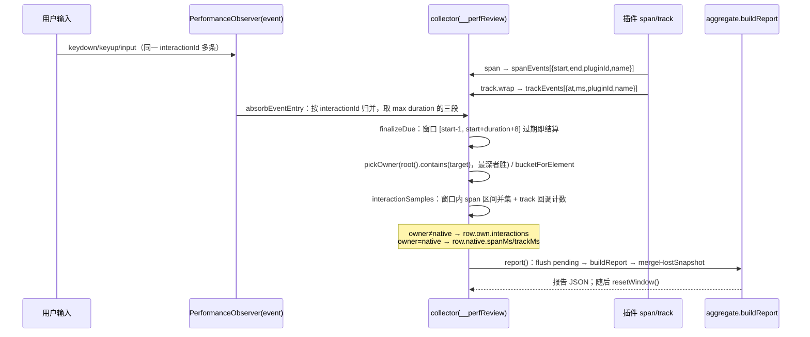
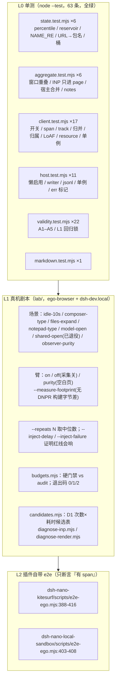
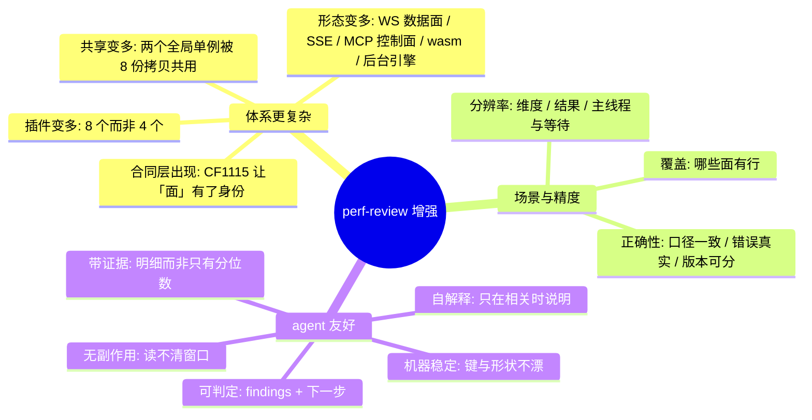

# PRE-1116 初评：perf-review 增强（Performance Review Enhancement）

> 范围：`packages/dsh-performance-review`（下称 DNPR）的现状、在 8 个活跃插件上的植入面、与 CF1115 合同/门面（`packages/dsh-interface`、`packages/dsh-host-route-guard`）的结合缺口，以及增强路线。
> 日期：2026-11-16。基线：`main` @ `77955e5`（工作区另有 11 个未提交文件，均不在 DNPR 包内，本评估不依赖它们）。
> 规格合同：[spec-26nov.md](../../specs/dsh-nano-performance-review/spec-26nov.md) rev4.1；前序评审：[performance-alpha.md](performance-alpha.md)、[performance-beta.md](performance-beta.md)；CF1115：[contract-and-facade-1115-qna.md](contract-and-facade-1115-qna.md)、[contract-and-facade-1115-eval.md](contract-and-facade-1115-eval.md)、[contract-and-facade-1115-closure.md](contract-and-facade-1115-closure.md)。
> 性质：**初评，不改代码，不改合同**。凡涉及公共合同（报告 schema、新路由、新 lane、请求级配对）的建议均标为「需 [业主] 裁决」，按仓根 AGENTS.md「不得擅自扩约」处理。
> 本评估做过的验证：`node --test packages/dsh-performance-review` → **63/63 通过**；全部 `file:line` 证据按本基线逐条读源码核对。**未**在 `dsh-dev.local` 跑 lab、未做真机复现；第 3/6 节中关于运行时影响的判断来自代码阅读，标注为「静态推断」。

---

## 目录

- §0 结论速览
- §1 设计初衷与原始目标
- §2 视图：架构、埋点、测试方法
- §3 执行现状台账
- §4 CF1115 埋点方式分析与缺口
- §5 业主方向的精确化与心智模型拆解 → 功能簇
- §6 功能簇专项分析
- §7 SWOT
- §8 推荐工作台账（P0 / P1 / P2）
- §9 Verdict

---

## §0 结论速览

1. **核心计量是对的，外壳跟不上了。** 交互归并、Event Timing 三段、span 区间并集、窗口归因、版本可见性这些「怎么量」的部分有 63 个单测锁定；问题集中在「量谁、谁来读、读到什么」——身份写死、接入样板分散、报告只出分位数不出证据。
2. **有一处会污染全部读数的接入缺陷。** [DNK] 每 10 s 调用破坏性 `report()`（`dsh-nano-kitesurf/src/client/index.js:56-63`），并默认把整进程宿主观测打开（`dsh-nano-kitesurf/index.js:420-421`）。装了 [DNK] 的页面上，lab 窗口与默认关闭承诺都不成立（静态推断）。
3. **覆盖是倒挂的。** 最敏感的 [DNT]（wasm + WebSocket + SSE + MCP）零埋点；[DNMSC] 有自己的账本但与 DNPR 不通；8 个插件里只有 3 个按规格植入。
4. **CF1115 给了一个现成的「全量咽喉」，但没有观测挂钩。** 所有 web 路由经 `route-guard`/`createWebRegistrar`，所有浏览器 JSON 调用经 `createJsonClient`（自带五类失败判别），所有 MCP 调用经 `createMcpToolset`——这三处任何一处加一个可注入观测器，覆盖面就从「手写 span 的那几条」变成「全部合同面」。
5. **推荐顺序**：P0 修接入缺陷与读数正确性（无合同变更）→ P1 CF1115 可注入观测 + 身份中立化 + 覆盖补齐 → P2 证据型报告与诊断判定（依赖 [业主] 对 schema v2 等的裁决）。

---

## §1 设计初衷与原始目标

### 1.1 业主原始诉求（spec §1，`spec-26nov.md:13-24`）

业主要一套**量化**机制判断「我们自己的插件在性能上是否合格」，要**自动化**报告；最终交付是**一个 package**，植入全部插件，监控插件的使用。后续优化只按报告点名，不凭感觉改。

四条诉求，按优先级：

| # | 诉求 | 原文要义 | 落成的指标族 |
|---|---|---|---|
| 1 | 对 dsh 原生 UI 的影响 | 用户点 composer/侧栏时，主线程是否在跑我们的代码、多少 ms、多少次 | `native.spanMsP95`、`native.trackMsP95`、`native.samples`、`inputDelayP95`、`processingP95` |
| 2 | 资源占用 | 主线程时间、强制布局、常驻定时器/观察器/rAF 的数量与活跃度、`lib/client.js` 体积；**不是**进程 RSS | `tracks.<name>.{live,callbacks,callbackMs}`、`forcedLayoutMs`、`nanoCombined.clientJsBytes` |
| 3 | UI 延迟 | 自己的面板/树/状态从动作到画完 | `own.inpP75`、`spans.<name>`、`profiler.commitP95`、`hostSpan.<name>` |
| 4 | 使用 | 哪条路径被用了多少次；优化顺序 = 次数 × 耗时 | `usage.<name>`、`counts`、lab `candidates.mjs` 的 D1 表 |

**合格定义**（`spec-26nov.md:24`）：lab 剧本相对已提交基线不超出 §7 预算，且报告能点名超预算的插件 id 与 span/track 名；运行中的插件不得因观测失败而卸载或改行为。

### 1.2 设计原则（从规格与实现中提炼）

| 原则 | 体现 | 证据 |
|---|---|---|
| 植入，而非旁观 | 否决独立 Cordis 插件：旁观者看不到 React 提交、路由函数与 DOM 根 | `spec-26nov.md:50-52` |
| 一页一观察器，一进程一宿主单例 | 多份 bundle 共享 `window.__perfReview` / `globalThis.__perfReviewHost` | `spec-26nov.md:54-60`；`client.js:662-666`；`host.js:315-345` |
| 诚实归因，宁可不归 | combo 脚本的 `sourceURL` 含多包名，不拆给单插件，进 `nanoCombined` | `spec-26nov.md:40-48`；`client.js:318-341` |
| 默认零成本 | 关闭时 `span/track/count` 为恒等包装，不打 mark 不查时钟 | `client.js:510-518`；`spec-26nov.md:152` |
| 观测不改行为 | 预算失败只影响 lab 退出码，不进插件启动 | `spec-26nov.md:311,333` |
| 测量先于预算 | `structure.*` 任一非 0 先修测量 | `spec-26nov.md:133-135`；`state.js:95-108` |
| 隐私 | 不记按键内容、路径、session id；目标进脱敏桶 | `spec-26nov.md:33,169-175` |
| 硬门禁 / audit 分层 | 高方差读数降 audit，硬门禁只留低方差结构项 | `spec-26nov.md:277-289`；`lab/budgets.mjs:56` |

### 1.3 明确的非目标（`spec-26nov.md:26-36`）

不接 session-telemetry / product-analytics；不装 OTel、不外发；不测 `measureUserAgentSpecificMemory`；不常驻 JS Self-Profiling；不以 Lighthouse 验收；不在超预算时自动降级；**不做浏览器↔宿主请求级配对**（`spec-26nov.md:36`）。最后一条是本次增强里唯一会被正面挑战的非目标（§6 FC-11）。

### 1.4 演进轨迹

rev1（2026-11-10 讨论）→ rev2（按源码复核纠正事实）→ rev3（包名定为 `packages/dsh-performance-review`，首植 [DNEE]）→ rev4（α 评审 A 闸：宿主快照送达、`libVersion` 显式传递、`observersMissing`）→ rev4.1（业主裁决 §12 方案 A：`nativeInpP75` 降为页级 audit，新增 `inputDelayP95`/`processingP95` 硬红线）。`spec-26nov.md:3-11`。

**设计时的世界**：4 个插件（notepad / model-selector / explorer-extra / shared-workspace），全部是「浏览器 UI + 少量宿主 HTTP 路由」形态；没有 WebSocket 数据面、没有 MCP 控制面、没有后台压缩引擎、没有 CF1115 合同层。今天这四个前提全部变了。

---

## §2 视图

### 2.1 架构视图

```mermaid
flowchart LR
  subgraph Browser["浏览器页面（一个 origin）"]
    direction TB
    B1["DNN lib/client.js<br/>perf.js → join('nano-notepad')"]
    B2["DNEE lib/client.js<br/>perf.js → join + configure(hostSnapshotUrl)"]
    B3["DNMS lib/client.js<br/>perf.js → join + profiler"]
    B4["DNK lib/client.js<br/>懒 join + 10s report()+POST"]
    S["window.__perfReview<br/>(先到的拷贝建立单例)"]
    O["PerformanceObserver ×3<br/>event / long-animation-frame / resource"]
    B1 & B2 & B3 & B4 -->|join / span / track / count| S
    O --> S
    S -->|report() = 快照 + 清窗口| R["report JSON (schema v1)"]
  end
  subgraph Host["dsh 宿主进程（一个 Node 进程）"]
    direction TB
    H1["DNN index.js hostJoin"]
    H2["DNEE lib/host.js hostJoin"]
    H3["DNMS index.js hostJoin"]
    H4["DNK lib/perf-host.js hostJoin + setEnabled"]
    H5["DNCS index.js hostJoin"]
    HS["globalThis.__perfReviewHost"]
    H1 & H2 & H3 & H4 & H5 -->|hostSpan / count| HS
    HS -->|30s writer| F["$DSH_HOME/plugins/perf-review/<br/>host.json + host-snapshots.jsonl"]
    HS --> RT["GET /nano-explorer-extra/perf-review/host<br/>snapshot | window(排空全进程)"]
    X["DNLS /perf-report + /perf-review/host<br/>(收 DNK 推来的页面报告)"]
  end
  S -. 5s 轮询 snapshot .-> RT
  B4 -. POST report .-> X
  B4 -. configure 指向 .-> X
  subgraph Lab["lab/（本机 ego-browser 驱动）"]
    L["run.mjs + scenarios.mjs<br/>budgets.mjs / candidates.mjs"]
  end
  L -->|addInitScript 开关 + page.evaluate report()| S
  L -->|场景首尾 mode=window| RT
```

读图要点：
- 浏览器与宿主两个单例**彼此不知道对方**；唯一桥是某个插件自愿暴露的快照路由（`dsh-nano-explorer-extra/src/host/routes.js:573-585`）。
- 页面单例的 `configure()` 先到先得（`client.js:573`），所以「哪条路由给页面送宿主数据」取决于 bundle 加载顺序。
- [DNK]→[DNLS] 的虚线是插件间专有通道（见 §3 L-B03、§6 FC-3）。

### 2.2 一次交互的数据生命周期



证据：`client.js:246-269`（归并）、`client.js:276-316`（结算与 60 s 剪枝）、`client.js:152-184`（归属）、`aggregate.js:51-100`（窗口样本与并集）、`client.js:602-636`（report 与重置）。

### 2.3 埋点视图（植入矩阵）

| 插件 | 浏览器 join | span | track | count | 宿主 hostSpan | 宿主快照路由 | 备注 |
|---|---|---|---|---|---|---|---|
| [DNN] | ✅ `src/client/perf.js:37` | `render` `highlight` `highlight-dom` `idb-write` `commit` `fx-turn` `fx-pipeline` `fx-stage-*` | `shortcut-key` `keystroke-input` `mirror-resize` `visibility` `page-resize` `escape-key` `bc-message` `draft-commit` `ctia-watch` | `panel-open` `tab-open` `version-save` | `save` `read`（`index.js:290,306`） | — | 最完整 |
| [DNEE] | ✅ `src/client/perf.js:27` | `apply-status` `list-level` `dir-status` `git-refresh` `stats-count` | `git-poll` `card-shape` `card-follow` `card-wake` | `files-expand` `dialog-open` `menu-open` | `git-status` `list` `stats`（`src/host/routes.js:303,360,566`） | ✅ `routes.js:577` | 页面唯一快照来源 |
| [DNMS] | ✅ `src/client/perf.js:23` + profiler | `catalog-fetch` `filter-render` `panel-place` | `panel-outside` `panel-place` | `panel-open` | `catalog`（`index.js:168`） | — | async-compact 三条路由无埋点 |
| [DNK] | ⚠️ 懒 join，每次 span 都 join（`src/client/index.js:39-52`） | `pane-op` `navigate` | — | — | `kite-warmup` 等，带 incidentId（`index.js:27,436`） | 借 [DNLS] | 见 L-B01/B02/B04 |
| [DNCS] | ⛔ 有 client 无 join | — | — | — | `self` `sessions`（`index.js:143,402`） | — | 12 条路由埋 2 条 |
| [DNT] | ⛔ | — | — | — | ⛔ | — | wasm/WS/SSE/MCP 全空白 |
| [DNLS] | n/a（无浏览器面） | — | — | — | ⛔ | 伪路由 `src/host/routes.js:1137-1146` | 只收 [DNK] 推送 |
| [DNMSC] | n/a | — | — | — | ⛔ | — | 自有 `lib/async-history.js` 账本 |

### 2.4 测试方法视图



| 层 | 证明什么 | 不证明什么 |
|---|---|---|
| L0 单测 | 聚合与归属逻辑在假条目上正确；单例与版本可见；禁用路径恒等 | 真实浏览器时序；植入点是否正确；多插件共存的相互干扰 |
| L1 lab | 真实 Chromium 上的读数、预算与退出码；红线可被注入触发 | 未写进场景的插件（[DNT]/[DNK]/[DNCS]/[DNMSC]）；流式通道；长时运行 |
| L2 e2e | 插件动作产生 span | 读数正确性；对其他插件的副作用（[DNK] 的 e2e 恰好依赖破坏性 `report()`） |

L1 证据：`lab/scenarios.mjs:10-18,64`、`lab/run.mjs:269,294,352`、`lab/budgets.mjs:43,56`、`lab/README.md:11-12,34-41`。

---

## §3 执行现状台账

状态图例：✅ 已做且有验证；⚠️ 已做但有缺陷；⛔ 应做未做（无合同障碍）；🔒 合同缺口，需 [业主] 裁决才能做；🗄️ 过期待清理。

### 3.A 计量核心

| ID | 项 | 状态 | 证据 | 说明 |
|---|---|---|---|---|
| L-A01 | Event Timing 按 `interactionId` 归并，保留 max-duration 条目的三段 | ✅ | `client.js:246-269`；`validity.test.mjs:301` | |
| L-A02 | `inputDelay/processing/presentation` P95 | ✅ | `client.js:231-243`；`aggregate.js:150-159` | rev4.1 落地 |
| L-A03 | 窗口归因 + span 区间并集 | ✅ | `aggregate.js:51-100`；`validity.test.mjs:214` | |
| L-A04 | `root()` 最深者胜 + 无布局读 | ✅ | `client.js:104-184`；`validity.test.mjs:253` | |
| L-A05 | LoAF：combo 进 `nanoCombined`，单包进 `scriptMs` | ✅ | `client.js:318-341` | 诚实但粒度粗，见 FC-7 |
| L-A06 | 资源字节（`encodedBodySize`）跨 reset 保留 | ✅ | `client.js:540-546`；`validity.test.mjs:330` | |
| L-A07 | 交互结算及时 + 60 s 剪枝 | ✅ | `client.js:310-315,371`；`validity.test.mjs:119-155` | |
| L-A08 | 宿主 span 错误计数反映真实失败 | ⚠️ | `host.js:262-272`；反例 `dsh-nano-model-selector/index.js:168-179` | 只认 throw，handler 内 catch 后回 500 记为成功 |
| L-A09 | 宿主分位数口径与页面窗口一致 | ⚠️ | `aggregate.js:115-128`（用 reservoir 累计样本） | snapshot 模式下累计值与窗口值混排 |
| L-A10 | 异步 span 区分主线程占用与等待 | ⛔ | `client.js:438-440` | 只有墙钟；spec 已把含 I/O 的 span 降 audit，正是因为它不可判 |

### 3.B 单例、开关与接入

| ID | 项 | 状态 | 证据 | 说明 |
|---|---|---|---|---|
| L-B01 | 读报告不破坏他人窗口 | ⚠️ | `client.js:602-636`；[DNK] `src/client/index.js:56-63` | `report()` 唯一读口且必清窗口；[DNK] 每 10 s 调用，无条件（关闭时也跑） |
| L-B02 | 宿主默认关闭 | ⚠️ | [DNK] `index.js:420-421`；`AGENTS.md:135`（DNK 包内写「仅本插件进程」） | `process.env` 与宿主单例全进程共享，实际打开全部插件 |
| L-B03 | 快照来源唯一、形状受校验 | ⚠️ | `client.js:567-590`；[DNK] `src/client/index.js:36`；[DNLS] `src/host/routes.js:1143-1145` | 先到先得 + 不校验；[DNK] 指向的路由回 `{ok,spans}` 不是快照 |
| L-B04 | `contributors` 有界 | ⚠️ | `client.js:528`；[DNK] `src/client/index.js:42` | 每次 join 都 push，[DNK] 每次 span 都 join |
| L-B05 | 版本倾斜可见 | ⚠️ | `state.js:9`（恒为 `'0.1.0'`）；`client.js:528`；`host.js:247` | 机制在，数据无区分度 |
| L-B06 | 宿主单例旧版升级不丢数据 | ⚠️ | `host.js:325-341` | 旧单例无 `_state` 时 `old=null` 全丢；有 `_state` 时沿用旧 writer（绑定旧闭包，写旧状态） |
| L-B07 | [DNLS] 收报告的数组有界 | ⚠️ | `dsh-nano-local-sandbox/src/host/routes.js:1138-1139` | 无上限追加 |
| L-B08 | 植入样板统一 | ⛔ | [DNEE]/[DNMS]/[DNN] `src/client/perf.js` 近乎逐字重复；[DNK] 手写 | |

### 3.C 身份与覆盖

| ID | 项 | 状态 | 证据 | 说明 |
|---|---|---|---|---|
| L-C01 | 交互目标桶插件中立 | ⚠️ | `client.js:86-91`；`state.js:225-239` | 写死 4 插件（含退役），新插件全落 `other` |
| L-C02 | [DNT] 植入 | ⛔ | 全仓 grep 无 `hostJoin`/`join` | |
| L-C03 | [DNMSC] 植入 / 与账本对齐 | ⛔ | `dsh-nano-model-selector-compaction/lib/async-history.js:38-48` 自有写入 | |
| L-C04 | [DNCS] 浏览器侧 + 其余 10 条路由 | ⛔ | `dsh-nano-cloud-session/index.js:19,143,402` | |
| L-C05 | [DNLS] 宿主侧 | ⛔ | 无 `hostJoin` | |
| L-C06 | [DNMS] async-compact 路由 | ⛔ | 仅 `catalog` 有 span（`index.js:168`） | |
| L-C07 | 规格植入表与现实同步 | 🗄️ | `spec-26nov.md:242-260` 仍是四插件含 shared-workspace | |

### 3.D 报告与诊断

| ID | 项 | 状态 | 证据 | 说明 |
|---|---|---|---|---|
| L-D01 | 宿主 errors/events/stats/counts 进页面报告 | ⛔ | 宿主已有 `host.js:34-72`；合并只取 n/p50/p95 `aggregate.js:287-293`；`markdown.js:94-98` | 数据已采，止于合并层 |
| L-D02 | 交互明细（最慢 N 条）进报告 | ⛔ | `collector.interactions` 存在（`state.js:71`），`buildReport` 不输出（`aggregate.js:143-269`） | |
| L-D03 | LoAF 帧明细进报告 | ⛔ | `client.js:318-341` 只累加 | |
| L-D04 | 结构计数带对象 | ⛔ | `state.js:95-108` 只有数字 | 不知道哪个插件哪个名字 |
| L-D05 | notes 仅在相关时出现 | ⚠️ | `aggregate.js:239-243` 五条恒输出 | 对 agent 是噪声 |
| L-D06 | 包内判定（findings） | 🔒 | 判定在 `lab/budgets.mjs:43`，不在包内；报告 schema v1 无 findings 位 | 需 schema v2 裁决 |
| L-D07 | 无损读取 `peek()` | ⛔ | 仅 `report()`（`client.js:638-652`） | 纯加法 API，不改报告 schema |
| L-D08 | 浏览器↔宿主请求级关联 | 🔒 | 宿主已支持 traceId（`host.js:252-259`）；规格非目标 `spec-26nov.md:36` | |
| L-D09 | agent 只读访问面（MCP/技能） | 🔒 | 无 | 新 lane，需裁决 |

### 3.E Lab 与治理

| ID | 项 | 状态 | 证据 | 说明 |
|---|---|---|---|---|
| L-E01 | 退役插件场景与预算清理 | 🗄️ | `lab/scenarios.mjs:16,179`；`lab/budgets.mjs:242` | |
| L-E02 | 新插件场景（terminal/kitesurf/cloud/compaction） | ⛔ | `lab/scenarios.mjs:10-18` | |
| L-E03 | 植入期望与预算由声明生成 | ⛔ | 当前手写于 spec §6.7 与 budgets.mjs | |
| L-E04 | 宿主快照路由的中立归属 | 🔒 | `dsh-nano-explorer-extra/src/host/route-table.js:198-209`（accepted finding：排空全进程） | 新增/改路由口径需裁决 |
| L-E05 | 插件自带 e2e 不依赖破坏性读 | ⚠️ | `dsh-nano-kitesurf/scripts/e2e-ego.mjs:392`、`dsh-nano-local-sandbox/scripts/e2e-ego.mjs:407` | 随 L-D07 改用 `peek()` |

**台账汇总**：✅ 9 · ⚠️ 13 · ⛔ 13 · 🔒 4 · 🗄️ 3。

---

## §4 CF1115 埋点方式分析与缺口

### 4.1 CF1115 实际给了什么

CF1115 本身**不是观测项目**，它是「合同族生产者—消费者闭环」的归口（`packages/dsh-interface/AGENTS.md:11`）。但它造出的四个门面恰好是观测最需要的咽喉：

| 门面 | 位置 | 消费者 | 观测相关的性质 |
|---|---|---|---|
| `createGuard().registerRoutes` | `packages/dsh-host-route-guard/src/route-guard.js:150-277`，handler 包装 `:223-241` | 全部 http+exact 路由（直接或经 registrar） | 每次请求必经；已知 `route.path/methods/sensitivity/capability/plugin`；已做 rejection/405/500 分类 |
| `createWebRegistrar` | `packages/dsh-interface/src/host/createWebRegistrar.js:35-158`；prefix `:85-103`；upgrade `:104-118` | [DNEE] `routes.js:651`、[DNN] `index.js:355`、[DNT] `web-routes.js:198` | 稳定 `binding.id`；`channel×match` 轴；`inventory()` 即「应该被观测的面」清单 |
| `createJsonClient.call` | `packages/dsh-interface/src/host/createJsonClient.js:56-107` | [DNEE]/[DNN]/[DNMS] `src/client/jsonClient.js` | 五类失败判别矩阵（`:20-28`）——天然的结果维度 |
| `createMcpToolset` / `decodeMcpReply` | `createMcpToolset.js:30-96`；`decodeMcpReply.js:24-55` | [DNT] `src/host/mcp.js:190`、`src/client/lanes.js:194` | 有 `onCall` 审计钩子（`:72`），但只在调用前、无时长无结果；[DNT] 未传入 |
| `defineFamily` / `projectWebTable` | `contracts/FamilyDefinition.js:46-140` | 构建期 | 身份 = `contractId × operationId/bindingId/providerId`，明文禁止从路径/工具名/插件名推断（`:20-22`） |
| `bindingTableModule` | `build/index.js:27-50` | 构建期 | 声明表烤成常量——perf manifest 可沿用同一机制 |

### 4.2 当前「CF1115 埋点方式」的实况

**事实：CF1115 没有建立任何埋点方式。** 合同层与观测层平行存在、零交集：

- route-guard 和 registrar 的 handler 包装里没有任何计时或回调（`route-guard.js:223-241`；`createWebRegistrar.js:86-101,106-116`）。
- `createJsonClient` 无钩子；三个插件的 `jsonClient.js` 也没有包 span。
- `createMcpToolset.onCall` 是唯一钩子，语义是审计（`{op:'mcp.call', name}`），在 dispatch 前触发；[DNT] 没有传（`grep onCall dsh-nano-terminal/src/host` 无结果）。
- 现存的 hostSpan 都是插件在 handler **内部**手写（如 `dsh-nano-model-selector/index.js:168`），与 binding id 没有关联；span 名是自由字符串，受 `NAME_RE` 约束（`state.js:13`）。

于是出现一个结构性错位：**CF1115 知道「有哪些面、每次调用结果是什么」，DNPR 知道「怎么量、怎么归因」，但两者之间没有接口。**

### 4.3 CF1115 已冻结的、可直接复用的观测相关真相

| 真相 | 出处 | 对增强的意义 |
|---|---|---|
| 失败五类：`cancelled/transport/http/protocol/domain` | `contracts/jsonOutcome.js:19-30`；QnA Q8 | 浏览器侧结果维度现成；不得在 DNPR 另造错误枚举 |
| 诊断快照形状 `Snapshot={available,observedAt,value}`；未观测才 `false/null/null`；读失败不是「未观测成功」 | `contract-and-facade-1115-qna.md:1409`（F21.4，`:322`） | agent 友好诊断的返回形状可直接沿用，避免另立第二套 |
| 性能库保持独立，不合并进归口 | `contract-and-facade-1115-qna.md:401,680` | 观测器只能**注入**进门面，不能让 dsh-interface 依赖 DNPR |
| DNPR 的职责边界：观测与聚合，**不是**业务错误合同、**不是** durable 审计权威 | `contract-and-facade-1115-eval.md:187` | DNPR 可读结果类型，不得成为错误真源；[DNMSC] 账本也不能被 DNPR 取代为权威 |
| host 出口「只注入 ctx，不持跨实例全局态」 | `packages/dsh-interface/AGENTS.md:18` | 观测器以参数传入，单例仍在 DNPR 内 |
| route-guard「不要加业务逻辑，极简可测」 | `packages/dsh-host-route-guard/AGENTS.md:58` | 钩子必须是可选、无默认行为的纯回调 |

### 4.4 功能缺口（无需改合同即可补）

| ID | 缺口 | 现状证据 | 补法 |
|---|---|---|---|
| G-F01 | route-guard 无观测回调 | `route-guard.js:223-241` | `createGuard({table, plugin, observe?})`；回调收 `{routeId/path, method, status, ms, outcome}`；未传时零开销 |
| G-F02 | registrar prefix/upgrade 无观测回调 | `createWebRegistrar.js:86-117` | 同上，透传给 guard；upgrade 记握手与拒绝 |
| G-F03 | `createJsonClient` 无观测回调 | `createJsonClient.js:56-107` | `createJsonClient({fetch, resolveUrl, observe?})`；每次 call 结束回调 `{operationId, kind|ok, httpStatus, ms}` |
| G-F04 | `onCall` 只有前置 | `createMcpToolset.js:72` | 增加结束回调（ms + `structuredContent.kind`），保留旧 `onCall` 语义 |
| G-F05 | 状态码与结果无法到达 hostSpan | `host.js:262-272` | 观测在 guard 层拿到 `res.statusCode`，而不是靠 throw |
| G-F06 | `inventory()` 未用作「期望观测面」 | `createWebRegistrar.js:147-150` | lab/测试比对 inventory 与观测到的键，未覆盖面可见 |

### 4.5 合同缺口（需 [业主] 裁决）

| ID | 缺口 | 冲突点 | 需要的决定 |
|---|---|---|---|
| G-C01 | 门面观测回调本身是公共合同的新增参数 | 仓根「不得擅自扩约」；guard/registrar 是全部路由的唯一入口 | 批准 `observe` 可选参数的形状与「不观测时行为逐字不变」的保证 |
| G-C02 | 指标键要用 binding id / `contractId×operationId` | `NAME_RE` 禁 `.`/`:`、≤40 字符（`state.js:13`）；32 键上限（`state.js:15`） | 报告 schema v2 的键模型（维度 vs 名字） |
| G-C03 | 结果维度进入报告 | schema v1 无此位（`spec-26nov.md:177-220`） | 是否在 hostSpan/clientOp 行加 `byOutcome` |
| G-C04 | 请求级关联 | `spec-26nov.md:36` 非目标 | 是否解除；traceId 是否允许走请求头 |
| G-C05 | 诊断返回形状 | F21.4 只冻结在 DNLS 工具族 | 是否把 `Snapshot` 形状扩用到 perf 诊断 |
| G-C06 | 快照路由归属 | `route-table.js:208` accepted finding | 每插件只读路由 / 维持现状 / 其他 |

---

## §5 业主方向的精确化与心智模型拆解

### 5.1 三个方向的精确表述

| 业主原话 | 精确化表述 | 判定「做到了」的可观测标准 |
|---|---|---|
| 适应更复杂的插件体系 | DNPR 的身份、归属、送达与接入，不随插件数量和形态增长而需要修改共享包；任一插件的接入不能改变其他插件的读数 | 新增一个插件只改该插件自身；共享包里不出现任何插件名；[DNK] 类副作用被测试拦下 |
| 提供更多埋点的场景与精度 | 覆盖面从「手写 span 的路径」扩展到「全部合同面 + 流式/后台/wasm 面」，并且每个读数的口径（窗口/累计、主线程/墙钟、成功/失败）正确且可声明 | inventory 中每个面都有观测行；8 个插件都有行；宿主 errors 与真实状态码一致 |
| 更 verbose、agentic friendly、更精确的诊断 | 报告的第一读者是 agent：机器稳定、自解释、携带证据、给出判定与下一步、读取无副作用 | agent 只凭一份报告能回答「谁、在哪、多慢、为什么、下一步做什么」，且读取不改变下一份报告 |

### 5.2 心智模型拆解

业主的三句话背后其实是三组隐含假设，拆开后每一条都能落到具体机制：



### 5.3 功能簇

| 簇 | 名称 | 主要服务的方向 |
|---|---|---|
| FC-1 | 身份与归属中立化 | 体系 |
| FC-2 | 单例与多拷贝治理 | 体系 / 精度 |
| FC-3 | 宿主快照送达与路由归属 | 体系 |
| FC-4 | CF1115 门面可注入观测 | 场景 / 体系 |
| FC-5 | 指标键模型与维度 | 场景 / 精度 |
| FC-6 | 新场景面：流式、wasm、后台、MCP | 场景 |
| FC-7 | 计量精度与口径 | 精度 |
| FC-8 | 证据型报告 | agent |
| FC-9 | 诊断判定与发现 | agent |
| FC-10 | 无损读取与 agent 访问面 | agent / 体系 |
| FC-11 | 端到端关联 | agent / 精度 |
| FC-12 | Lab 与覆盖治理 | 全部 |

---

## §6 功能簇专项分析

### FC-1 身份与归属中立化

**现状**
- 目标桶写死：`BUCKET_ATTRS` 列 4 个插件的 data 属性，含已退役的 `data-nano-shared-workspace`（`client.js:86-91`）；`targetBucket` 同样写死（`state.js:225-239`）。
- 包名→插件 id 靠命名约定 `dsh-nano-X → nano-X`（`state.js:215-219`）。目前 8 个插件恰好都符合，但这是巧合不是合同。
- 每个插件各写一份几乎相同的 `perf.js`（[DNEE] `src/client/perf.js:27-40`、[DNMS] `src/client/perf.js:23-30`、[DNN] `src/client/perf.js:37-`）；[DNK] 手写懒加载版本（`src/client/index.js:39-52`），恰好是缺陷来源。

**问题**：共享包需要认识每一个插件，违背「插件中立」的方向；新插件的交互全部落进 `other`，归属分析对它们失明。

**目标形状**
- `join(id, { root, bucket })`：桶由插件声明，共享包只保留 `composer-textarea`/`sidebar-row`/`other` 等**原生**桶。
- `definePerfImplant({ id, version, libVersion, root, bucket, react })`：统一懒 join、一次 configure、`libVersion` 传递，替换四份样板。
- 包名映射改为 join 时显式声明 `packageName`，约定映射退为兜底。

**合同依赖**：无（join 的 impl 是内部 API）。报告里的 `bucket` 取值集合扩大，属于 schema v1 内的值域变化，建议在 spec 登记。

### FC-2 单例与多拷贝治理

**现状**
- `LIB_VERSION='0.1.0'` 恒定（`state.js:9`）；各插件 `lib/` 在不同提交构建（`git log` 显示 DNPR 相关修复散落在多次提交），版本字段无区分度。
- `contributors` 无界（`client.js:528`）。
- 宿主升级路径两处缺陷（`host.js:325-341`）。

**Case study：宿主升级丢数据**
`ensurePerfReviewHost` 的注释说「把累积状态带过去」。实际分支：当旧单例缺 `_state`，`old` 为 `null`，`next.plugins` 保持空 Map，旧数据全部丢失；当旧单例有 `_state` 但缺 `setEnabled`，`next.writer = old.writer`（`:338`），新单例因此不再启动自己的 writer，而旧 writer 闭包里的 `writeFile` 读的是**旧** `state`——此后 `host.json` 永远写旧状态，新 span 只在内存里。两种情况都只在版本倾斜时出现，而版本倾斜正是 FC-2 要暴露却暴露不出来的东西。

**目标形状**
- 构建期注入 `__DNPR_BUILD__`（DNPR 源码内容哈希）随 `libVersion` 一起进 contributors；倾斜在报告里真实可见。
- contributors 按 `pluginId@libVersion@build` 去重存储。
- 升级时复制状态而不是沿用 writer；或干脆以「状态对象挂在 global、实现可替换」的方式重写单例。

### FC-3 宿主快照送达与路由归属

**现状**
- 页面单例只接受第一个 `hostSnapshotUrl`，且不校验返回形状（`client.js:567-590`）。
- [DNEE] 是唯一合规来源（`src/client/perf.js:40`），其路由 `mode=window` 排空**全进程**所有插件（`route-table.js:208`，accepted finding）。
- [DNMS]、[DNN] 注释明确「NDEE owns the poll」（[DNMS] `src/client/perf.js:7-8`；[DNN] `src/client/perf.js:7-9`）——这是一个跨插件的隐式依赖：卸载 [DNEE]，页面就失去所有宿主数据。
- [DNK] 指向 [DNLS] 的 `/perf-review/host`（`src/client/index.js:36`），该路由回 `{ok:true, spans:[…]}`（`dsh-nano-local-sandbox/src/host/routes.js:1143-1145`），不是宿主快照。

**Case study：加载顺序决定页面是否看得到宿主数据**
combo 脚本里 [DNK] 若排在 [DNEE] 之前，`configure` 先收到 [DNLS] 的 URL；[DNEE] 的调用因 `hostSnapshotProvider !== null || hostSnapshotTimer !== null` 被忽略（`client.js:573`）。此后 `hostSnapshotCache` 被写成 `{ok, spans}`，`mergeHostSnapshot` 读 `.plugins` 得 `undefined`，`hostSpan` 全空，报告里没有任何结构计数提示（静态推断）。同时 [DNK]→[DNLS] 是两个插件之间的专有数据通道，触及仓根「不得侧载」。

**目标形状（需 [业主] 裁决 G-C06）**
- 推荐：每个有宿主的插件在**自己的前缀**下暴露只读、不排空的 `<prefix>/perf-review/host`，只返回本插件那一行；页面单例接受**多源**，按 pluginId 合并。排空只留给 lab，用单独动词。
- 无论选哪个方案：`configure` 必须做形状校验，不合格计入 `structure.hostSnapshotRejected`。

### FC-4 CF1115 门面可注入观测

**现状**：见 §4.2。三处咽喉零钩子。

**Case study：[DNEE] 16 条路由只有 3 个 hostSpan**
[DNEE] 全部 16 条路由经 `createWebRegistrar`（`src/host/routes.js:651`），但 hostSpan 只手写在 `git-status`/`list`/`stats`（`:303,360,566`），注释明言「names stay inside the spec's v1 set」（`:329`）。`/commit`、`/pull`、`/push`、`/fetch`、`/checkout` 这些最慢、最可能超时的路径完全不可见。在 guard 层加一个回调就能一次覆盖全部 16 条，且拿到真实状态码。

**目标形状**
```js
// 插件侧（示意，非合同）
const review = ensurePerfReviewHost().hostJoin(PLUGIN, { version, libVersion })
createWebRegistrar({ plugin: PLUGIN, bindings, observe: review.observeBinding })
// guard 内部（示意）：observe?.({ id, method, status: res.statusCode, ms, outcome })
```
- 观测器由插件传入，dsh-interface 与 route-guard 不 import DNPR（满足 `dsh-interface/AGENTS.md:18`、QnA `:401,680`）。
- 未传 `observe` 时，guard 的行为与字节级产物不变（可用现有 `route-guard.test.mjs` 与 registrar 测试锁定）。
- 浏览器侧同理：`createJsonClient({ fetch, resolveUrl, observe })`，结果维度直接用 `FAILURE_KIND`。

**合同依赖**：G-C01（参数本身）、G-C02/G-C03（键与维度如何进报告）。

### FC-5 指标键模型与维度

**现状**：span 名 = 自由字符串，`/^[a-z0-9][a-z0-9-]{0,39}$/`（`state.js:13`）；每插件 32 个 span 键、32 个 usage 键（`state.js:15-16`）；超出计 `overflowSpans` 并丢弃。

**问题**：自动埋点后，键数 = 合同面数 × 结果类型。[DNEE] 16 条路由 × 5 类结果就是 80 个组合；[DNCS] 的 `session` 一条路由下还有 10 个 op（`dsh-nano-cloud-session/AGENTS.md` 使用节）。把维度拼进名字会立即撑爆 32 键。

**目标形状（需 G-C02/G-C03 裁决）**
- 键 = 合同身份（binding id 或 `contractId:operationId`）；维度 = 小而封闭的集合（`outcome`、`statusClass`、`cache`）。
- 报告行：`ops.<id> = { n, p50, p95, max, byOutcome: { ok, domain, http, … } }`。
- 手写 span 继续保留，命名空间与 ops 分开，互不挤占配额。

### FC-6 新场景面：流式、wasm、后台、MCP

**现状**

| 面 | 插件 | 现有可观测基础 | DNPR 覆盖 |
|---|---|---|---|
| WebSocket 数据面（v2 CREDIT/SNAPSHOT） | [DNT] | `web-routes.js:20`（upgrade+exact binding） | 无 |
| SSE 事件流（snapshot + seq + missed + heartbeat） | [DNT] | `src/host/events.js:1-8` | 无 |
| MCP 控制面 | [DNT] | `src/host/mcp.js:190`；错误 kind `src/host/errors.js:1-30` | 无 |
| wasm 编译/实例化 | [DNT] `lib/dnt-core.wasm`；[DNN] `lib/fx/` | — | 无（[DNN] 只有 `fx-turn`/`fx-pipeline` 外层 span） |
| 后台压缩 episode | [DNMSC] | `lib/async-history.js:38-48`（arm/claim/commit/drop/skip） | 无 |
| CDP 截图/导航 | [DNK] | `hostSpan` + incidentId | 有，但见 L-B01/B02 |

**目标形状**
- 新 track 类型：`websocket`、`sse`、`worker`（`spec-26nov.md:122` 把类型列为封闭集合，需登记）。
- [DNT]：WS 帧数/字节/积压（CREDIT 窗口）、SNAPSHOT 降级次数、SSE missed 次数与首帧时延、wasm `instantiate` 时长、MCP 每工具时长与 kind。
- [DNMSC]：episode 的 arm→claim→commit 时长作为 hostSpan，**账本仍是 [DNMSC] 唯一真源**；DNPR 只读计时，不复制决策记录（`contract-and-facade-1115-eval.md:187` 边界）。
- lab：`terminal-burst`（高吞吐输出下的 composer inputDelay）、`kitesurf-shot`、`cloud-list`。

### FC-7 计量精度与口径

**Case study：失败被记成成功**
[DNMS] `catalogHandler` 把整个 handler 包进 `hostSpan('catalog', async () => { try {…} catch { sendJson(res, 500, …) } })`（`dsh-nano-model-selector/index.js:168-179`）。异常在内部被吃掉，`hostSpan` 只看到 Promise resolve，记为 `err=false`。宿主 `errors` 恒 0，`lastErrorAt` 恒 null——宿主已经花成本采集的错误信号对这类写法完全失效。FC-4 在 guard 层观测 `res.statusCode` 是根治。

**其他口径问题**
- 宿主分位数用累计 reservoir（`aggregate.js:115-128`）；页面 snapshot 模式下与窗口数据并列，口径不同却不标注。takeWindow 已提供 `windowSamples`（`host.js:62-63,99`），应优先使用并在行上标 `scope: window|cumulative`。
- 异步 span 只有墙钟（`client.js:438-440`）。可拆 `syncMs`（到第一个 await 返回）与 `settleMs`，前者才是主线程成本。
- LoAF 只读 `sourceURL`（`client.js:322-336`）。`PerformanceScriptTiming` 另有 `invoker`、`invokerType`、`sourceFunctionName`、`sourceCharPosition`。结合 combo 内各包的字符区间，存在按包归属的可能；但 spec §3.1 否决过 URL 归属（`spec-26nov.md:40-48`），列为研究项，需 [业主] 决定。
- 宿主 reservoir 64 个样本（`state.js:20`）对 p95 的置信度有限；报告应同时给出样本数与「低样本」标记，而非只给 p95。

### FC-8 证据型报告

**现状**：报告只输出分位数与计数（`aggregate.js:143-269`）。`collector.interactions` 里每条都有 `owner/bucket/inputDelay/processing/presentation/samples`（`client.js:284-294`），在 `buildReport` 处被丢弃；宿主 `events[]`（`host.js:65`）在 `mergeHostSnapshot` 处被丢弃（`aggregate.js:287-293`）。

**目标形状（需 schema v2 裁决）**
- `page.topInteractions[k]`：最慢 k 条，每条含三段、owner、bucket、各插件 `spanMs/trackMs`、重叠 LoAF 帧 id。
- `page.topFrames[k]`：最重 LoAF 帧，含 `blockingDuration`、`forcedStyleAndLayoutDuration`、脚本条目（脱敏后的 URL 包名 + invokerType）。
- `plugins.<id>.hostSpan.<name>` 增加 `errors`、`lastErrorAt`、`recent[]`（来自宿主 events 环）。
- `structure.events[]`：最近 N 条结构异常，含 `{kind, pluginId, name}`。
- 体积上限仍守 256 KB（`spec-26nov.md:222`）：k 与 N 固定小值。

### FC-9 诊断判定与发现

**现状**：判定逻辑全部在 `lab/budgets.mjs`（`evaluate` `:43`、`audit` `:56`），只有 lab 能判；页面与宿主拿到报告也不知道是否合格。notes 有五条恒输出（`aggregate.js:239-243`）。

**参照：[DNK] 的诊断面已经验证过 agent 友好形态**——`/diagnostics` 一次给出「errorId → 状态码 → 原因 → 下一步命令」，以 `lib/diagnostics.js` 的 `ERROR_CATALOG` 为唯一真源（见 `dsh-nano-kitesurf/AGENTS.md` 使用节）。

**目标形状（需 schema v2 裁决）**
- 包内纯函数 `diagnose(report, manifest) → findings[]`；`lab/budgets.mjs` 改为调用它，判定只有一份真源。
- `finding = { id, severity: hard|audit|info, pluginId, metric, value, threshold, scope, evidence: [指向 topInteractions/topFrames/structure.events 的引用], next }`。
- notes 改为条件触发，并带稳定 id，agent 可以按 id 查说明而不是解析中文段落。
- 返回形状可沿用 F21.4 `Snapshot`（G-C05），保持「未观测」与「读失败」的区分。

### FC-10 无损读取与 agent 访问面

**Case study：[DNK] 的 10 秒清窗**
`setInterval(reportPerf, 10000)` 无条件运行（`dsh-nano-kitesurf/src/client/index.js:62`）。每次 `report()`：先 `finalizeDue(now+60000)` 把仍在进行的交互强行结算（`client.js:603`），再 `resetWindow()` 清空全部插件的 own/native/samples/span window/track callbacks/profiler（`client.js:538-560,634`）。lab 一个 `composer-type` 场景约 10 s（120 字 × 80 ms），因此场景窗口大概率被中途清空一次，[DNN] 的 `keystroke-input`、[DNEE] 的 `git-poll` 读数随之失真（静态推断，建议 P0 用 lab 复现确认）。关闭开关时报告照样构建并 POST，[DNLS] 侧 `session.spans` 无界增长（`routes.js:1138-1139`）。

**目标形状**
- `peek(meta)`：与 `report()` 同形但不 flush、不 reset；`report()` 只保留给 lab 的场景边界。
- 文档与 lint 级约束：插件代码不得调用 `report()`（可在各包测试里 grep 拦截）。
- agent 访问面（G-C 级，L-D09）：只读工具返回 `peek()` + `diagnose()` 结果。是否开放以及走 MCP 还是技能，需 [业主] 裁决。

### FC-11 端到端关联

**现状**：宿主已支持 `traceId/incidentId`（`host.js:252-259`），[DNK] 已在用（`dsh-nano-kitesurf/index.js:22-27,318-323`）；浏览器侧 span 没有 traceId；规格明确不做配对（`spec-26nov.md:36`）。

**价值**：一次「点提交 → 宿主 git commit → 状态刷新」可以串成一条链，agent 能直接看到慢在浏览器、网络还是宿主。

**代价与约束**：traceId 若走请求头，就是新的跨层字段，属于公共合同变更；`createJsonClient` 明文「never invent」（`createJsonClient.js:13-19`），注入 trace 头必须是显式的 operation 级声明。需 [业主] 裁决 G-C04。

### FC-12 Lab 与覆盖治理

**现状**：场景列表与预算名单写死在 `lab/scenarios.mjs:10-18` 与 `lab/budgets.mjs:242`，包含退役插件；新插件无场景；植入期望只存在于规格文字（`spec-26nov.md:242-260`）。

**目标形状**
- 每个插件一份 perf manifest（声明 span/track/op 名、kind、预算行、所属场景），构建期经 `dsh-interface/build` 同款机制烤成常量（`build/index.js:27-50`）。
- 单测：manifest 声明的键必须在植入代码里出现；registrar `inventory()` 中的面必须在 manifest 或自动观测里有归属。
- lab 从 manifest 生成场景期望与预算，删除手写名单。

---

## §7 SWOT

| | 有利 | 不利 |
|---|---|---|
| **内部** | **S 优势** | **W 劣势** |
| | S1 计量核心正确且被 63 条单测锁定（归并、三段、并集、归属） | W1 读取即破坏：唯一读口 `report()` 必清窗口 |
| | S2 诚实归因文化：不可归因进 `nanoCombined`，不硬拆 | W2 身份写死：桶与映射认识具体插件 |
| | S3 默认零成本 + 禁用臂 / purity 臂 / footprint 构建 | W3 接入靠样板，缺统一 helper，导致 [DNK] 类缺陷 |
| | S4 硬门禁 / audit 分层，红线可被注入证明 | W4 宿主信号止于合并层：errors/events 采了不出 |
| | S5 版本可见性机制（contributors/observerVersion）已在 | W5 错误计数依赖 throw，与真实状态码脱钩 |
| | S6 宿主侧已有 traceId、events 环、jsonl 时间序列 | W6 报告无证据、无判定，agent 只能读分位数 |
| | | W7 覆盖倒挂：最敏感插件零埋点 |
| | | W8 单例升级与版本戳缺陷，倾斜不可见 |
| **外部** | **O 机会** | **T 威胁** |
| | O1 CF1115 三个咽喉可一次覆盖全部合同面 | T1 插件接入的副作用跨插件传播（[DNK] 已发生） |
| | O2 CF1115 已冻结的五类失败、F21.4 Snapshot 可直接复用 | T2 宿主快照来源依赖某个插件存在，形成隐式耦合与侧载风险 |
| | O3 `dsh-interface/build` 的烘焙机制可承载 perf manifest | T3 schema 演进若无裁决会触发「擅自扩约」 |
| | O4 [DNK] `/diagnostics` 证明了 agent 诊断形态 | T4 自动埋点若无配额模型会撑爆 32 键上限 |
| | O5 [DNT] events/errors、[DNMSC] 账本已有结构化信号可接 | T5 dsh 升级（`<0.3.0` 之外）改变 shell DOM 或 combo 机制 |
| | O6 LoAF 新字段与 combo 区间可能提供更细归因 | T6 观测成本被新自动埋点抬高，违背默认零成本 |

### 7.1 Weakness 完整说明

- **W1 读取即破坏。** 设计初期只有 lab 一个读者，`report()` 兼任「读」和「切窗口」是合理的简化。今天读者有四类：lab、插件自报（[DNK]）、插件 e2e、未来的 agent。任何一个非 lab 读者都会切掉 lab 的窗口。这不是某个插件写错，而是 API 只有一种读法。影响：读数失真且无结构计数报警。
- **W2 身份写死。** `BUCKET_ATTRS`、`targetBucket`、`packageNameToPluginId` 都把插件知识放进共享包。插件从 4 到 8，每次都需要改共享包，否则新插件在归属里不可见；而且共享包里残留退役插件的锚点。影响：归属分析覆盖率随插件数下降，与「插件中立」方向相反。
- **W3 接入靠样板。** 四份 `perf.js` 几乎逐字相同，正确用法（一次 join、传 libVersion、只有一个 configure）靠注释传承。第五个插件没抄样板就出了三个缺陷（L-B01/B03/B04）。影响：每新增一个插件都是一次重新犯错的机会。
- **W4 宿主信号止于合并层。** 宿主花成本采集了 `errors/lastErrorAt/lastTraceId/events/counts`，`mergeHostSnapshot` 只取三个数。影响：最贵的信号最不可见，agent 在页面报告里看不到任何宿主失败。
- **W5 错误计数依赖 throw。** 插件普遍在 handler 内部 catch 后自己回 JSON 错误（仓库约定 `{ok:false, reason}`），`hostSpan` 因此几乎从不记错。影响：`errors` 字段是系统性假阴性。
- **W6 报告无证据、无判定。** 只有分位数，没有「哪几次」；判定在 lab 脚本里，报告本身不知道自己是否合格。影响：agent 需要再去读 lab 源码才能解释一份报告，回答不了「为什么」。
- **W7 覆盖倒挂。** 最初四插件是 UI 形态，最敏感的流式/后台插件是后来加的，没有对应的接入模板。影响：性能风险最高的面恰好是盲区。
- **W8 单例升级与版本戳。** 版本恒定使倾斜不可见；升级分支在倾斜时丢数据或写旧数据。影响：恰在最需要诊断的时候诊断失效。

### 7.2 Opportunity 完整说明

- **O1 CF1115 咽喉。** 路由、JSON 调用、MCP 调用三类交互都已收口到单一实现，而且都已经掌握身份（binding id / operation）与结果（状态码 / 五类失败 / tool kind）。在这三处各加一个可选回调，覆盖面从「手写的 ~25 个 span」变为「inventory 里的全部面」，同时根治 W5。成本集中在三个文件，且可以用现有测试锁定「不传回调时行为不变」。
- **O2 已冻结的真相。** 五类失败与 F21.4 Snapshot 都经过 QnA 冻结。DNPR 直接沿用，不需要自造错误枚举或诊断形状，也就不触发新的合同登记（仍需裁决「扩用」本身）。
- **O3 烘焙机制。** 路由表已经是「声明 → 构建期常量 → 运行时只读」。perf manifest 走同一条路，lab 预算与植入期望就有了单一真源，FC-12 的漂移问题从流程问题变成测试问题。
- **O4 [DNK] 诊断形态。** 「errorId → 状态 → 原因 → 下一步」已经在真实 agent 工作流里使用，可以提升为 DNPR 的 findings 形态，减少设计风险。
- **O5 现成的结构化信号。** [DNT] 的 events 总线已有 seq/missed/heartbeat，errors 已有稳定 kind；[DNMSC] 账本已有 arm/claim/commit/drop。接入只需要计时，不需要重新设计语义。
- **O6 更细的 LoAF 归因。** `sourceCharPosition` 与 combo 中各包的字符区间结合，可能把今天的 `nanoCombined` 拆开。这能直接回答业主诉求 1「主线程是否在跑我们的代码」。属于研究项，需要先验证 dsh 当前 combo 是否稳定提供区间信息，再请 [业主] 裁决是否修订 §3.1。

---

## §8 推荐工作台账

规则：
- **P0** = 读数正确性与接入安全，无合同变更，可立即执行。
- **P1** = 体系适配与覆盖补齐；其中标 🔒 的项需要 [业主] 先裁决对应 G-C 项。
- **P2** = agent 友好的证据与诊断，依赖 schema v2 裁决。
- 规模：S ≤ 半天，M ≤ 2 天，L > 2 天（单人估计）。
- 每项都在 `.agents/worktrees/<语义分支>` 中执行，完成合并后按 [业主] 要求删除 worktree。

### 8.0 裁决前置（[业主]）

| ID | 决定 | 解锁 |
|---|---|---|
| Q-01 | 门面 `observe` 可选参数（G-C01） | P1-04、P1-05、P1-06 |
| Q-02 | 报告 schema v2：键模型、`ops`/`byOutcome`、`topInteractions`/`topFrames`/`findings`/`structure.events`（G-C02/C03） | P1-07、P2-01 ~ P2-04 |
| Q-03 | 宿主快照路由归属（G-C06） | P1-03 |
| Q-04 | 请求级关联（G-C04） | P2-07 |
| Q-05 | 诊断形状扩用 F21.4（G-C05）与 agent 访问面（L-D09） | P2-05、P2-06 |
| Q-06 | track 类型扩充 `websocket/sse/worker`；LoAF 区间归因研究 | P1-09、P2-08 |

### 8.1 P0：读数正确性与接入安全

| ID | 工作 | 簇 | 涉及文件 | 验收 | 规模 |
|---|---|---|---|---|---|
| P0-01 | 新增 `peek()`（不 flush、不 reset）；插件代码禁用 `report()` | FC-10 | `packages/dsh-performance-review/src/client.js` | 单测：peek 前后 report 结果一致；各插件测试 grep 拦截 `report(` | S |
| P0-02 | [DNK] 去掉 10 s 自报与 POST；仅在开关开启时按需 `peek()`；e2e 改用 `peek()` | FC-10 | `dsh-nano-kitesurf/src/client/index.js:54-64`、`scripts/e2e-ego.mjs:392` | lab `composer-type` 装 [DNK] 与不装两次读数窗口长度一致 | S |
| P0-03 | [DNK] 不再写 `process.env.DSH_PERF_REVIEW`，`setEnabled` 改为仅在显式 `perfReview:true` 时调用；修正包内 AGENTS 表述 | FC-2 | `dsh-nano-kitesurf/index.js:416-421`、`AGENTS.md:135` | 默认配置启动后 `__perfReviewHost._state().enabled === false`；不写 `host.json` | S |
| P0-04 | [DNK] 改为模块级一次 join（或用 P0-08 helper） | FC-1/2 | `dsh-nano-kitesurf/src/client/index.js:39-52` | contributors 长度不随 span 次数增长 | S |
| P0-05 | `configure` 形状校验；拒绝计 `structure.hostSnapshotRejected`；[DNK] 去掉指向 [DNLS] 的 configure | FC-3 | `client.js:567-590`；`dsh-nano-kitesurf/src/client/index.js:36` | 单测：错误形状不进 cache 且计数 +1 | S |
| P0-06 | [DNLS] `perf-report` 收报告设上限或随 P0-02 退役该对路由 | FC-3 | `dsh-nano-local-sandbox/src/host/routes.js:8-9,1137-1146` | 数组有界或路由已移除且路由表同步 | S |
| P0-07 | contributors 去重存储；构建期注入 `__DNPR_BUILD__` 内容哈希 | FC-2 | `client.js:528`、`host.js:247`、`state.js:9`、各包 `scripts/build-client.mjs` | 报告 contributors 能区分不同构建 | M |
| P0-08 | 修宿主单例升级：复制状态、重启自身 writer | FC-2 | `host.js:315-345` | 单测：无 `_state` 与无 `setEnabled` 两种旧单例升级后数据不丢、host.json 写新状态 | S |
| P0-09 | `mergeHostSnapshot` 透传 `errors/lastErrorAt/stats/counts`（作为 v1 行内的附加字段）；Markdown 增加 errors 列 | FC-7/8 | `aggregate.js:281-310`、`markdown.js:92-100` | 单测：宿主 err=true 的 span 在报告与 md 中可见 | S |
| P0-10 | notes 改为条件触发 | FC-9 | `aggregate.js:227-246` | 无相关数据时不输出对应 note | S |
| P0-11 | lab 清理退役插件场景与预算 | FC-12 | `lab/scenarios.mjs:16,179`、`lab/budgets.mjs:242` | `--scenario all` 不含 shared-open；预算不引用 sidebar-* | S |
| P0-12 | 用 lab 复现 P0-02 前后差异，写入本目录 PRE 后续记录 | 验证 | `lab/` | 有一对前后报告证明窗口不再被清 | S |

> P0-09 只给 v1 行增加字段，不改变已有字段语义。若 [业主] 认为这也属于 schema 变更，可挪到 Q-02 之后。

### 8.2 P1：体系适配与覆盖补齐

| ID | 工作 | 簇 | 涉及文件 | 验收 | 规模 | 前置 |
|---|---|---|---|---|---|---|
| P1-01 | `definePerfImplant()` helper；四个插件迁移 | FC-1 | `packages/dsh-performance-review/src/client.js`；四插件 `src/client/perf.js` | 四份 perf.js 变为单行调用；行为单测不变 | M | — |
| P1-02 | 桶由插件声明（`join` 的 `bucket`）；共享包只保留原生桶，删除退役锚点 | FC-1 | `client.js:86-91`、`state.js:225-239` | 共享包 grep 不到任何 `nano-*` 插件名 | S | — |
| P1-03 🔒 | 快照路由按 Q-03 落地；页面单例多源合并 | FC-3 | `client.js:567-590`；各插件宿主路由与路由表 | 卸载 [DNEE] 后其他插件宿主数据仍可见 | M | Q-03 |
| P1-04 🔒 | route-guard / registrar 增加 `observe` 可选回调（含 prefix、upgrade） | FC-4 | `route-guard.js:150-241`；`createWebRegistrar.js:35-118` | 现有 guard/registrar 测试全绿；新测试：回调收到真实 status 与 ms；不传时字节级行为不变 | M | Q-01 |
| P1-05 🔒 | `createJsonClient` 增加 `observe`；`createMcpToolset` 增加结束回调 | FC-4 | `createJsonClient.js:48-110`；`createMcpToolset.js:30-96` | 回调收到五类结果之一；`onCall` 旧语义不变 | M | Q-01 |
| P1-06 🔒 | DNPR 提供 `observeBinding` / `observeOperation` 适配器，按 binding id 记 ops 行 | FC-4/5 | `host.js`、`client.js` | [DNEE] 16 条路由全部出现 ops 行 | M | Q-01 |
| P1-07 🔒 | 键模型与维度（ops 命名空间独立配额、`byOutcome`） | FC-5 | `state.js`、`aggregate.js` | 自动埋点不触发 overflowSpans | M | Q-02 |
| P1-08 | 宿主分位数优先用 window 样本，行上标 `scope` | FC-7 | `aggregate.js:115-128,281-310` | snapshot/window 两种模式下口径标注正确 | S | — |
| P1-09 🔒 | [DNT] 植入：wasm instantiate、WS 帧/积压/降级、SSE missed/首帧、MCP 工具时长 | FC-6 | `dsh-nano-terminal/src/client/*`、`src/host/{ws,events,mcp}.js` | lab `terminal-burst` 有完整行 | L | Q-06（track 类型） |
| P1-10 | [DNMSC] episode 计时 hostSpan（账本仍为唯一决策真源） | FC-6 | `dsh-nano-model-selector-compaction/lib/host-compaction.js` | arm→commit 时长可见；账本内容不变 | M | — |
| P1-11 | [DNCS] 浏览器侧 join；[DNLS] 宿主侧 hostJoin；[DNMS] async-compact 路由 | FC-6 | 各包 | 8 插件均有报告行 | M | 部分可被 P1-04 自动覆盖 |
| P1-12 | 异步 span 拆 `syncMs` / `settleMs` | FC-7 | `client.js:425-443`、`aggregate.js:102-108` | 单测：含 await 的 span 两段之和等于墙钟 | S | — |
| P1-13 | perf manifest + 构建期烘焙 + 单测（声明 ↔ 植入 ↔ inventory 三方对账） | FC-12 | 各包 `scripts/build-client.mjs`；DNPR 新增校验 | 未声明或未植入的键让测试失败 | L | — |
| P1-14 | lab 新场景：`terminal-burst`、`kitesurf-shot`、`cloud-list`；预算从 manifest 生成 | FC-12 | `lab/scenarios.mjs`、`lab/budgets.mjs` | 新场景跑通并写基线 | M | P1-09/13 |
| P1-15 | 规格 rev5：植入表、track 类型、快照路由、键模型同步 | 治理 | `docs/specs/dsh-nano-performance-review/spec-26nov.md` | 与代码一致；登记各 Q 裁决 | S | Q-01~03 |

### 8.3 P2：证据型报告与诊断判定

| ID | 工作 | 簇 | 涉及文件 | 验收 | 规模 | 前置 |
|---|---|---|---|---|---|---|
| P2-01 🔒 | `page.topInteractions[k]`（三段、owner、bucket、各插件 ms、重叠帧引用） | FC-8 | `aggregate.js`、`client.js:284-294` | agent 只凭报告能指出最慢交互中的插件 | M | Q-02 |
| P2-02 🔒 | `page.topFrames[k]`（LoAF 明细，脱敏） | FC-8 | `client.js:318-341`、`aggregate.js` | 报告体积 ≤ 256 KB | M | Q-02 |
| P2-03 🔒 | `structure.events[]`（kind、pluginId、name，有上限） | FC-8 | `state.js:95-108` 及各计数点 | 每个非 0 计数都能找到对应事件 | S | Q-02 |
| P2-04 🔒 | `diagnose(report, manifest) → findings[]`；`lab/budgets.mjs` 改调它 | FC-9 | DNPR 新增 `diagnose.js`；`lab/budgets.mjs` | lab 退出码与旧实现对同一批基线一致 | L | Q-02、P1-13 |
| P2-05 🔒 | 诊断返回沿用 F21.4 Snapshot 形状 | FC-9 | DNPR | 未观测 / 读失败 / 有观测三态可区分 | S | Q-05 |
| P2-06 🔒 | agent 只读访问面（`peek` + `diagnose`） | FC-10 | 按裁决选择 MCP 工具或技能 | agent 不读源码即可得到 findings | M | Q-05 |
| P2-07 🔒 | 请求级关联：jsonClient operation 显式声明 trace，宿主 hostSpan 记录 | FC-11 | `createJsonClient.js`、`host.js:252-259` | 一次请求的浏览器与宿主行可按 traceId 对上 | M | Q-04 |
| P2-08 🔒 | LoAF 区间归因研究：验证 combo 区间稳定性，出可行性结论 | FC-7 | 研究记录，暂不改代码 | 结论文档 + 是否修订 spec §3.1 的建议 | M | Q-06 |

### 8.4 执行建议

1. **先 P0-01、P0-02、P0-03、P0-12 一组。** 它们决定后续所有 lab 读数是否可信，且全部是局部修改。
2. **P0 其余项可以并行**，都是包内或单插件内的小改动，每项各自带单测。
3. **Q-01 与 Q-02 是 P1/P2 的主要阻塞点**，建议在 P0 期间完成裁决。Q-03 可以与 P1-01/P1-02 并行讨论。
4. **P1-04 落地前先补测试**：在 guard 与 registrar 现有测试基础上，增加「不传 observe 时产物与行为不变」的断言，再改代码。
5. **P1-13 manifest 早做**，它是 P1-14 与 P2-04 的共同前提，也能把 L-C07、L-E01 这类漂移永久收进测试。
6. 不建议在 P2 之前扩大 lab 的硬门禁范围。新增指标先进 audit，跑满三次稳定性验证后再提为硬门禁，沿用 rev4.1 的分层纪律（`spec-26nov.md:277-289`）。

---

## §9 Verdict

**判断**：DNPR 的计量核心值得保留，不需要重写；需要做的是把它从「为四个 UI 插件服务的植入库」升级为「以合同面为单位、对 agent 可读的插件组观测层」。完成 P0 后，现有读数从「可能被污染」回到可信；完成 P1 后，观测面与合同面对齐；完成 P2 后，报告从「数字」变成「证据加判定」。

完成后预期为插件组的长期演进提供以下价值：

| 维度 | 价值 | 衡量方式 |
|---|---|---|
| 可信度 | 任何插件的接入不再改变其他插件的读数；默认关闭真实成立 | P0-12 前后对照；默认配置下宿主 `enabled=false` |
| 覆盖度 | 观测面 = CF1115 inventory；新增插件或路由自动获得基础观测 | inventory 与 ops 行一一对应；8 个插件都有行 |
| 可扩展性 | 新插件只改自身：声明 manifest、调用 helper、传入观测器；共享包不再出现插件名 | 共享包 grep 无插件名；新插件接入的 diff 只落在该插件目录 |
| 正确性 | 错误计数与真实状态码一致；窗口与累计口径分明；版本倾斜可见 | `errors` 与 guard 观测的 5xx 对账；contributors 能区分构建 |
| 可解释性 | agent 凭一份报告回答「谁、在哪、多慢、为什么、下一步」 | findings 每条都能指向 topInteractions/topFrames/structure.events 中的证据 |
| 治理 | 判定与期望各只有一份真源（manifest + `diagnose()`）；合同变更都有裁决记录 | lab 与包内判定共用一个函数；spec rev5 登记全部 Q 项 |
| 演进成本 | dsh 升级或插件形态变化时，影响集中在门面与 helper 两处，不再逐插件修改 | 下一次 dsh 升级的观测适配 diff 规模 |

本评估的边界：所有缺陷都已按代码核对 `file:line`，但没有在开发实例上复现。P0-12 的作用就是用 lab 实测确认 §6 FC-10 与 FC-3 的静态推断，结果应追加到本目录的 PRE 后续记录里。
