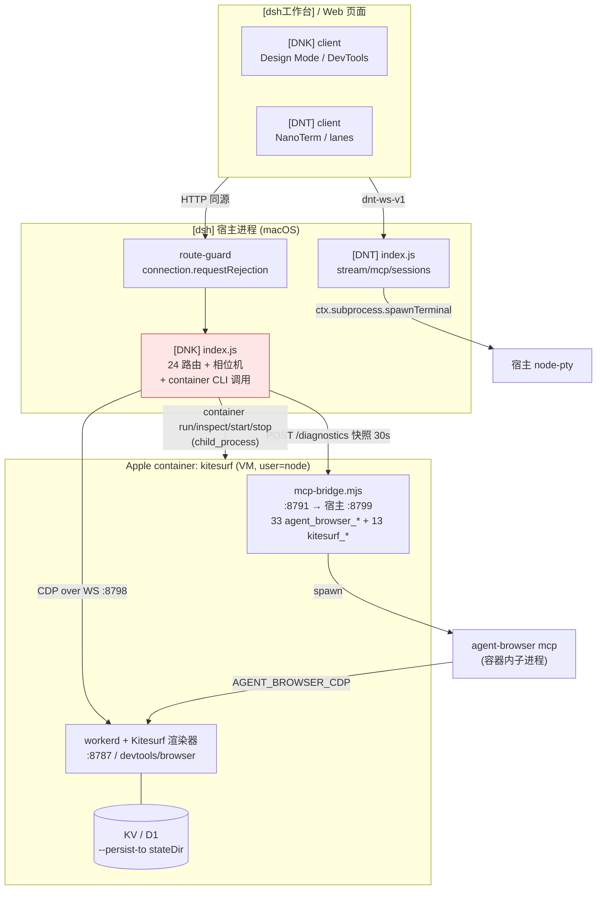
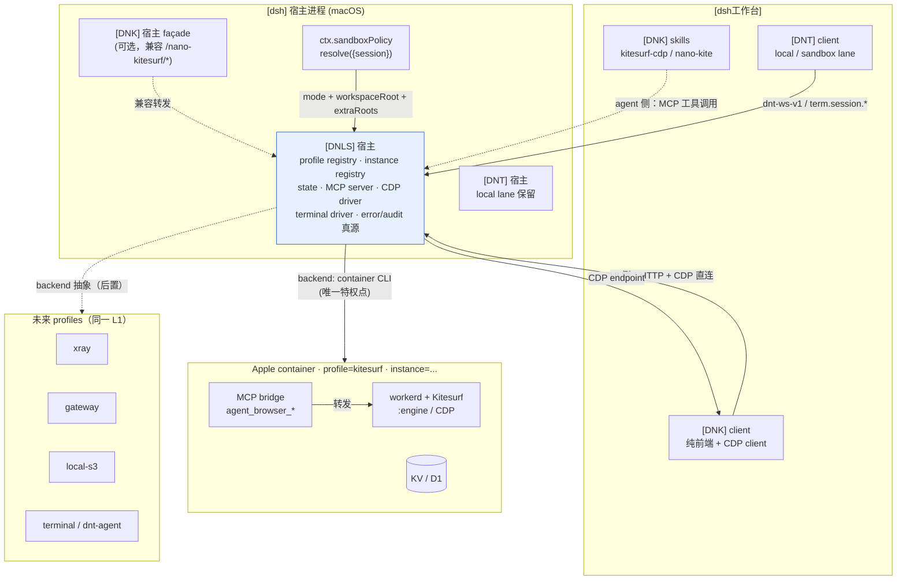

# DNLS v1.1 — `dsh-nano-local-sandbox` 评估、心智模型记载与规格草案

> **文档类型**：`eval / 架构登记 + 业主心智模型记载 + 上层规格草案 + 工作分簇台账`
> **建档日期**：`2026-11-14`（Asia/Shanghai）
> **文档状态**：`draft — 待 [业主] 复核`（本文件不产生任何实现承诺，不改动任何代码/配置/profile）
> **读者**：[业主]、后续在本仓库实施 [DNLS] 的 agent
> **上游文档**：[`sandbox-nano-nvx.md`](sandbox-nano-nvx.md) · [`../../code-review/26-nov/security-audit.md`](../../code-review/26-nov/security-audit.md) · [`../../code-review/26-nov/review-03.md`](../../code-review/26-nov/review-03.md) · [`../../../test/spike/model-execution-sandbox/README.md`](../../../test/spike/model-execution-sandbox/README.md)
> **评估对象**：[业主] 于 2026-11-14 提出的 [DNLS] 心智模型；[DNK] 中已实现的 macOS Apple container profile 管理能力；[DNK]/[DNT] 现有 CDP/MCP 协议面；与 [`sandbox-nano-nvx.md`](sandbox-nano-nvx.md) v1 设计的异同
> **执行边界**：本机只读探查（`container inspect` / `curl /health` / `npm test`），未重启、未重装、未修改三个 dsh 实例；未创建 [DNLS] 包

---

## 0. 结论摘要与阅读指针

### 0.1 本文档回答什么

[业主] 在本轮给出了四条方向性指令（见 §1.1 原文），要把「[DNK] 里的 Kitesurf macOS 容器能力」升格为一个独立平台插件 [DNLS]，并把 [DNK]、[DNT] 以及未来的 xray / gateway / 本地 S3 全部降为该平台的消费者。本文档把这四句话**拆成可验收的工程语言**，把当前已实现的资产**逐文件逐行登记**，把「心智模型 → 物理拓扑」**投影成可视关系**，把 macOS 与后续 NVX **收进同一套后端抽象**，与前序 v1 文档**逐条对账**，最后把全部工作**分簇并落成 `file:line` 台账**。

### 0.2 一句话裁决

**方向成立，但不是「把 [DNK] 的容器代码搬个家」，而是把 [dsh-nano] 的执行层重划成「一个持有 container 特权的平台层 + 一组只消费标准契约的前端层」；成败取决于「deploy profile / instance / policy / MCP / CDP / terminal」六份合同能否先于实现冻结。**

### 0.3 章节索引

| 章 | 内容 | 对应 [业主] 要求 |
|---|---|---|
| §1 | [业主] 心智模型记载 + 详细要求拆解 | 要求 1 |
| §2 | [DNK] 中 macOS container profile 管理详细分析 | 要求 2 |
| §3 | 当前 CDP 与 MCP 协议及接口详细分析 | 要求 3 |
| §4 | 心智模型 → macOS topology 映射与视觉投影 | 要求 4 |
| §5 | macOS / NVX 统一后端抽象 + 上层 spec 清单 | 要求 5 |
| §6 | 与 [`sandbox-nano-nvx.md`](sandbox-nano-nvx.md) 的逐项对比与差异判断 | 要求 6 |
| §7 | 全量工作分析与业务分簇 | 要求 7 |
| §8 | 分簇台账（`file:line` + 合约单位） | 要求 8 |
| §9 | Verdict：对 nano 插件簇的多维度后端价值 | 要求 9 |

### 0.4 术语锚定

按仓根 [`AGENTS.md`](../../../AGENTS.md) 的词汇纪律，本文全程使用 `[业主]`、`[dsh]`、`[dsh-nano]`、`[真相层]`、`[dsh工作台]` 等方括号锚定；新增缩写如下（仅为本文书写约定，**不是已登记的合同**）：

| 本文写法 | 含义 | 状态 |
|---|---|---|
| `[DNLS]` | `dsh-nano-local-sandbox`，本轮要构建的平台插件 | **草案**，包尚不存在 |
| `[DNK]` | `dsh-nano-kitesurf`，仿 Cursor Design Mode 的右工作区浏览器 | 已存在，`0.1.0` |
| `[DNT]` | `dsh-nano-terminal`，WASM 内核终端 | 已存在，`0.1.0` |
| `deploy profile` | 一份「可部署的本地执行环境定义」（镜像 + 参数 + 挂载 + 端口 + 服务 + policy 映射） | [业主] 提出的新概念，本文给草稿 schema |
| `instance` | 一个 deploy profile 的运行实例 | 本文引入 |
| `backend` | macOS Apple `container` / 未来 NVX 的统一抽象 | 本文引入 |
| `consumer` | 只通过标准契约使用 [DNLS] 的前端插件（[DNK] / [DNT] / 未来服务） | 本文引入 |

> ⚠️ **命名待 [业主] 定案**：[业主] 第 2 点同时出现「构建 `dsh-nano-local-sandbox` [DNLS]」与「权限收归 `dsh-nano-sandbox`」两种表述。本文统一按 **[DNLS] = `dsh-nano-local-sandbox`** 书写，`dsh-nano-sandbox` 视为同一实体的简称，**不为两者建立两份真源**。若 [业主] 意为两个包，须由 [业主] 在 [真相层] 登记后本文再改。

### 0.5 基准快照与漂移声明

| 锚 | 值 |
|---|---|
| 仓库 HEAD（建档时 / 复核时） | 建档 `eba86d9`（`dnk: e2e 20/20`）→ 复核时 `e41baaf`（`dnk: viewport picker uses the DSH menu`）；分支 `main`，`ahead origin/main` |
| 运行时 [dsh] | Desktop profile，`@deepseek-ai/dsh@0.2.2-rc.3`（`dsh-sandbox` / `sandbox-policy` / `sandbox-local` / `subprocess` / `mcp-client` 同版本）；前序文档基准为 `0.2.2-rc.2` checkout / `0.2.2-rc.1` 运行实例 |
| [DNK] 本机运行态 | `kitesurf` 容器 `running`（`docker.io/library/kitesurf-engine:latest`），`user=node`，端口 `127.0.0.1:8798→8787` / `127.0.0.1:8799→8791`，checkout 只读挂载 |
| 探针结果 | `curl 127.0.0.1:8798/health` → `kitesurf: OK`；`curl 127.0.0.1:8799/health` → `{"ok":true,...,"uptimeMs":...}`；`GET /dsh-nano-terminal/health` → `200`，`local:up / mcp:client / isolate:stub` |
| 测试 | [DNK] `npm test` **52/52**；[DNT] `npm test` **6/6**；[DNK] e2e 最新记录 **20/20** |
| `container` CLI | `/usr/local/bin/container`，`c05a560 (debug build)` — ⚠️ debug 构建，见 §9.3 |

> ⚠️ **仓库处于活跃开发中**：本轮观察期间 HEAD 从 `7656117` → `a38a502` → `a1e467c` → `53df87c` → `eba86d9` → `e41baaf` 连续推进，[DNK] 路由表由 23 条增至 24 条（新增 `/nano-kitesurf/perf-report`）。**§8 台账的所有 `file:line` 是 `eba86d9` 时刻的快照**（复核时抽查 `e41baaf` 下 `index.js:65-68`、`lib/mcp.js:91-93`、`scripts/route-scan.mjs:210-212`、仓根 `AGENTS.md:38` 等关键引用仍准确）；若行号漂移，以「路径 + 符号名 / 常量名」为准，不以行号为准。这本身是 [DNLS] 必须先冻结合同的一条实证理由。

---

## 1. [业主] 心智模型记载与详细要求拆解

### 1.1 原文记载（[真相层] 输入）

> **1.** 我们先不管 x86 以及 windows 的部分。我们完全在 macos 下工作。并完成 macos 内部适配后，再转向 windows 的支持
>
> **2.** 现在业主想要构建 dsh-nano-local-sandbox [DNLS]，里面包含第一个 deploy profile，即当前我们在 DNK 中实现的部分。业主想要把 sandbox 的功能，也就是当前的 mac container 的权限收归 dsh-nano-sandbox，并通过 dsh 原生 policy 进行适配与部署
>
> **3.** 后续 DNK 只能通过其内部的 skill，与 DNLS 进行对接，DNK 将会在我们 DNLS 构建完毕，并提供标准的 mcp 与接口后，废弃其自身内部打包，唤醒，启动，重启 container 的能力。DNK 的 kitesurf 版本，以及 workerd，kv，d1 等 v8isolate 下的构建，均由 DNLS 提供后端能力与维护。DNK 退化为一个纯粹的前端消费者，cdp driver 的对接人
>
> **4.** DNLS 提供实现完整的 mcp 以及 CDP 等驱动。我们后续的其他功能，包括在 sandbox 内未来构建 xray，gateway，本地 s3 等内容，均在 DNLS 下进行发展。这就包括了 DNT 对于 sandbox 的直接连接，terminal 操控

### 1.2 心智模型的三层结构

把四句话折叠成一个稳定的层次模型，后续所有章节都引用这一模型：

```
┌─────────────────────────────────────────────────────────────────┐
│ L3  消费者层 (consumers)                                        │
│     [DNK] Design Mode 前端 · [DNT] 终端前端 · xray / gateway /   │
│     本地 S3 前端                                                │
│     只持有：UI、交互、领域逻辑、skill、CDP/WS 客户端             │
├─────────────────────────────────────────────────────────────────┤
│ L2  契约层 (contracts)  ← 必须先冻结                           │
│     MCP 控制面 · CDP driver · terminal driver · HTTP 状态面      │
│     deploy profile schema · instance 模型 · policy 映射          │
│     错误/审计/构建版本真源                                       │
├─────────────────────────────────────────────────────────────────┤
│ L1  平台层 ([DNLS])  ← 唯一持有 container 特权                   │
│     backend 抽象 (macOS Apple container 首期 / NVX 后置)         │
│     镜像构建 · 生命周期 · 端口 · 卷 · KV/D1 · 版本 pin           │
│     通过 [dsh] 原生 policy 适配与部署                            │
└─────────────────────────────────────────────────────────────────┘
```

**核心不变量**：

- **I-1（特权唯一）**：只有 L1 可以调用 `container` / `nvx` CLI、持有镜像与卷的写权；L3 代码里不得出现 `child_process` / `container` / `kitesurf-engine` / 版本 pin。
- **I-2（真源唯一）**：Kitesurf 版本、workerd/wrangler/agent-browser 版本、KV/D1 构建、镜像 digest、端口分配、instance 注册表，全系统只有 L1 一份可写权威副本（呼应仓规「单一真源」）。
- **I-3（依赖单向）**：L3 → L2 → L1；L1 不得 import L3 的任何模块，L3 之间不得建立专有通道（呼应「不得侧载」「插件中立」）。
- **I-4（平台中立）**：L1 不得与 `dsh-mini` / `nano-agent` 耦合；backend 抽象里 macOS 与 NVX 是同构实现，不是两条独立产品线（呼应「插件中立」）。
- **I-5（合同先行）**：L3 的废弃动作以「L2 已提供标准 MCP 与接口」为前置条件（[业主] 第 3 点原文：「DNLS 构建完毕，并提供标准的 mcp 与接口后」）。**先拆后补是禁止的**。

### 1.3 详细要求拆解表

| # | 原文要点 | 工程语义 | 可验收判据 | 隐含约束 |
|---|---|---|---|---|
| R1 | 只做 macOS，x86/Windows 后置 | 首期 backend = Apple `container`；Windows/NVX 不进入实现范围 | 首期代码中无 `nvx` / `win32` 分支；但 backend 接口不写死 Apple 语义 | L1 的 backend 抽象必须在首期就存在，否则 Windows 接入要重做契约 |
| R2 | 构建 [DNLS]，第一个 deploy profile = 当前 [DNK] 的部分 | 把 `kitesurf-engine:latest` + workerd + MCP bridge + KV/D1 整体登记为 `profile: kitesurf` | [DNLS] 能独立 ensure/start/stop/health 一个 kitesurf profile，不依赖 [DNK] | 「profile」必须是数据/配置，不能是硬编常量（当前 [DNK] 是硬编，见 §2.10） |
| R3 | mac container 权限收归 [DNLS] | `container run/inspect/start/stop/delete` 的调用点收敛到 L1 一个模块 | 全仓 grep `spawn('container'` / `execFile('container'` 只出现在 [DNLS] | 与 [dsh] `ctx.subprocess` / `ctx.sandbox.confine` 的关系必须登记（见 §1.5-Q4） |
| R4 | 通过 [dsh] 原生 policy 适配与部署 | 读取 `ctx.sandboxPolicy.resolve()`，把 `SandboxMode` / `workspaceRoot` / `additionalWritableRoots` 映射为 profile 挂载与实例参数 | 三档模式各有确定的挂载矩阵；policy 变化有可观测的实例响应 | `SandboxMode` **只覆盖文件效果**；网络/进程/资源必须另立 profile 策略，不得假称由 [dsh] policy 覆盖 |
| R5 | [DNK] 只通过内部 skill 与 [DNLS] 对接 | agent 侧的 [DNK] ↔ [DNLS] 交互面 = skill + [DNLS] MCP 工具 | `kitesurf-cdp` / `nano-kite` 技能正文改为「读 [DNLS] MCP 工具」；[DNK] 不再有 `/kite` 路由 | 见 §1.5-Q3：UI 的同步调用不能走模型回合 |
| R6 | [DNK] 废弃打包/唤醒/启动/重启 container 能力 | 删除 [DNK] 的 `runtime/`、容器 CLI、锁文件、端口自愈 | [DNK] `package.json files`、`AGENTS.md`、路由表、安全台账均不再含容器资产 | 必须保留一个过渡期双轨，见 §7.3 |
| R7 | Kitesurf/workerd/KV/D1 构建由 [DNLS] 提供与维护 | 版本 pin、镜像构建、state 目录、KV/D1 持久化的所有权归 L1 | [DNK] 无 `KITESURF_CHECKOUT` / `config.checkout` / `linux-prefix`；镜像 digest 由 [DNLS] 登记 | 与 §1.5-Q2（instance 范围）耦合：KV/D1 是 per-instance 还是 shared |
| R8 | [DNK] 退化为纯前端消费者 + CDP driver 对接人 | [DNK] 保留 UI / Design Mode / note 预算 / CDP client；不再持有 CDP server 的生命周期 | [DNK] 通过 L2 契约取得 `cdp` endpoint；不自己 ensure 引擎 | CDP socket 关闭会把页面打回 `about:blank`（见 §3.2），L1 必须提供 socket keeper 或明确保留单页语义 |
| R9 | [DNLS] 提供完整 MCP 以及 CDP 驱动 | L2 有两类驱动：MCP 控制面（给 agent/消费者）+ CDP 驱动（给浏览器类消费者） | MCP `tools/list` 可枚举 profile/instance/exec/terminal 工具；CDP endpoint 可被 `agent-browser --cdp` 直接接 | 与现有 `agent-browser mcp` 桥（33 工具）和 13 个 `kitesurf_*` 原生工具的归并关系（见 §3.3） |
| R10 | xray / gateway / 本地 S3 后续在 [DNLS] 下发展 | L1 是多 profile 平台，不是 kitesurf 专用后台 | 新增一个 profile 不需要改 L1 核心，只增加 profile 定义 | 要求 profile schema 在首期就具备扩展性 |
| R11 | [DNT] 对 sandbox 直接连接、terminal 操控 | [DNT] 的 `mcp` / 新增 `sandbox` lane 指向 [DNLS] terminal driver | open/input/output/resize/close/scrollback 全链路通过 | [DNT] `dnt-agent` 目前是 stub，真 PTY agent 归 L1 维护（见 §3.5） |

### 1.4 「收归」的精确定义

[业主] 反复用「收归」，本文把它拆成六个可核对的所有权，避免只搬代码不搬责任：

| 所有权 | 当前持有者 | 收归后持有者 | 证据（当前） |
|---|---|---|---|
| ① 容器进程调用权 | [DNK] `lib/container-engine.js:82` `spawn('container', ...)`；`index.js:427` `execFile('container', ['inspect', ...])` | [DNLS] backend | §2.3 / §2.5 |
| ② 镜像与构建链 | [DNK] `runtime/Dockerfile` + `runtime/entrypoint.sh` + `runtime/linux-prefix/` | [DNLS] `profiles/kitesurf/` | §2.2 |
| ③ 版本真源 | [DNK] 隐含在 `Dockerfile`（`node:22-bookworm-slim`）、`linux-prefix/package.json`（wrangler@4 / agent-browser@0.42.0）、`KITESURF_CHECKOUT` 外部目录 | [DNLS] profile manifest（digest + pin） | §2.2 / §2.6 |
| ④ 生命周期状态机 | [DNK] `lib/nano-kite.js:31` 相位 + `index.js:357` `bringUp` + `index.js:401` `sleepEngine` | [DNLS] instance registry | §2.4 |
| ⑤ 端口与自愈 | [DNK] `ensureLocalContainer` 的 adopt/repair、`portReport`、`/recover` | [DNLS] instance 网络面 | §2.5 |
| ⑥ 持久状态 | [DNK] `nano-kitesurf.lock.json`、`history.jsonl`、`~/.dsh-kitesurf-state`（KV/D1） | [DNLS] state service | §2.6 |

**未被收归、明确留在 [DNK] 的**：Design Mode 交互、note 预算（`src/shared/note.js`）、截图坐标换算（`src/shared/shot-point.js`）、右工作区 UI（`src/client/index.js`）、i18n、错误呈现、`lastPick` 上下文引用环（`lib/diagnostics.js` 的 `putRef/getRef`）。这些是 [DNK] 的领域资产，不是 sandbox 资产。

### 1.5 未被明说、但必须在开工前锁定的决策（不得擅自扩约）

按仓规「**不得擅自扩约**：公共合同变更必须先有 [业主] 决定并 durable 登记；AGENT 不得私自决定，不得由实现反推合同」，以下七项本文**只登记为待决**，不给产品定论：

| Q | 待决问题 | 为什么阻塞 | 本文的临时工作假设（**非决定**） |
|---|---|---|---|
| Q1 | 包名/插件 id：最终是 `[DNLS] = dsh-nano-local-sandbox` 还是另有 `dsh-nano-sandbox`？ | 两个名字会变成两份真源 | 按 §0.4 统一为 `dsh-nano-local-sandbox` |
| Q2 | 第一个 kitesurf profile 是 **shared**（全宿主一份，保持当前单页体验）还是 **session**（每 [dsh] session 一份，严格对齐 per-session `SandboxMode`）？ | 决定 [DNK] UI 是否要按会话开多页、内存水位（当前容器 4 GB/实例）、KV/D1 是否 per-instance | 首期按 `shared` 做平台化，把 `instance` 模型留成可扩展 |
| Q3 | 「[DNK] 只能通过 skill 对接」是否包含 UI 的同步调用？ | 若包含，每次点选/截图都要过一次 LLM 回合，延迟与成本不可接受 | 假设 **agent 侧走 skill+MCP，UI/宿主侧走标准 HTTP/CDP 直连**；这是本文对 [业主] 意图的解释，须 [业主] 确认 |
| Q4 | `[dsh]` 原生 policy 的接入形态：注入 `ctx.sandboxPolicy` 做「适配与部署」，还是替换 `ctx.shell`/`ctx.fs`/`ctx.subprocess` 的 capability group？ | 安装版 `dsh-sandbox` 明确把 container/microVM 排除在 `ctx.sandbox` 之外（见 §6.3 差异 (b)） | 假设 **注入 `ctx.sandboxPolicy` + 独立 profile 策略**，不实现 `SandboxProvider`；若 [业主] 要 capability group，需另立 [真相层] 决定 |
| Q5 | 兼容面：保留 `/nano-kitesurf/*` 作为 façade，还是让 [DNK] client 直接改调 `/nano-local-sandbox/*`？ | 影响 e2e、技能正文、安全台账（`route-sensitivity.json`）、已装 profile | 假设 **保留 façade**，迁移期零破坏 |
| Q6 | terminal 契约：复用 [DNT] 现有 `term.session.*` MCP 形状，还是 [DNLS] 另立通用 terminal driver？ | 决定 [DNT] 改动量与「平台中立」程度 | 假设 **复用 `term.session.*` 形状**，由 [DNLS] 实现 server 侧 |
| Q7 | 首个里程碑 DoD | 决定「DNLS 构建完毕」的判据 | 假设 **DNK 的 kitesurf profile 在 [DNLS] 上 e2e 全绿 + [DNK] 不再直调 container** |

### 1.6 与仓根硬约束的对齐检查

按仓根 [`AGENTS.md`](../../../AGENTS.md) 的硬约束核对。精确锚点：词汇与登记 `[AGENTS.md:11-20](../../../AGENTS.md#L11)`、现行插件清单 `[AGENTS.md:23-29](../../../AGENTS.md#L23-L29)`（**[DNLS] 不在清单内，须先登记**）、六条原则 `[AGENTS.md:34-40](../../../AGENTS.md#L34-L40)`、拓扑 `[AGENTS.md:43-48](../../../AGENTS.md#L43-L48)`。

| 仓规 | 在新拓扑下的体现 | 张力 / 处理 |
|---|---|---|
| **插件中立** `[AGENTS.md:34](../../../AGENTS.md#L34)` | [DNLS] 服务官方 [dsh]，backend 抽象不与 `dsh-mini`/`nano-agent` 耦合 | ⚠️ **解释张力**：把 container/policy 特权收归一个**仓内插件**，与「平台中立 / host 侧归 host」存在解释空间；等价合规形态是 host 注入服务（[DNT] 现通过 `ctx.subprocess` 消费 host 服务，`lib/sessions.js:154`）。须 Q4 定案 |
| **上层建筑归 host** `[AGENTS.md:35](../../../AGENTS.md#L35)` | 审批、会话模式、权限预设仍归 [dsh]；[DNLS] 只做「适配与部署」 | [DNLS] 不得自己发明审批链或 `sandbox/mode` 事件 |
| **不得侧载** `[AGENTS.md:36](../../../AGENTS.md#L36)` | [DNK]/[DNT]/未来服务之间不得建专有通道 | ⚠️ **最大张力**：① [DNK] 现通过 `lib/` 内部模块直连容器；② `attach.path` 在 server 与 client **双侧硬编** `/dsh-nano-terminal/stream`（`lib/mcp.js:96`、`src/client/lanes.js:140`），把 [DNT] 私有命名空间烤进跨插件合同；③ 若 `makeLane` 加 `case 'sandbox'` 并配专用地址常量，通用 MCP client 会退化成两插件专有通道 |
| **单一真源** `[AGENTS.md:37](../../../AGENTS.md#L37)` | 版本、镜像、端口、instance、KV/D1、错误目录各只有一份可写权威 | 当前 `history.jsonl` + workerd KV 双写、[DNT] 三处 session 投影、三份安全台账数字互相矛盾，均须收敛 |
| **不得擅自扩约** `[AGENTS.md:38](../../../AGENTS.md#L38)` | 六份 L2 合同须 [业主] 决定 | 该条**逐字点名**「error 枚举、idempotency 法则、客户端 retry 义务、**新 lane**、新凭证面」—— 恰好覆盖 §1.5 Q6、[DNT] `makeLane` 新分支、`OPEN_RETRIES`、[DNLS] 常驻特权面 |
| **不得过度仪式** `[AGENTS.md:39](../../../AGENTS.md#L39)` | 迁移期用现有 [DNK] e2e 做对等验收，不新增 release-gate | 把 [DNT] 纳入 guard/台账必然新增检查项，须 [业主] 明确授权，eval 文档不得私自升格为门禁 |
| **worktree** `[AGENTS.md:40](../../../AGENTS.md#L40)` | 若实施，唯一合法位置 `.agents/worktrees/`，语义分支名，合并后删除 | 本文不建 worktree |

---

## 2. [DNK] 中 macOS container profile 管理详细分析

> 本章只描述 **As-Is 已实现事实**，全部带 `file:line`。「profile」一词在 [DNK] 代码中并不存在 —— 见 §2.10，这正是 [DNLS] 要补的第一块抽象。

### 2.1 资产清单

| 文件 | 行数 | 角色 | 收归后去向 |
|---|---|---|---|
| [`dsh-nano-kitesurf/lib/container-engine.js`](../../../dsh-nano-kitesurf/lib/container-engine.js) | 331 | Apple `container` CLI 控制面：参数构造、进程调用、端口探测容器接管/重建/停止、状态目录 | **[DNLS] macOS backend** |
| [`dsh-nano-kitesurf/lib/nano-kite.js`](../../../dsh-nano-kitesurf/lib/nano-kite.js) | 180 | 相位机 `idle/running/suspended`、init 锁、configure、adopt/degrade | **[DNLS] instance registry** |
| [`dsh-nano-kitesurf/index.js`](../../../dsh-nano-kitesurf/index.js) | 1112 | 24 条宿主路由、bringUp/sleepEngine、portReport、selftest、diagnostics push、skill 注册 | 拆分：生命周期/容器/诊断面 → [DNLS]；UI façade/技能 → [DNK] |
| [`dsh-nano-kitesurf/runtime/Dockerfile`](../../../dsh-nano-kitesurf/runtime/Dockerfile) | 39 | 镜像定义 | **[DNLS] `profiles/kitesurf/`** |
| [`dsh-nano-kitesurf/runtime/entrypoint.sh`](../../../dsh-nano-kitesurf/runtime/entrypoint.sh) | 34 | 容器内启动：`mcp-bridge` 监督循环 + `wrangler dev` | **[DNLS] `profiles/kitesurf/`** |
| [`dsh-nano-kitesurf/runtime/mcp-bridge.mjs`](../../../dsh-nano-kitesurf/runtime/mcp-bridge.mjs) | 546 | WS→`agent-browser mcp` 桥 + 13 个 `kitesurf_*` 原生工具 + diagnostics 快照 | **[DNLS] MCP 控制面**（见 §3.3） |
| [`dsh-nano-kitesurf/runtime/linux-prefix/`](../../../dsh-nano-kitesurf/runtime/linux-prefix/) | — | 宿主侧 `npm install --os=linux --cpu=arm64` 产物，不入库 | **[DNLS] 构建配方** |
| [`dsh-nano-kitesurf/lib/engine.js`](../../../dsh-nano-kitesurf/lib/engine.js) | 1269 | CDP 客户端 + 页面能力 + 诊断 ring | **[DNLS] CDP driver**（建议分阶段，见 §3.7） |
| [`dsh-nano-kitesurf/lib/history.js`](../../../dsh-nano-kitesurf/lib/history.js) | 71 | 本地 JSONL 浏览历史（cap 500） | **[DNLS] state service** |
| [`dsh-nano-kitesurf/lib/dom.js`](../../../dsh-nano-kitesurf/lib/dom.js) | 151 | `buildSrcDoc`：脚本剥离 / base 重基 / picker 注入 | **[DNK] 保留**（前端呈现资产）或 [DNLS] DOM driver |
| [`dsh-nano-kitesurf/AGENTS.md`](../../../dsh-nano-kitesurf/AGENTS.md) | 175 | 包合同（身份/交付物/安装/验收/使用/拓扑/配置/构建/故障/不要） | 改写 |

### 2.2 镜像构建链（版本真源目前是分散的）

| 环节 | 位置 | 事实 |
|---|---|---|
| 基础镜像 | `runtime/Dockerfile:10` | `FROM node:22-bookworm-slim`；注释 `runtime/Dockerfile:1-9` 记录 Alpine 3.22 + gcompat 因 `__res_init` 缺失失败、celld 官方镜像是 Debian 12 —— 这是**实测得来的硬约束** |
| 运行时依赖 | `runtime/Dockerfile:12-14` | `apt-get` 装 `ca-certificates` + `tini` |
| npm 前缀 | `runtime/Dockerfile:16` | `COPY linux-prefix /opt/npm-global`；`runtime/Dockerfile:6-9` 说明因 builder VM npm registry 断流，改在宿主预装 `wrangler@4 agent-browser@0.42.0` 且 `--ignore-scripts`，**不提交进包** |
| 权限修正 | `runtime/Dockerfile:22-26` | root 阶段 `chmod 755` bridge 二进制 + 建软链 + 创建 `/tmp/kitesurf-state` 并 `chown node`；`runtime/Dockerfile:30` `USER node` |
| 环境契约 | `runtime/Dockerfile:32-36` | `KITESURF_HOME=/opt/kitesurf`、`KITESURF_PORT=8787`、`KITESURF_MCP_PORT=8791`、`AGENT_BROWSER_CDP=ws://127.0.0.1:8787/devtools/browser` |
| 入口 | `runtime/Dockerfile:38-39` | `EXPOSE 8787 8791`；`tini → /entrypoint.sh` |
| 启动逻辑 | `runtime/entrypoint.sh:10-12` | `( while :; do node /mcp-bridge.mjs; ...; done ) &` 监督循环；`runtime/entrypoint.sh:14-21` 可选 `CELLD_BUCKET` 分支 |
| workerd | `runtime/entrypoint.sh:23-34` | 校验 `$home/packages/engine/wrangler.jsonc` 存在；`cd` 后 `exec wrangler dev --env local -c wrangler.jsonc --port "$port" --ip 0.0.0.0 --persist-to "$state"`（`state` 默认 `/var/lib/kitesurf-state`，工作树把默认改为 `KITESURF_STATE_DIR`） |
| checkout | `lib/container-engine.js:57-71` | `KITESURF_CHECKOUT` 必填、必须存在、必须含 `packages/engine/wrangler.jsonc`；缺失是 `kitesurf.kite.checkout`（400 配置错，非引擎故障） |

**判断**：这是**一条已经跑通的、含实测踩坑记录的构建配方**，是 [DNLS] 第一个 deploy profile 最有价值的现成资产。但它的版本真源散落在 Dockerfile 注释、宿主 `linux-prefix/package.json`、外部 `KITESURF_CHECKOUT` 目录、`wrangler.jsonc` 四处 —— 收归的第一件事就是把这四处收敛成一份 profile manifest。

### 2.3 容器参数与硬化（`createArgs`）

[`lib/container-engine.js:37-53`](../../../dsh-nano-kitesurf/lib/container-engine.js)：

| 参数 | 值 | 意图 |
|---|---|---|
| `run -d --name kitesurf` | 固定容器名 `CONTAINER_NAME = 'kitesurf'`（`lib/container-engine.js:17`） | 单例 |
| `-c 4 -m 4G` | 4 CPU / 4 GB | 资源上限 |
| `-p 127.0.0.1:${hostEnginePort}:8787` | 引擎端口只发布宿主回环 | 不落 LAN |
| `-p 127.0.0.1:${hostMcpPort}:8791` | MCP 桥端口只发布宿主回环 | 不落 LAN |
| `--mount type=bind,source=${checkout},target=/opt/kitesurf,readonly` | checkout 只读 | 防止容器写宿主源码 |
| `--tmpfs /opt/kitesurf/packages/engine/.wrangler` | wrangler 的 mkdtemp 落点 | 与只读挂载共存 |
| `--mount type=bind,source=${stateDir},target=/var/lib/kitesurf-state` | KV/D1 持久状态（当前工作树新增） | 跨容器重建保留 |
| `ENGINE_IMAGE = 'kitesurf-engine:latest'`（`lib/container-engine.js:18`） | 固定镜像 tag | 单一入口 |

`lib/container-engine.js:82-121` `runContainer` 数组 argv 无 shell 注入、120s CLI 超时、stdout/stderr 尾部三行作为真因、`scrubPaths` 抹宿主路径（`lib/container-engine.js:74-80`）。

**本机 `container inspect kitesurf` 实证**（建档时）：`user=node`、`publishedPorts` 两项均 `hostAddress: 127.0.0.1`（8798→8787、8799→8791）、`mounts` 中 `/opt/kitesurf` 带 `ro`、`resources.cpus=4 / memoryInBytes=4294967296`、`state=running`。即 [review-03 二审](../../code-review/26-nov/review-03.md) §6B.4 登记的「环境承接」项（`0.0.0.0` 发布 / root / 可写挂载 / 无监督桥）**已在本机实际重建生效**。

### 2.4 生命周期状态机

[`lib/nano-kite.js:31-128`](../../../dsh-nano-kitesurf/lib/nano-kite.js) 是相位真源：

| 动作 | 位置 | 语义 |
|---|---|---|
| `init` | `lib/nano-kite.js:60-76` | 先查 Node ≥22（`lib/nano-kite.js:66-69`），再写一次 `$DSH_HOME/nano-kitesurf.lock.json`；`already:true` 幂等；锁放 DSH_HOME 而非插件目录（`PITFALLS` `lib/nano-kite.js:16`） |
| `start` | `lib/nano-kite.js:78-82` | 仅 `idle` → `onStart` → `running`；`suspended` 必须走 `resume` |
| `suspend` | `lib/nano-kite.js:84-87` | 仅 `running` → `onSuspend` → `suspended`；**丢页到 about:blank** |
| `resume` | `lib/nano-kite.js:89-93` | 仅 `suspended` → `onResume` → `running` |
| `configure` | `lib/nano-kite.js:95-101` | `httpBase` 经 `engineOrigin`（`lib/nano-kite.js:130-150`）校验、`mcpPort` 经 `mcpPortOf`（`lib/nano-kite.js:152-158`）；与 `Config.validate` 共用一条 loopback/allowRemote 规则 |
| `adopt` | `lib/nano-kite.js:107-110` | 宿主重启后 `/health` 已活但内存相位是 `idle` → 直接置 `running`，不重做检查 |
| `degrade` | `lib/nano-kite.js:117-120` | 引擎死在底下 → 降为 `idle`，让「一键准备环境」可用 |

宿主侧接线在 `index.js:345-354`（`onStart/onSuspend/onResume` → `bringUp`/`sleepEngine`）：

- `bringUp`（`index.js:357-400`）：`hostSpan('kite-bringup')` 包住 → `ensureLocalContainer`（`index.js:363-364`）→ 若 adopt 到不同端口则改写 `httpBase/mcpPort` 并记 `portRepair`（`index.js:369-384`）→ `rememberCheckout`（`index.js:388`）→ 20 次 ×1s `/health` 轮询（`index.js:389-398`）。注释 `index.js:358-361` 记录冷启动约 100s，并把 `kite-container` / `kite-warmup` 拆成两个 perf span。
- `sleepEngine`（`index.js:401-406`）：先 `stopLocalContainer` 再 `releaseEngine()`，保证停失败时相位仍是 `running` 且 socket 还在。
- `effectiveCheckout`（`index.js:413`）：`config.checkout > KITESURF_CHECKOUT > persistedCheckout()`（锁里上次成功的 checkout，`index.js:124-131`），注释明确这是「上一次配置的消费回执，不是新真源」。

**判断**：这套相位机 + adopt/degrade 已经是**通用的 instance 生命周期雏形**，但被硬绑在 `kitesurf` 单例上。收归时把 `phase` 提升为 `instance.phase`，把 `onStart/onSuspend/onResume` 提升为 backend hook 即可，不需要重写语义。

### 2.5 端口韧性与自愈（[DNK] 里最复杂的一块）

| 能力 | 位置 | 行为 |
|---|---|---|
| `hostPortFree` | `lib/container-engine.js:132-141` | loopback 连接探测，700ms 超时 |
| `firstFreePort` | `lib/container-engine.js:149-156` | 从 start 起步进 10，最多 12 个候选 |
| `container system start` 预热 | `lib/container-engine.js:195-202` | debug CLI 冷 apiserver 的 `failed to bootstrap` 必须前置 priming |
| `runOnce` 单次重试 | `lib/container-engine.js:205-216` | 只对 `timed out/bootstrap/internalError/unavailable/not found/no such` 重试，**确定性输入错不重试** |
| 端口漂移检查 | `lib/container-engine.js:226-269` | `inspect` 比对两个发布端口且 `hostAddress ∈ {127.0.0.1, ::1}`；不匹配时若目标端口被占，**接管现有容器**（`adopted:true`，`lib/container-engine.js:249-257`）而非删除；只有「目标端口被占且现有容器端口也不可用」才抛 `kitesurf.kite.portbusy`（`lib/container-engine.js:260-262`），容器保持原样 |
| 首次创建端口修复 | `lib/container-engine.js:271-299` | 偏好端口忙 → 自动后移；返回 `repaired:true` / `requestedEnginePort` |
| warm start | `lib/container-engine.js:301-308` | `container start`，容忍 `already/running` |
| `stopLocalContainer` | `lib/container-engine.js:315-324` | `no such/not found` 视为已达成终态 |
| `statePath` | `lib/container-engine.js:328-331` | `KITESURF_STATE_DIR` 或 `~/.dsh-kitesurf-state`（工作树新增） |
| `portReport` | `index.js:421-461` | 汇总 configured / effective / container.published / `heldBy: free / this-container / other` / `lastRepair` / healthy；`index.js:427-430` 又一处 `execFile('container', ['inspect'])` |
| `/ports` | `index.js:868-878` | 只读诊断 |
| `/recover` | `index.js:913-961` | reconcile（alive+idle→adopt / dead+running→degrade）→ 按相位 suspend→resume 或 start → 复检 → 回报 steps |
| `/selftest` | `index.js:472-516` | 11 项检查：plugin / engine / engine-identity / container / ports-published / ports-loopback / mcp-bridge / targets / dom / routes / phase |

**判断**：端口韧性是**宿主机器特定经验**（8787 被 Cursor 占用、8798/8799 实跑）沉淀出来的，属于 [DNLS] instance 网络面必须继承的资产。但 `kitesurf` 容器名、8787/8791 容器内端口、`hostPort` 步进策略都是硬编，收归时必须参数化。

### 2.6 状态与真源盘点

| 状态 | 位置 | 生命周期 | 当前是否单一真源 |
|---|---|---|---|
| 相位 `phase` | `lib/nano-kite.js:37`（内存） | 宿主进程存活期，重启即丢，靠 `adopt/degrade` 校准 | ✅ 一份（内存） |
| `lastPick` / `lastError` | `index.js:50-53`（内存） | 重启即丢 | ✅ 一份 |
| console / operations / network ring | `lib/diagnostics.js`（内存） | 重启即丢 | ✅ 一份 |
| `nano-kitesurf.lock.json` | `index.js:120-121` | DSH_HOME，跨宿主重启 | ⚠️ 与 `persistedCheckout` 回执混在一起（`index.js:124-144`） |
| `history.jsonl` | `lib/history.js:16`（插件目录） | 持久，cap 500 | ❌ **双写**：`index.js:996` 清本地 + `engine.js:1266` 清 KV；`index.js:1004` 优先读 KV、失败回退本地（`source: workerd-kv` / `plugin-store`） |
| KV / D1 | `~/.dsh-kitesurf-state`（`lib/container-engine.js:328-331`） | 跨容器重建 | ⚠️ 工作树新增，尚未提交验证 |
| `buildId` | `index.js:107` | `version + hash(index.js / route-table.js / client.js)` | ✅ 一份，用于「我到底在跟哪份代码说话」 |
| `context ref` 环 | `lib/diagnostics.js` `putRef/getRef`（`index.js:883-911`） | 内存，最近 50 条 | ✅ 一份，重启即清 |

**判断**：`history` 是当前最明显的「真源分裂」样本 —— 同一份业务状态在插件 JSONL 与 workerd KV 里各写一遍，靠 `source` 字段区分读源。[DNLS] 收归后必须按仓规「单一真源」收敛为一份 durable 权威副本，另一份最多作为 consumption receipt。

### 2.7 自检与可观测面

- `runSelfTest`（`index.js:472-516`）11 项一次性回答「这套安装到底能不能用」；结果缓存进 `lastSelfTest`（`index.js:514`）并随 diagnostics 推送。
- `buildDiagnostics`（`index.js:519-556`）打包 plugin / engine / settings / ports / selftest / elements / history / dom / observability / console / network / operations / perf / hints；`hints`（`index.js:530-537`）是按当前状态自动生成的下一步。
- `pushDiagnostics`（`index.js:560-577`）每 30s（失败立即）把快照 POST 到容器内 bridge 的 `/diagnostics`，让「只用 MCP 的 agent」看到同一份状态 —— 这是 [DNK] 当前**最像 [DNLS] MCP 控制面**的一块。
- `traced`（`index.js:245-290`）包装 `res.end` 埋点每条路由；`ERROR_STATUS` + `ERROR_CATALOG` 单一真源（`index.js:208-219`、`lib/diagnostics.js`）；`fail`（`index.js:221-236`）同时写宿主 stderr 一行 JSON。
- 技能由 `lib/skill.js` 生成、构建期写 `skills/*/SKILL.md`（`index.js:582-598` 注册 `kitesurf-cdp` / `nano-kite`），`npm test` 校验生成物与真源逐字符一致。

### 2.8 当前运行态实证

```
container list:  kitesurf  docker.io/library/kitesurf-engine:latest  linux arm64  running
inspect:         user=node · publishedPorts 127.0.0.1:8798→8787, 127.0.0.1:8799→8791
                 mounts: /opt/kitesurf (ro, virtiofs) · /opt/kitesurf/.../.wrangler (tmpfs)
                 resources: 4 cpus / 4096 MB
curl 8798/health → "kitesurf: OK"
curl 8799/health → {"ok":true,"mcp":"/mcp","conns":0,...}
GET /dsh-nano-terminal/health → 200 · local:up / mcp:client / isolate:stub
```

### 2.9 债务与「必须迁走 / 必须重写」分类

| 类别 | 内容 | 处理 |
|---|---|---|
| **整段迁走（不改语义）** | `runContainer` / `createArgs` / `checkoutPath` / `stopLocalContainer` / `entrypoint.sh` 监督循环 / `mcp-bridge` 帧解码 / 相位机 | 搬进 [DNLS] 并参数化 |
| **必须重写（当前是单例硬编）** | `CONTAINER_NAME`、`ENGINE_IMAGE`、`8787`/`8791`、默认 `httpBase`、`KITESURF_CHECKOUT` 全局、`statePath` 固定目录、容器名写进 `inspect` 命令（`index.js:429`） | 提升为 profile/instance 字段 |
| **必须拆分** | `index.js` 24 条路由里既有容器生命周期又有 UI façade；`lib/engine.js` 既做 CDP client 又做状态采集 | 按 §3.7 接口契约表拆 |
| **必须收敛** | `history` 双写；`lock` 混装 checkout 回执；`buildId` 只覆盖 3 个文件 | 单一真源 + 消费回执 |
| **必须补录的合同漂移** | 代码抛出的 7 个 errorId 未进 `ERROR_CATALOG` 正则 → 落默认 502，与 `AGENTS.md:116`「输入类 400」承诺不符：`kitesurf.shot.fit`（`index.js:665`）、`kitesurf.shot.empty`（`lib/engine.js:921`）、`kitesurf.history.body`（`index.js:997`）、`kitesurf.network.query`（`index.js:1077`）、`kitesurf.dom.empty/blank`（`lib/engine.js:1171,1175`）、`kitesurf.elements.empty`（`lib/engine.js:1193`） | `ERROR_CATALOG`（`lib/diagnostics.js:36-69`）补正则；这是公共错误枚举变更，按仓规须 [业主] durable 登记 |
| **必须校正的文档漂移** | `lib/skill.js:212` 与 `skills/kitesurf-cdp/SKILL.md:224` 写「还有 6 个 kitesurf_*」却只列 8 个名字，实际 `KITESURF_TOOLS` 是 **13 个**（漏 `history/dom/elements/selftest/network`）；`AGENTS.md:100-114` 使用表只列 15 条路由（缺 9 条） | 生成物与台账由单一真源重建 |
| **必须消解的自相矛盾** | `lib/history.js:4-8` 与 `runtime/mcp-bridge.mjs:209` 断言「workerd 无 D1/KV binding」，但 `lib/engine.js:1249-1269` 仍读写 `${httpBase}/history`、`index.js:1003-1007` 把结果标 `source:'workerd-kv'`，`lib/container-engine.js:328-331` 又挂了 KV/D1 stateDir | 先由 [业主] 定哪份是 canonical（见 §2.6） |
| **[DNK] 保留** | Design Mode、note 预算、shot-point、i18n、右工作区 UI、`lastPick`/context ref | 留在消费者层 |

### 2.10 「deploy profile」概念在 [DNK] 中不存在的证据

[业主] 说「第一个 deploy profile，即当前我们在 [DNK] 中实现的部分」—— 需要明确：**[DNK] 实现的是「一个具体 profile 的内容」，不是「profile 抽象」**。证据：

- 容器名、镜像 tag 是模块级常量（`lib/container-engine.js:17-18`）；
- 镜像内端口 8787/8791 写死在 `createArgs`（`lib/container-engine.js:40-41`）与 `ensureLocalContainer` 匹配逻辑（`lib/container-engine.js:232-233`）；
- 容器内启动命令写死 `wrangler dev --env local`（`runtime/entrypoint.sh:34`）；
- 引擎地址是单一 `httpBase`（`lib/nano-kite.js:36`），没有 profile id / instance id；
- `AGENTS.md:145` 把 `KITESURF_CHECKOUT` 作为**宿主全局配置**，不是 profile manifest 字段。

因此 [DNLS] 的首期工作量不是「搬一个 profile」，而是「**先造 profile 抽象，再把 kitesurf 这份内容填进去**」。这是 §5 spec 清单与 §7 分簇的主要依据。

---

## 3. 当前 CDP 与 MCP 协议、以及对应接口的详细分析

### 3.1 协议栈总览（As-Is）

```
 [dsh] Web 页面 / [dsh工作台]
   │  HTTP (同源, connection.requestRejection)
   ▼
 [DNK] 宿主 index.js  ── 24 条 /nano-kitesurf/* 路由 ──┐
   │                                                  │ POST /diagnostics (30s, loopback)
   │  CDP over WebSocket                               ▼
   │  ws://127.0.0.1:8798/devtools/browser     容器内 mcp-bridge.mjs (:8791, 宿主 :8799)
   ▼                                                  │
 容器内 workerd + Kitesurf 渲染器                      │ WS ws://127.0.0.1:8799/mcp
   (engine :8787, wrangler dev)                       ├─ 转发 → agent-browser mcp (33 工具)
   ▲                                                  └─ 本地应答 → 13 个 kitesurf_* 工具
   └── AGENT_BROWSER_CDP 指回同一 CDP socket ──────────┘

 [DNT] 宿主 index.js ── /dsh-nano-terminal/stream (WS, dnt-ws-v1)
   │                 ── /dsh-nano-terminal/mcp (JSON-RPC, 8 个 term.* 工具)
   └─ ctx.subprocess.spawnTerminal (node-pty)
```

### 3.2 CDP 面

| 项 | 事实 | 位置 |
|---|---|---|
| 端点形状 | `browserSocketUrl(httpBase)` → `ws(s)://<host>/devtools/browser`；`AGENTS.md:124` 登记为 `ws://127.0.0.1:8798/devtools/browser` | [`lib/engine.js:20`](../../../dsh-nano-kitesurf/lib/engine.js) · [`AGENTS.md:118-130`](../../../dsh-nano-kitesurf/AGENTS.md) |
| 引擎身份校验 | `verifyEngine` 先 `GET /health`，正文必须以 `kitesurf` 开头，否则 `kitesurf.engine.mismatch`；`verifiedBase` 按 origin 缓存，`dropLive` 时清空 | `lib/engine.js:371-386` · `lib/engine.js:352-360` |
| 单条共享 socket | 模块级 `live` 单例；`connectLive` 复用同 URL 的 OPEN socket，否则 `dropLive()` 重建 | `lib/engine.js:388-463` |
| 帧协议 | 自写 `id → pending Map` 的 JSON 帧；`sessionId` 可选；`CALL_MS=20s` / `CONNECT_MS=4s` / `NAVIGATE_MS=45s` | `lib/engine.js:15-17` · `lib/engine.js:404-460` |
| 域 enable | `Page.enable`、`Runtime.enable` 必开；`Log/Network/DOM/CSS.enable` best-effort（缺 `CSS.enable` 会让 matched rules 恒空） | `lib/engine.js:477-486` |
| 事件归一 | `captureCdpEvent` 统一处理 `Runtime.consoleAPICalled` / `exceptionThrown` / `Log.entryAdded` / `Network.*` / `Page.frameNavigated` / target crashed | `lib/engine.js:294-346` |
| 页面附着 | `Target.getTargets` → 取第一个 page target（无则 `Target.createTarget('about:blank')`）→ `Target.attachToTarget(flatten:true)` → 缓存 `{targetId, sessionId}` | `lib/engine.js:465-489` |
| 重试纪律 | `useLive` 只对 `transport=true`（connect / closed / execution-context-destroyed）整体重跑一次；**timeout 与所有确定性错误绝不重跑**（二次 `Page.navigate` 会竞态） | `lib/engine.js:499-515` |
| 页面能力 | `openPage`、`captureShot`（webp q82 / fit 1:1）、`pickElement`/`pickBySelector`、`editElement`、`captureDom`、`captureElements`、`engineTargets`、`evaluateInPage`、`navigateHistory`、`setBrowserSettings` | `lib/engine.js:684` 起各导出 |
| 漂移防护 | shot/pick 响应带 `{url, scrollY, targetId, viewport}`，pane 比对后自动重截并提示 | `AGENTS.md:105` · `lib/engine.js:867` |
| 致命语义 | **CDP socket 一关，Kitesurf 把页面打回 `about:blank`**；技能明令禁止 `agent-browser close` / daemon idle 掉线 / suspend-resume 后假定旧页还在 | `skills/kitesurf-cdp/SKILL.md:63-68` · `lib/nano-kite.js:13` |

**对 [DNLS] 的约束**：如果 L1 成为「CDP driver 的所有者」，它必须长期持有**一条上游 CDP socket**（或容器内 keeper），否则消费者面板重挂载、宿主重启会丢页面。当前 [DNK] 的 `live` 单例在宿主进程内存里（`lib/engine.js:348-360`），重启即重建 —— 这个语义迁到 L1 后要么保留（明确「单页、重启丢页」），要么由 [DNLS] 用 keeper 改变，二者必须写进合同。

### 3.3 MCP 面

| 项 | 事实 | 位置 |
|---|---|---|
| 端点 | `ws://127.0.0.1:8799/mcp`（容器 `:8791`，宿主回环发布）；帧必须以 `\n` 结尾，否则静默丢弃 | `AGENTS.md:127` · `skills/kitesurf-cdp/SKILL.md:61` |
| 传输 | 自写 RFC 6455：`acceptKey`（`mcp-bridge.mjs:32-36`）、`originAllowed` 精确 hostname allowlist（`mcp-bridge.mjs:38-51`，修了 `localhost.evil.example` 绕过）、分片重组 / ping-pong / close 回握（`mcp-bridge.mjs:80-154`）、`MAX_FRAME`/`MAX_MESSAGE` 1 MiB（`mcp-bridge.mjs:20-21`）、`MAX_CONNS=8`（`:22`）、`IDLE_MS=20min`（`:23-25`）；upgrade 门禁在 `:497-504`，`/diagnostics` 负载 ≤512 KB（`:468-472`） | `runtime/mcp-bridge.mjs:17-30` · `:32-154` · `:449-531` |
| 监听面 | 桥在容器内监听 `0.0.0.0`（Apple container 发布到容器网络 IP，绑 127.0.0.1 会不可达），真正边界是**宿主侧 loopback 发布 + Origin allowlist** | `runtime/mcp-bridge.mjs:533-540` · `lib/container-engine.js:41-42` |
| 子进程 | 每连接 spawn `agent-browser mcp`，注入 `AGENT_BROWSER_CDP`（`runtime/Dockerfile:36`）指向同一 CDP；entrypoint 用 `while :` 监督重启，tini 作 PID 1（`runtime/Dockerfile:39`） | `runtime/entrypoint.sh:10-12` · `runtime/mcp-bridge.mjs:362-365` |
| 工具面 | 33 个 `agent_browser_*`（上游 `agent-browser mcp`）+ **13 个 `kitesurf_*` 原生工具** | `runtime/mcp-bridge.mjs:163-254` |
| 13 个原生工具 | `kitesurf_diagnostics` / `kitesurf_console` / `kitesurf_operations` / `kitesurf_error_catalog` / `kitesurf_targets` / `kitesurf_history` / `kitesurf_dom` / `kitesurf_elements` / `kitesurf_selftest` / `kitesurf_network` / `kitesurf_ports` / `kitesurf_recovery_plan` / `kitesurf_bridge_health` | `runtime/mcp-bridge.mjs:165-253` |
| 应答机制 | `answerNativeTool`（`mcp-bridge.mjs:272`）从宿主 **POST /diagnostics 推来的快照**本地应答，不碰 `agent-browser` 子进程；未收到快照回 `kitesurf.diag.stale`（`mcp-bridge.mjs:278`） | `mcp-bridge.mjs:271-339` · `index.js:560-577` |
| HTTP 健康 | `GET http://127.0.0.1:<mcpPort>/health` 返回 `{ok, mcp, conns, accepted, rejected, uptimeMs, diagnosticsPushedAt}` | `skills/kitesurf-cdp/SKILL.md:61` |
| [DNK] 技能 | `kitesurf-cdp` 教 agent 用 `agent-browser --cdp` 接 `/status` 返回的 `kite.cdp`，不烤死地址；`nano-kite` 教 `POST /kite {action}` | `skills/kitesurf-cdp/SKILL.md:40-59` · `skills/nano-kite/SKILL.md:9-19` |

**判断**：[DNK] 的 MCP 面已经具备「平台级控制面」的三个要素 —— **可枚举工具 / 快照推送 / 自带错误目录**，但它有一个结构性倒挂：**13 个 `kitesurf_*` 工具的数据原料全部来自 [DNK] 宿主推给容器的快照**（`index.js:566` POST 到容器内 `/diagnostics`）。也就是说「容器里的 MCP server 在汇报宿主插件的执行状态」。[DNLS] 收归后，MCP server 与状态真源都在 L1，这个倒挂自然消失；`kitesurf_*` 工具应升级为 **profile 无关的 `sandbox_*` 工具族**（`instance.status` / `instance.ensure` / `profile.list` / `logs` / `selftest` …），`agent_browser_*` 仍作为 CDP profile 的驱动工具保留。

### 3.4 宿主 HTTP 面（[DNK] 24 条路由，`eba86d9` 快照）

路由常量 `index.js:23-46`，注册表 `index.js:600-1111`，烤进的台账 `lib/route-table.js`（24 条）。按敏感性分簇（敏感级取自 `lib/route-table.js`）：

| 组 | 路由（method） | 敏感级 / capability | 作用 |
|---|---|---|---|
| 探活 | `status`（GET/HEAD） | L0 `read:kitesurf` | `/health` + `/json/version` + 引擎特征 + 仿真态 + buildId |
| 设计态 | `last`（GET）、`pick`（POST）、`shot`（POST）、`edit`（POST）、`context`（GET/POST） | L2 `read:host` / `write:engine` | 点选包、截图、就地改字、上下文引用环 |
| 导航 | `open`（POST）、`history`（POST）、`browse-history`（GET/POST/DELETE） | L2 `net:kitesurf` / `read:host` | 导航、前进后退、浏览历史 |
| 引擎配置 | `settings`（POST） | L1 `write:kitesurf` | UA / viewport / media / extraHeaders，事务性回滚 |
| **容器生命周期** | `kite`（POST） | **L2 `proc:kitesurf`** | init/start/suspend/resume/configure — **收归首选** |
| **容器诊断/自愈** | `ports`（GET）、`recover`（POST）、`selftest`（GET/POST） | L2 | 端口真相、一键自愈、11 项自检 — **收归** |
| 可观测 | `console` / `operations` / `diagnostics` / `targets` / `evaluate` / `network` / `elements` / `dom` | L0~L2 | 环形缓冲、CDP targets、有界求值、DOM/CSS 树 |
| perf | `perf-review/host`（GET/POST）、`perf-report`（POST） | L2 `read:host` | 进程级 perf 与客户端报告汇 |

统一机制：`registerRoutes(...{ table: ROUTE_TABLE, plugin: PLUGIN })`（`index.js:1111`）启动期 `route-not-listed/route-stale/route-drift/route-duplicate` 硬失败；`connection.requestRejection` 鉴权；`readBody` 按 `route.bodyLimit` 限额（`index.js:159-198`）；`fail` 按 `ERROR_STATUS` 映射真实状态码（`index.js:208-236`）。

### 3.5 [DNT] 的数据面与控制面（对照）

| 面 | 事实 | 位置 |
|---|---|---|
| 数据面 | `GET /dsh-nano-terminal/stream` WS upgrade，`dnt-ws-v1`；open → ready（含 `replayBytes`）→ `replayInto` 二进制输出帧 / 文本控制帧（exit / resize / ping-pong）。**已知协议缺陷**：宿主对 `0x09` ping 回写裸 payload、无 `0x0A` 帧头（`index.js:65-68`），客户端无 ping 发送方 | [`index.js:51-132`](../../../dsh-nano-terminal/index.js) · [`lib/ws.js:24-115`](../../../dsh-nano-terminal/lib/ws.js) |
| 桌面特例 | `dsh-app://` 拒绝 WS upgrade，client 用 `__DSH_TRANSPORT__.streamBaseUrl` 取真实宿主 origin；**只有 `LocalLane` 调用它**，`McpLane` 从 `this.url` 构造 ws URL，无桌面 transport 处理 | [`src/client/lanes.js:9-22`](../../../dsh-nano-terminal/src/client/lanes.js) · `:42` · `:140-145` |
| 控制面 | `POST /dsh-nano-terminal/mcp` JSON-RPC，**8 个工具**：`term.session.create/list/input/read/resize/close` + `term.audit` + `term.lane.status`；`PROTOCOL_VERSION=2025-06-18`；`tools/call` 回 `content` + `structuredContent` | [`lib/mcp.js:5-78`](../../../dsh-nano-terminal/lib/mcp.js) · `:80-186` |
| 管理面 | `GET /sessions`、`POST /session/:id/close`、`GET /health`；宿主 slash `/term new\|list\|close\|attach` | `index.js:136-190` · `:196-230` |
| 三 lane | `local`（`ctx.subprocess.spawnTerminal`，完整）；`mcp`（client 侧完整，**仓库内无配套 server**；且宿主 `term.session.create` 对 `lane != 'local'` 直接抛错 `lib/mcp.js:91-93`，与 inputSchema 三 lane 枚举自相矛盾）；`isolate`（进程内 echo REPL **占位**，无 wasm isolate / PTY / 容器） | `src/client/lanes.js:24-105` / `:107-198` / `:200-251` · [`AGENTS.md:106`](../../../dsh-nano-terminal/AGENTS.md) |
| session 真源 | `SessionRegistry`（打包产物 `lib/sessions.js:114-212`）；客户端 `paneSessions` 是 UI 权威（`NanoTerm.jsx:156`、注释 `:593-596`）；`SessionRecord:213-325` — **服务端 Map / 客户端 paneSessions / health 列表是三处投影**，收归后须按「单一真源」只留 L1 一份 | [`lib/sessions.js:114-212`](../../../dsh-nano-terminal/lib/sessions.js) · `:213-325` · [`src/client/NanoTerm.jsx:144-156`](../../../dsh-nano-terminal/src/client/NanoTerm.jsx) |
| guest agent | `dnt-agent` crate **只有 7 行 stub**：`eprintln!("dnt-agent 0.1.0 stub — container lane backend placeholder")`，注释自称「Real PTY 与完整 MCP 工具面延到 v2」 | [`crates/dnt-agent/src/main.rs:1-7`](../../../dsh-nano-terminal/crates/dnt-agent/src/main.rs) |
| **合规缺口** | [DNT] 全部 `ctx.webServer.register` / `registerUpgrade` 为裸注册，`inject` 无 `connection`，全包 `requestRejection` 零命中，三份安全台账中 **[DNT] 路由 0 条**；`AGENTS.md:100`「已鉴权请求才可达」是文档声明而非代码事实 | `index.js:23,51,136-190` · [`AGENTS.md:100`](../../../dsh-nano-terminal/AGENTS.md) · §8 C5 |

**判断**：[DNT] 的 `mcp` lane（`src/client/lanes.js:107-198`）已经把「远端 MCP terminal server」的**客户端契约**写完整了 —— `term.session.create` → 拿 `attach.path` → WS attach → ready/resize/exit/close。因此 R11「[DNT] 对 sandbox 直接连接」的**最低成本路径**是：[DNLS] 实现这 8 个 `term.session.*` 工具的 server 侧（把 `create` 的 backend 从 `ctx.subprocess.spawnTerminal` 换成 sandbox 内 PTY），[DNT] 只加一个指向 [DNLS] 的 lane 配置。`dnt-agent` stub 正好是 sandbox 内 PTY agent 的落点，但按 R7 的收归逻辑，它应迁到 [DNLS] 的 terminal profile 下维护。

### 3.6 状态所有权矩阵（As-Is）

| 状态 | 宿主内存 | 容器内 | 持久 | 迁移到 [DNLS] 后的归属 |
|---|---|---|---|---|
| CDP `live` socket | ✅ `lib/engine.js:461` | — | — | L1 CDP driver（keeper 决策待定） |
| 引擎页面 | — | ✅ workerd | — | L1 instance |
| console/ops/network ring | ✅ `lib/diagnostics.js` | — | — | L1 可观测（消费者只读） |
| `lastPick` / context ref | ✅ `index.js:50` / `lib/diagnostics.js` | — | — | **[DNK] 保留**（领域态） |
| `phase` / `httpBase` / `mcpPort` | ✅ `lib/nano-kite.js:37` | — | — | L1 instance registry |
| `history` | ✅ JSONL | ✅ KV | 两者 | L1 state service（收敛为一份） |
| KV/D1 | — | ✅ `--persist-to` | ✅ `stateDir` | L1 state service |
| 镜像 / 版本 pin | — | ✅ 镜像 | ✅ 外部 checkout | L1 profile manifest |
| `audit.jsonl`（[DNT]） | — | — | ✅ DSH_HOME | L1 或 [DNT]（待 Q6） |
| `dnt.apply`（[DNT] localStorage） | 浏览器 | — | ✅ | **[DNT] 保留**（诊断日志） |

### 3.7 接口契约清单：哪些必须迁、哪些必须留

> 这是 §8 台账的「合约单位」来源。**迁 = 由 [DNLS] 提供并由 [DNK] 消费；留 = 仍在 [DNK]。**

| 接口 / 能力 | 当前实现 | 契约要点 | 归属 |
|---|---|---|---|
| `profile.list / describe` | 不存在 | 新增：返回 profile id、版本、capabilities | **迁（新建）** |
| `instance.ensure / start / stop / restart / status` | `/kite`（`index.js:766-790`）+ 相位机 | 幂等、相位错误 409、adopt/degrade | **迁** |
| `instance.ports / recover / selftest` | `/ports` `/recover` `/selftest` | 端口真相、自愈 steps、11 项检查 | **迁** |
| `instance.diagnostics / console / operations / errorCatalog` | `/diagnostics` 等 + diagnostics push | 一份快照供 HTTP 与 MCP 双读 | **迁**（并升级为 `sandbox_*` 工具族） |
| `instance.logs / buildInfo` | `buildId`（`index.js:107`）、宿主 stderr | 镜像 digest、版本 pin、构建时间 | **迁（新建完整版）** |
| `cdp.endpoint / cdp.targets / cdp.evaluate` | `browserSocketUrl` `/targets` `/evaluate` | 端点从 status 动态取，不烤地址 | **迁**（L1 CDP driver） |
| `cdp.open / shot / pick / edit / history / settings` | `lib/engine.js` 各导出 | 单页、有界、漂移检测 | **迁**（L1 driver；[DNK] 保留 note 预算与 UI） |
| `dom.srcdoc` | `lib/dom.js:140` `buildSrcDoc` | 脚本剥离 / base 重基 / picker 注入 | **留 [DNK]**（前端呈现） |
| `history.list / remove / clear` | `/browse-history` + `lib/history.js` + KV | 收敛双写为一份 | **迁**（L1 state） |
| `context.ref` | `/context` + `putRef/getRef` | 短 token 解析完整上下文 | **留 [DNK]** |
| `note.design / batch / multi` | `src/shared/note.js` | 80 字 / 640 字 / 1600 字预算 | **留 [DNK]** |
| `terminal.session.*` | [DNT] `lib/mcp.js` | 8 工具 + `dnt-ws-v1` 数据面 | **L1 实现 server；[DNT] 保留 client** |
| `agent_browser_*` | `runtime/mcp-bridge.mjs` 转发 | 33 工具，CDP 驱动 | **迁**（L1 CDP profile） |

---

## 4. [业主] 心智模型 → macOS topology 映射与视觉投影

### 4.1 As-Is 拓扑（`eba86d9`）



**红色 = 当前持有 container 特权的代码**。可以看到特权散落在 [DNK] 宿主里，且 [DNK] 既是「容器的主人」又是「页面的消费者」还是「MCP 快照的生产者」——三重角色耦合，正是 [业主] 要拆的结。

### 4.2 To-Be 拓扑（[DNLS] 首期，macOS）



### 4.3 投影矩阵（心智概念 → 物理实体 → 代码单位 → 契约面）

| [业主] 心智概念 | macOS 物理实体 | 当前代码单位（As-Is） | To-Be 代码单位 | 契约面 |
|---|---|---|---|---|
| 「[DNLS]」平台 | [dsh] 宿主进程内的一个插件 | 不存在 | `dsh-nano-local-sandbox/`（包） | Cordis `apply` / `inject` |
| 「第一个 deploy profile」 | `kitesurf-engine:latest` VM + 镜像配方 + 挂载 + 端口 | `runtime/*` + `lib/container-engine.js` + `KITESURF_CHECKOUT` | `profiles/kitesurf/profile.json` + 构建配方 | `profile.list/describe` |
| 「mac container 权限」 | `container` CLI 进程调用 | `lib/container-engine.js:82`、`index.js:427` | `backend/apple-container.js` | `backend` 接口（内部） |
| 「通过 [dsh] 原生 policy 适配」 | `ctx.sandboxPolicy.resolve()` 结果 → `--mount` 参数 | 无（当前全靠 `Config.validate` 的 loopback 校验） | `policy-adapter.js` | `SandboxExecutionPolicy` → 挂载矩阵 |
| 「唤醒/启动/重启」 | 容器相位 `idle/running/suspended` | `lib/nano-kite.js:31-128` + `index.js:357-406` | `instance/registry.js` | `instance.*` MCP 工具 |
| 「KV/D1 v8isolate 构建」 | `--persist-to stateDir` + workerd KV namespace | `runtime/entrypoint.sh:30-34`、`index.js:996`、`engine.js:1256` | `state/kv.js` + profile manifest | `state.*`（内部）+ `history.*` |
| 「标准 mcp 与接口」 | 容器内 :8791 / 宿主 :8799 WS + 宿主 HTTP 路由 | `runtime/mcp-bridge.mjs` + `index.js:600-1111` | `mcp/server.js` + `http/routes.js` | `sandbox_*` 工具 + HTTP |
| 「CDP 驱动」 | `ws://…/devtools/browser` | `lib/engine.js:20,388-489` | `drivers/cdp.js` | `cdp.*` |
| 「[DNK] 纯前端消费者」 | React 面板 + 右工作区 tab | `src/client/index.js` | 基本不变 | 消费上述契约 |
| 「[DNK] skill 对接」 | `kitesurf-cdp` / `nano-kite` 技能正文 | `lib/skill.js` → `skills/*/SKILL.md` | 正文改为调用 [DNLS] MCP | skill（模型侧） |
| 「[DNT] 直连 sandbox」 | sandbox 内 PTY + `term.session.*` | `src/client/lanes.js:107-198`（client）+ `crates/dnt-agent`（stub） | `profiles/terminal/` + [DNT] 新 lane | `term.session.*` + `dnt-ws-v1` |
| 「xray/gateway/本地 S3」 | 各自 VM/服务 | 不存在 | `profiles/{xray,gateway,s3}/` | 同一 profile schema |

### 4.4 三条关键数据流的时序投影

**(a) 冷启动（[DNK] 打开面板，引擎未起）**

```
[DNK] skill/UI ──instance.ensure(profile=kitesurf, policy)──▶ [DNLS]
[DNLS] ──resolve(ctx.sandboxPolicy)──▶ {mode, workspaceRoot, extraRoots}
[DNLS] ──backend.ensure(镜像 digest, 挂载矩阵, 端口)──▶ container run
[DNLS] ──health 轮询 /health + /json/version──▶ running
[DNLS] ──instance.status{cdp, mcp, engineVersion, buildId}──▶ [DNK]
[DNK] ──cdp.attach──▶ 渲染页面
```

**(b) 点选注入（UI 同步路径，不经过模型）**

```
[DNK] UI ──cdp.pick{x,y}──▶ [DNLS] CDP driver ──CDP──▶ workerd
[DNLS] ──element packet──▶ [DNK] ──note 预算 + composer 注入──▶ 用户输入框
（模型侧若需要：skill → sandbox.diagnostics / cdp.evaluate → [DNLS] MCP）
```

**(c) [DNT] sandbox terminal**

```
[DNT] client ──term.session.create(lane=sandbox)──▶ [DNLS] MCP
[DNLS] ──backend.exec(profile=terminal, pty)──▶ sandbox 内 dnt-agent
[DNLS] ──attach.path + session id──▶ [DNT]
[DNT] ──WS dnt-ws-v1 (binary in/out, resize, exit)──▶ [DNLS] ──▶ PTY
```

### 4.5 信任边界与认知一致性检查

| 边界 | 谁在这条线两侧 | 准入 | 备注 |
|---|---|---|---|
| B1 页面 → [DNK] façade | Web 同源 ↔ 宿主 | `connection.requestRejection` | 保持现状 |
| B2 消费者 → [DNLS] | [DNK]/[DNT]/未来服务 ↔ L1 | **登记过的 MCP / HTTP / CDP / WS 契约** | 禁止私有模块 import（「不得侧载」） |
| B3 [DNLS] → container CLI | L1 ↔ macOS 内核 | **L1 独占**（唯一特权点） | 是否再经 `ctx.subprocess` / `ctx.sandbox.confine` 包装，见 Q4 |
| B4 [DNLS] → [dsh] policy | L1 ↔ `ctx.sandboxPolicy` | 只读 resolve | [DNLS] 不写 `sandbox/mode`（「上层建筑归 host」） |
| B5 CDP socket | [DNLS] driver ↔ workerd | loopback 发布 | socket 关闭 = 丢页 |

**一致性检查**：
- ✅ 单一真源：版本/镜像/端口/instance/KV-D1/错误目录各在 L1 一份；
- ✅ 不得侧载：B2 是唯一跨插件通道；
- ⚠️ 插件中立：B3 的 Apple 语义必须封在 `backend/` 内，不得泄漏到 L2 契约（否则 NVX 接入要改合同）；
- ⚠️ 上层建筑归 host：B4 只读，审批与 `sandbox/mode` 不进 L1。

---

## 5. macOS / NVX 统一后端抽象、上层 spec 清单与首期目标

### 5.1 为什么首期就必须有 backend 抽象

[业主] 第 1 点是「先 macOS，Windows 后置」，但第 5 点要求「macOS 与 NVX 统一后端抽象」。这两条合起来意味着：**首期只实现 macOS，但 backend 接口的形状必须按「两种实现都装得下」来设计**，否则 Windows 接入会演变成一次 L2 合同重做（违反「不得擅自扩约」）。

前序 [`sandbox-nano-nvx.md`](sandbox-nano-nvx.md) §8B.7（`L1919-1927`）已经证明两侧原语同构：capability 集合、只读挂载、网络策略、内存/CPU 上限、UID/GID 一一对应，且 §8B.8（`L1929-1938`）证明 `ShellSandboxInfo` 四字段在两个后端里形状一致。这份同构性结论在 [DNLS] 下**直接可复用**（见 §6.4）。

### 5.2 Backend 能力矩阵（草案）

`backend` 是 L1 内部接口（**不是** L2 跨插件契约），其形状应对 profile 层屏蔽平台差异：

| 能力 | 语义 | macOS Apple `container` | NVX（后置） | 前序依据 |
|---|---|---|---|---|
| `ensureImage(spec)` | 按 digest 准备镜像 / 根文件系统 | `container build -t <tag>`（`Dockerfile` + `linux-prefix`） | `nvx-rs artifacts/download` + EROFS layer | §5.9.6 `L1013-1026`；§8C.8 `L2141-2156` |
| `create(instance)` | 建实例（CPU/内存/用户/挂载/端口/网络） | `container run -d -c -m -p --mount --tmpfs`（`lib/container-engine.js:37-53`） | `nvx-rs sandbox provision/start` | §5.9.4 `L970-991`；§7.4 `L1388-1396` |
| `start / stop / restart` | 生命周期 | `container start/stop` | `nvx-rs sandbox run/stop` | §2.4 本文 |
| `inspect(instance)` | 端口/状态/挂载真相 | `container inspect` JSON | `nvx-rs sandbox` 状态 | §2.5 本文 |
| `exec(instance, argv)` | 在工作负载内执行 | `container exec -i -t -d`（前序 §5.9.6 `L1026-1035` 证明比 NVX 完整） | `nvx-rs sandbox exec`（无 stdin / 1 MiB 上限） | §7.5 `L1427-1452` |
| `publish(ports)` | 回环发布 | `-p 127.0.0.1:<host>:<container>` | `--host-loopback` + ingress | §7.4 `L1400-1412` |
| `mount(spec)` | 只读 / rw / tmpfs / 持久卷 | `type=bind,readonly` / `tmpfs` / `bind stateDir` | `--mount ro` / `--mount-write` / `--upper ram 或 scratch` | §5.9.4 / §7.4 |
| `networkPolicy(spec)` | egress / loopback | `--network`（vmnet 命名网络） | `--network-egress-allow CIDR` / `--host-loopback deny` | §7.4 `L1400-1412` |
| `identity(spec)` | 非 root / capability | `USER node`（镜像层）；`--uid/--gid` | `--workload-user UID:GID` + capability 清零 | §5.9.4 / §6.10 `L1315-1330` |
| `stateVolume(spec)` | KV/D1 持久 | `stateDir` bind mount | EROFS + scratch upper | §2.6 本文 / §7.8 `L1507-1519` |
| `capabilities()` | 声明式能力报告 | 用于 policy 映射与 diagnostics | 同 | v1 新增 |

**关键设计约束**：

- **A-1**：`backend` 不得向 profile 层暴露「Apple 专有」名词（`container`、`vmnet`、`virtiofs`）；profile 只说 `image / mounts / ports / resources / network / identity`。
- **A-2**：`exec` 的能力差异（NVX 无 stdin、1 MiB 输出上限）必须**在 capability 报告里显式声明**，由 profile/driver 决策走 MCP 而非 shell —— 这正是前序 §9.2（`L2177-2188`）「VM + MCP 而不是 VM + shell」的结论，在 [DNLS] 下仍是唯一正确路径。
- **A-3**：backend 的 policy 输入统一是已经 resolve 好的 `SandboxExecutionPolicy`（mode / workspaceRoot / additionalWritableRoots / sessionId），不自己读 session（「上层建筑归 host」）。
- **A-4**：backend 不实现 `ctx.sandbox` 的 `SandboxProvider`（`confine(argv) → ConfinedArgv` 预设「命令在宿主 spawn」），理由见 §6.3 差异 (b)。

### 5.3 Deploy Profile schema v1（草稿）

> 这是 §8 台账的「合约单位 P-schema」。**草案，不是合同**；按「不得擅自扩约」，落地前须 [业主] 冻结。

```yaml
# profiles/kitesurf/profile.yaml（示意，非实现）
id: kitesurf                      # profile id，全局唯一
version: 1                        # schema 版本
platform: [darwin/arm64]          # 首期只有 macOS；Windows 后置再加 win32/x86_64
backend: apple-container          # 由 registry 按 platform 选择 backend 实现
build:
  dockerfile: Dockerfile
  base: node:22-bookworm-slim     # 实测硬约束：Alpine 缺 __res_init
  npmPrefix:                     # 唯一版本真源
    wrangler: "4"
    agent-browser: "0.42.0"
  checkout:                      # Kitesurf 源码版本 pin（收归后不再靠 env 全局）
    ref: <immutable-commit>
    verify: packages/engine/wrangler.jsonc
  digest: sha256:...              # 镜像 digest，启动期校验
runtime:
  user: node
  entrypoint: /entrypoint.sh
  services:
    - id: engine
      port: 8787
      command: wrangler dev --env local -c wrangler.jsonc --persist-to <state>
    - id: mcp-bridge
      port: 8791
      supervisor: true
    - id: cdp
      upstream: engine           # /devtools/browser
  state:
    kv: <stateDir>               # KV / D1 / caches（单一真源）
  isolation:
    mounts:
      - { source: checkout, target: /opt/kitesurf, readonly: true }
      - { source: .wrangler, type: tmpfs }
      - { source: <stateDir>, target: /var/lib/kitesurf-state }
    network: loopback-only
    resources: { cpus: 4, memory: 4G }
policyMapping:                   # [dsh] SandboxMode → 挂载/实例响应
  read-only:         { checkout: ro, state: ephemeral, network: deny }
  workspace-write:   { checkout: ro, state: rw, workspace: rw, extraRoots: rw }
  danger-full-access:{ checkout: ro, state: rw, note: "仍在容器内，但无宿主文件围栏" }
capabilities:                    # 供 L2 契约声明
  drivers: [cdp, mcp, history, dom, elements, network]
  tools: [sandbox.instance.*, sandbox.cdp.*, agent_browser_*]
health:
  engine: { path: /health, expectPrefix: "kitesurf" }
  bridge: { path: /health, expectOk: true }
  selftest: 11-checks
```

**为什么这张表重要**：当前 [DNK] 把上表所有字段都硬编在代码里（§2.10）。[DNLS] 的价值不是再写一遍，而是让**新增一个 profile 只增加一份 YAML + 一个构建配方，不改 L1 核心**（R10）。

### 5.4 Instance 模型（草稿）

| 字段 | 含义 | 来源 |
|---|---|---|
| `instanceId` | 稳定 ID | registry 生成 |
| `profileId` / `profileVersion` | 绑定的 profile | profile registry |
| `phase` | `idle / running / suspended / failed` | 由 [DNK] `lib/nano-kite.js:31-128` 提升 |
| `sessionId?` | 若为 per-session 实例（Q2） | `SandboxExecutionPolicy.sessionId` |
| `policyFingerprint` | 创建时 resolve 的 mode + roots 哈希 | 用于检测「session mode 切换后策略过期」 |
| `endpoints` | `{ cdp, mcp, engine, terminal }` 动态地址 | 由 `portReport`（`index.js:421-461`）提升 |
| `artifacts` | 镜像 digest、构建时间、版本 pin | profile manifest |
| `stateVolume` | KV/D1 卷句柄 | backend |
| `audit` | 操作事件流 | L1 审计 |

**R3 冲突登记表（必须写进合同）**：[dsh] 的 `SandboxMode` 可在 session 运行时切换（前序 §8B.6 `L1908-1917`、安装版 `sandbox-policy/README.md:61-63`），而容器挂载在创建时固定。[DNLS] 必须显式定义策略变化时的行为：`recreate` / `policy-stale` 报错 / `deny escalation`，并**不广告 `sandbox_permissions`**（前序 §8A.6 R3、`L1809-1813` 的结论在新方向下仍成立）。

### 5.5 上层 spec 清单（S1–S16）

> 优先级：`P0` = macOS 首期必须；`P1` = 首期应做（影响后续扩展）；`P2` = NVX 回顾时做。

| # | spec | 内容 | 首期 | 合约单位 | [业主] 待决 |
|---|---|---|---|---|---|
| S1 | 包身份与 Cordis 装配 | `dsh-nano-local-sandbox` / `inject` 列表 / `cordis.patch.yml` / `AGENTS.md` | P0 | `plugin-identity` | Q1 |
| S2 | deploy profile schema + registry | §5.3 YAML、校验、digest、版本 pin | P0 | `P-schema` / `profile-registry` | — |
| S3 | instance registry + 生命周期 | §5.4、ensure 幂等、adopt/degrade、phase 409 | P0 | `instance-registry` | Q2 (shared/session) |
| S4 | apple-container backend | §5.2 全部能力，收编 `lib/container-engine.js` | P0 | `backend-apple` | Q4 (是否经 ctx.subprocess/confine) |
| S5 | policy adapter | `ctx.sandboxPolicy.resolve()` → 挂载矩阵 + fingerprint | P0 | `policy-adapter` | Q4 |
| S6 | state service（KV/D1/history 单一真源） | 收敛 `history.jsonl` + KV 双写 | P0 | `state-service` | Q2 |
| S7 | MCP 控制面（server） | `sandbox_*` 工具族 + streamable-http + 错误目录 + diagnostics push | P0 | `mcp-server` | Q5/Q6 |
| S8 | CDP driver | endpoint / targets / evaluate / open / shot / pick / settings；socket keeper 决策 | P0 | `cdp-driver` | Q2/Q3 |
| S9 | HTTP 状态面 | 24 条 [DNK] 路由的收归与 façade 映射 | P0 | `http-routes` | Q5 |
| S10 | terminal driver | 实现 `term.session.*` server 侧 + `dnt-ws-v1`；`dnt-agent` 落位 | P1 | `terminal-driver` | Q6 |
| S11 | 构建与供应链 | linux-prefix 配方、SHA256、digest pin、失败关闭 | P0 | `build-recipe` | — |
| S12 | 错误/审计/perf 真源 | `ERROR_CATALOG` 提升、instance 审计事件、selftest | P0 | `observability` | — |
| S13 | [DNK] 消费者改造 | 删除容器资产、skill 改指 [DNLS] MCP、保留 UI/note 预算 | P0 | `dnk-consumer` | Q3/Q5 |
| S14 | [DNT] sandbox lane | 新增/复用 `mcp` lane 指向 [DNLS] terminal driver | P1 | `dnt-consumer` | Q6 |
| S15 | NVX backend | §5.2 的 NVX 实现 | P2 | `backend-nvx` | Q1/Q4 |
| S16 | 未来 profiles | xray / gateway / local-s3 | P2 | `profiles/*` | — |

### 5.6 macOS 首期实验目标与验收门槛

**首期目标（建议 DoD，待 Q7 确认）**：

> 在 macOS 上，[DNLS] 独立托管「kitesurf」profile，[DNK] 不再直接调用 `container`；[DNK] 现有 e2e（[`scripts/e2e-ego.mjs`](../../../dsh-nano-kitesurf/scripts/e2e-ego.mjs)，最新 20/20）在 [DNLS] 后端上**全绿对等**。

| 门槛 | 判据 | 来源 |
|---|---|---|
| G1 功能对等 | native iframe / annotate / pick→note / composer / console / network / elements / styles / lifecycle / selftest 全部通过 | 前序 [DNK] e2e `16/16 → 20/20` 记录 |
| G2 特权收归 | 全仓 grep `spawn('container'` / `execFile('container'` / `kitesurf-engine` / `linux-prefix` 只出现在 `dsh-nano-local-sandbox/` | R3/R6 |
| G3 真源唯一 | `history` 不再双写；镜像 digest / 版本 pin 只有 profile manifest 一份 | 仓规「单一真源」 |
| G4 契约不侧载 | [DNK]/[DNT] 与 [DNLS] 之间只有登记过的 MCP/HTTP/CDP/WS；无 `lib/` 互 import | 仓规「不得侧载」 |
| G5 policy 可观测 | 三档 `SandboxMode` 各有确定挂载矩阵；策略切换有 `policyFingerprint` 响应 | R4 |
| G6 不裸奔 | L1 的构建步骤落在 `ctx.sandbox.confine`（S3 底座）或 per-call 批准提权（S1），不允许静默无约束 | 前序 §8.8 `L1718` |
| G7 无回归 | [DNK] 52/52 单测 + [DNT] 6/6 单测保持通过；[DNK] 已装 profile 可平滑升级 | 「不得过度仪式」 |
| G8 可移植性预训练 | 用一份「假 NVX backend」跑通 backend 接口测试（不实现 NVX），证明 S15 不需要改 L2 合同 | R1 |

### 5.7 NVX 回顾方式（何时、回顾什么、不重做什么）

**触发条件**（三者同时）：① macOS 首期 G1–G8 全绿；② [业主] 提供 Windows x86_64 主机并完成 WHP 特性启用；③ [业主] 明确授权进入 Windows 阶段。

**回顾方式**：不是重做评估，而是**按 §5.2 能力矩阵逐行填写 NVX 列并跑对照测试**。具体：

| 回顾项 | 前序可直接引用 | 必须重跑 |
|---|---|---|
| 平台可行性 / 隔离剖面 | §5.5 `L743-785` 远端 x86_64 实测（`uid=65534` / `CapEff=0` / `NoNewPrivs=1` / 独立 PID ns） | 在 [DNLS] backend 抽象下复测，不是裸跑 CLI |
| guest 永远是 Linux / Windows 是默认宿主 | §5.8 `L871-919` | 文档级复核 |
| build 能力不对称 | §8C.8 `L2141-2156` | 决定 NVX profile 用 `--mount` 只读挂工具目录（避免自建镜像责任） |
| 供应链 | §8B.5 `L1883-1906`（15 个 release 全 `prerelease=True`） | 重新确认 pin tag + SHA256 + vendoring 决策 |
| shell 语义冲突 | §7.5 `L1427-1452` | 确认 [DNLS] 仍走 MCP 而非 `exec`，前三条冲突自动不成立 |
| 升级语义 | §8B.6 `L1908-1917` | §5.4 的 `recreate / policy-stale` 决策是否对 NVX 同样适用 |
| 宿主构建约束 | §8.7 P-B2 `L1707` | 重跑 P-B1/P-B2（前序明确「未实测」，见附录 C.3 `L2415`） |
| 审计四字段 | §8A `L1725-1823` | 用 [DNLS] `observability` spec 重新对账 `mode/denied/enforcement/runnerFailed` |

**明确不重做**：NVX 仓库功能调查（§4）、协议层登记（§6）、三平台机制说明（§5.1–5.4）、arm NVX 永久不做的裁决（§8B.2 `L1840-1852`）、Apple container 规格调查（§5.9）。这些是已完成的事实登记，[DNLS] 只消费结论。

---

## 6. 与 [`sandbox-nano-nvx.md`](sandbox-nano-nvx.md) 的设计对比与差异判断

> 前序文档 2433 行，`document status: complete`（`L10`），基准 DSH checkout `0.2.2-rc.2`（`L6`）；本文基准 `0.2.2-rc.3` 安装版（§0.5）。两者相隔 macOS 内部适配已实际完成（见 §6.3 差异 f），因此**前序的若干「未实测」结论在本文时点已经被事实推翻**，这不是文档错误，是时间差，必须显式登记。

### 6.1 立论对照

| 维度 | 前序 v1（2026-11-12） | [DNLS] 新方向（2026-11-14） |
|---|---|---|
| **驱动力** | 安全审查两条 HIGH（`hunter-e:grok-creds-workspace-copy` / `imagine-template-shell-injection`），`/imagine` 需要真隔离（`L18-29`、§9.1 `L2162-2175`） | 架构解耦：把本地 container 特权与前端消费者分层，让多插件复用同一底座（§1.2） |
| **一句话** | 「把 `/imagine` 这类第三方 CLI 从宿主搬到受控 VM 里，用 MCP 重新接线」（§9.7 `L2237`） | 「一个持有 container 特权的平台层 + 一组只消费标准契约的前端层」（§0.2） |
| **范围** | `/imagine` 单一场景，2 个薄适配器 | 第一个 profile = kitesurf，后续 terminal / xray / gateway / local-s3 |
| **平台次序** | Windows NVX + macOS Apple container 并列 v1 | macOS 独占首期，Windows 完全后置 |
| **产出物** | 配方 + 适配器，**不产出二进制**（§0.4 `L55-57`） | 平台插件 + profile manifest + **主动维护 Kitesurf/workerd/KV/D1 构建版本** |

**判断**：新方向不是前序的修订版，而是**问题域的上移** —— 前序回答「怎么把不可信 CLI 隔离起来」，新方向回答「本仓库的本地执行层应该怎么组织」。前序的全部技术结论仍然有效，但它们从「答案」降级为「[DNLS] 的一个 backend 的依据」。

### 6.2 逐项异同矩阵

> 标注：`✅ 一致` / `◐ 部分一致或范围变化` / `⚠️ 冲突` / `➖ 新方向未覆盖` / `📌 事实状态已变`

| # | 前序判断（带行号） | 新方向 | 判定 |
|---|---|---|---|
| 1 | DSH 沙箱是「文件写入围栏，不是隔离运行环境」（§0.2 `L40-42`、§3.4 `L405-425`、spike README §9） | 不重述，但要求「通过 [dsh] 原生 policy 适配与部署」 | ✅ 一致（继承为 §5.2 A-3 / S5 的输入前提） |
| 2 | VM 边界覆盖原生沙箱漏掉的全部四项：凭据 / 执行位置 / 网络 / 读取（§9.1 `L2166-2175`） | [DNLS] 的容器隔离同样覆盖 | ✅ 一致 |
| 3 | macOS 用 Apple `container` 是「更优解」，每容器一 VM（§5.9 `L920-941`、§5.9.9 `L1065-1075`） | macOS-only 首期 | ✅ 一致且被强化 |
| 4 | `container machine` 是反隔离模式，只用 `run`/`exec`（§5.9.5 `L993-1011`） | [DNK] 现用 `container run -d` + `inspect` + `start`/`stop`，未用 `machine` | ✅ 一致（**必须继承为硬禁令**） |
| 5 | v1 = 2 个包：`nvx-windows` + `apple-container-macos`（§0.3 `L44-51`、§8B.1 `L1829-1838`） | 单包 [DNLS] + backend 抽象 + 多 profile | ⚠️ **冲突（收敛）**：包结构从「按平台分包」变成「按平台分 backend」 |
| 6 | **不打包运行时，只产出确定性配方；不产出二进制**（§0.4 `L55-57`、§8B.3 `L1854-1863`、§9.4 `L2201-2209`、§9.7 `L2237`） | **[DNLS] 提供并维护 Kitesurf 版本、workerd、KV/D1 的构建与版本** | ⚠️ **根本性倒置**（见 §6.3 差异 a/e） |
| 7 | microVM 不实现 `SandboxProvider`；走 capability group 或 MCP（§7.1 `L1337-1360`、§8A.4 `L1767-1789`） | 「通过 [dsh] 原生 policy 适配与部署」 | ⚠️ **语义歧义**（见 §6.3 差异 b，须 Q4 定案） |
| 8 | v1 主路径 = VM 内 MCP 服务器 + `streamable-http`（§8C.1 `L1946-1970`、§8C.2 `L1972-1990`） | [DNLS] 提供完整 MCP 控制面 | ✅ 一致（但 MCP server 从「VM 内」移到「L1」，见差异 c） |
| 9 | 升级语义 A/B 待 [业主] 拍板（§0.6 `L73-76`、§8B.6 `L1908-1917`） | §5.4 `policyFingerprint` 仍要解决「策略创建时固定 vs 会话运行时切换」 | ✅ 仍待决（未消失，反而因 per-session 更尖锐） |
| 10 | 不广告 `sandbox_permissions`（§8A.6 R3 `L1809-1813`） | §5.4 同样建议不广告 | ✅ 一致，可直接继承 |
| 11 | 审计四字段 `mode/denied/enforcement/runnerFailed`，两满足两构造（§8A.2 `L1742-1753`、§8B.8 `L1929-1938`） | S12 `observability` spec | ✅ 可继承（且 macOS/NVX 形状同构的结论直接支撑 backend 抽象） |
| 12 | 三档 policy 映射两侧原语一一对应（§8B.7 `L1919-1927`）、能力对比表（§7.6 `L1471-1488`） | §5.2 backend 能力矩阵 | ✅ 直接复用 |
| 13 | L0 人手 / L1 插件 `ctx.sandbox.confine`(S3) / L2 guest；模型不持有持久宿主权限（§8C.5 `L2043-2114`） | 「mac container 权限收归 [DNLS]」 | ◐ 一致但**权力主体变了**（见 §6.3 差异 g） |
| 14 | 构建脚本须 pin 版本 + 校验 SHA256 + 失败关闭（§8C.6 `L2116-2127`） | S11 构建与供应链 | ✅ 一致（必须继承） |
| 15 | `denied` 需构造、`enforcement` 系声明而非后端自报（§8A.3 `L1755-1765`、R1 `L1807`） | S12 错误/审计真源 | ✅ 一致（声明必须写清依据） |
| 16 | NVX 15 个 release 全 `prerelease=True`，需 pin + SHA256 + vendoring（§8B.5 `L1883-1906`） | Windows 后置 | ➖ 推迟，未作废；§5.7 列为回顾必重跑项 |
| 17 | P-B1（Seatbelt 下 `container system start`）/ P-B2（Windows ACL 下 `nvx-rs`）**未实测**（§8.7 `L1700-1709`、附录 C.3 `L2415`） | 本文 `container inspect` 实证 [DNK] 已跑通 macOS 容器 | 📌 **事实状态已变**（见 §6.3 差异 f） |
| 18 | Apple container 本机「未实跑」，安装被 sudo 密码与网络阻断（§5.9.8 `L1050-1063`、附录 C.2 `L2408`） | [DNK] 已安装并运行 `kitesurf-engine:latest` | 📌 **事实状态已变**（同上） |
| 19 | `dsh.local` 生产实例 `danger-full-access`，沙箱等于关闭（§3.10 `L495-505`、spike README §7.4） | 未重述 | ✅ 仍是有效事实；[DNLS] 的 policy 适配必须考虑「部署默认可能无约束」 |
| 20 | Linux 不在 v1；arm NVX 永久不做（§8B.1 `L1836`、§8B.2 `L1840-1852`） | 连 Windows 都后置 | ✅ 一致且范围更窄 |
| 21 | 四个待办：升级语义 / 授权 macOS 安装 / Windows 主机 / MCP 工具面（§9.6 `L2226-2233`） | 见下 | ◐ 见 §6.3 差异 f 与 §9.5 |
| 22 | `ctx.shell/fs/subprocess` 替换是未来 capability group，非 v1（§7.3 `L1373-1386`、§8A.4 `L1779-1787`） | Q4 未定 | ➖ 新方向未明确，须 [业主] 决定 |
| 23 | 「单接口跨容器/VM 已被否决」、`environment-coherent groups remains undecided`（§2.8 `L350-351`） | Q4 若选 capability group 会正面触及 | ⚠️ 潜在冲突（见差异 b） |
| 24 | 远程执行 = 换 `url`（§8C.3 `L1993-2003`） | [DNLS] 首期本地 loopback；未来 xray/gateway 可能远程 | ✅ 契约仍成立，首期不用 |

### 6.3 差异的深度分析与判断

#### 差异 (a) + (e)：责任边界的根本性倒置 —— **最核心**

前序把「不打包运行时」立为**免责的关键**（§8B.3 `L1854-1863`）：

> 打包运行时 = 承担运行时本身的安全；打包插件 = 只承担适配器正确性。**v1 只做第二种。**

[业主] 第 3 点要求「Kitesurf 版本，以及 workerd、kv、d1 等 v8isolate 下的构建，均由 [DNLS] 提供后端能力与维护」—— 这是**主动把构建责任收进平台**。两者不是措辞差异，是责任分配倒置。

**判断**：这个倒置**合理且必要**，但必须改写责任边界的登记，否则会留下一个虚假的免责声明。理由：

1. 前序的「免责」针对的是 **NVX 的 guest 二进制 / openvmm / kernel**（`§8B.3 L1859-1861`）—— 那确实是自建运行时的高危区，[DNLS] 首期**不碰**（只驱动官方稳定版 Apple container，`§8B.5 L1887` 记为低风险）。
2. [DNLS] 要维护的是 **profile 内容的构建配方**：Dockerfile 基础镜像、npm 前缀版本、Kitesurf checkout ref、wrangler 配置。这属于前序 §8B.4 `L1865-1881` 中「**残留责任**」列表里的「版本 pin 的选择」「工具安装脚本」「policy 映射正确性」—— 前序自己就承认这四项无法转移。
3. 换言之：[DNLS] 没有推翻前序，而是**把前序登记为「残留责任」的那部分正式升格为平台职责**。这是从「两个薄适配器」到「一个平台」的必然代价。

**必须同步修订的结论**：§0.4 `L55-57`、§8B.3 `L1854-1863`、§8B.4 `L1865-1881`、§9.4 `L2201-2209`、§9.7 `L2237` 中「不打包运行时 / 只产配方」的表述，在 [DNLS] 语境下应改为「**不自建 guest 运行时二进制；但主动维护 profile 构建配方与版本 pin，并承担其残留责任**」。同时 §8C.6 `L2116-2127` 的脚本契约（pin + SHA256 + 失败关闭）从「建议」升级为 **S11 的验收门槛**。

#### 差异 (b)：「通过 [dsh] 原生 policy 适配与部署」的语义歧义 —— **最需要 [业主] 定案**

前序在四处明确否决把 VM 注册成 `SandboxProvider`：

- `ConfinedArgv` 契约预设「命令在宿主 spawn，只是被包一层」（§7.1 `L1358`、§8A.4 `L1789`）；
- 「单接口跨容器/VM 已被否决」（§2.8 `L351`）；
- `environment-coherent groups remains undecided`（§2.8 `L350`）；
- 安装版 `dsh-sandbox/README.md:12,32` 明写 `Confinement is same-world only` / containers「replace whole capabilities instead of registering here」。

[业主] 说「通过 [dsh] 原生 policy 进行适配与部署」，有两种读法：

| 读法 | 含义 | 与前序 | 判断 |
|---|---|---|---|
| **B1（推荐）** | 注入 `ctx.sandboxPolicy`，`resolve({session})` 取 `mode/workspaceRoot/additionalWritableRoots`，映射成 profile 挂载矩阵与实例参数；构建步骤经 `ctx.sandbox.confine` 构造性沙箱化（§8C.5.2 S3 `L2063-2065`） | ✅ 完全一致 | **本文工作假设**（Q4） |
| **B2（不建议）** | 把 [DNLS] 注册为 `ctx.sandbox` 的 `SandboxProvider`，让「container」看起来像第四档 SandboxMode | ⚠️ 正面冲突，且把 `SandboxMode` 三档词汇扩成四档 | 违反「不得擅自扩约」；`confine(argv)` 形状不匹配；`sandbox_permissions` 升级契约会被破坏 |

**判断**：B1 是对的，B2 是错的。但 [业主] 的原话没有排除 B2，因此这一条**必须由 [业主] 在 [真相层] 锚定**（Q4），agent 不得私自按 B2 实现、也不得私自按 B1 扩约。B1 下仍有一个未解冲突：[dsh] `SandboxMode` 可 per-session 运行时切换（`sandbox-policy/README.md:61-63`），而容器挂载创建时固定 —— §5.4 的 `policyFingerprint` / `recreate` / `policy-stale` 就是为此而设，且前序 §8A.6 R3 `L1809-1813` 已给出「不广告 `sandbox_permissions`」的正确处置。

#### 差异 (c)：立论迁移（安全隔离 → 平台解耦）带来的覆盖变化

前序 §9.1 `L2166-2175` 的六行需求表是**安全需求**：凭据不出宿主、CLI 不在宿主执行、网络可控、宿主文件不可读、env 隔离、可远程。新方向的立论是**架构需求**：特权收归、真源唯一、多消费者复用。

**判断**：这是**覆盖方向的旋转，不是削弱**。前序的六项安全需求在 [DNLS] 下依然全部成立（容器边界天然满足），但新方向额外带来三项前序没有的收益：① 消除 [DNK]/[DNT]/未来服务各自实现容器逻辑的重复；② 把版本/镜像/端口/状态的真源收敛成一份；③ 让「新增一个后端服务」变成加一份 profile 而非加一个插件。**风险**是立论从「防不可信代码」变成「服务可信前端」后，容易在忙碌中把隔离强度当成可选项 —— 因此 §5.6 的 G6「不裸奔」必须保留前序 §8.8 `L1711-1721` 的一票否决门槛。

#### 差异 (d)：包结构从「按平台分包」收敛为「按平台分 backend」

前序 §8B.1 `L1829-1838` 两个包各自带 `index.js / lib/skill.js / lib/mcp-bridge.js`。新方向是单包 [DNLS] + §5.2 backend 抽象。

**判断**：收敛更优，且**前序自己已经铺好了路** —— §8B.8 `L1929-1938` 证明两个后端的 `ShellSandboxInfo` 四字段形状完全一致，§8B.7 `L1919-1927` 证明三档 policy 映射两侧原语一一对应，§7.6 `L1471-1488` 的能力对比表已经是一张现成的 backend 能力矩阵。因此「统一后端抽象」不是新发明，是把前序的**同构性结论兑现成接口**。首期只实现 macOS 一列，NVX 列留空但接口按两列设计（§5.2 A-1/A-2）。

#### 差异 (f)：事实状态冲突 —— 前序「未实测」已被 [DNK] 实证推翻

前序 §5.9.8 `L1050-1063` 登记「本机实跑 ❌ 未完成」，原因：`.pkg` 安装需管理员密码、brew 下载 `HTTP/2 PROTOCOL_ERROR`；附录 C.2 `L2408` 记「未实测 Apple container」。§9.6 待办 #2 `L2231` 是「授权 macOS 安装 Apple container」。

本文 §0.5 / §2.8 的实证：`container` CLI 已装（`c05a560` debug build）、`kitesurf-engine:latest` 镜像已构建、`kitesurf` 容器 `running`、`user=node`、loopback 发布、只读挂载、`/health` 返回 `kitesurf: OK`。

**判断**：这是**时间差，不是文档错误**，但必须做三件事：
1. 前序 §5.9.8 加一条「后续状态」回指针（指向本文），不要把「未实跑」继续当作当前事实；
2. §9.6 待办 #2 标记为**已完成**（由 [DNK] 实施完成），#3（Windows 主机）仍开放但被 [业主] 第 1 点主动后置；
3. **P-B1 很可能已被实证消解**：前序 §8.7 `L1706` 担心「Seatbelt `workspace-write` 下 `container system start` 的 LaunchAgent 写被拒」，而 [DNK] 的 `ensureLocalContainer` 已经常规调用 `container system start`（`lib/container-engine.js:195-202`）并成功。但要注意 [DNK] 是**宿主插件直接 spawn**（S2 底座），并没有经过 `ctx.sandbox.confine` 包装 —— 所以 P-B1 的**原始命题（S3 底座下能否跑）仍未被验证**，只是「不用 S3 也能跑」被证明了。§5.7 仍把 P-B1 列为 NVX 回顾必重跑项，且 §5.6 G6 要求 DNLS 的构建步骤不能静默无约束，这个要求没有放松。

#### 差异 (g)：权限分层的主体从「技能引导的 agent」变成「平台插件」

前序 §8C.5 `L2043-2114` 的三层/三底座里，L1 运行时管理默认由插件经 **S3（`ctx.sandbox.confine`，policy 写死）** 执行，S1（agent bash）只是 per-call 提权兜底；结论是「v1 中模型不持有任何持久宿主权限」（`L2114`）。

[DNLS] 把 container 权限**全部收归一个常驻插件**。这与前序的 S3 方向一致（都是「固定代码 + 固定 policy，模型不碰」），但有两个新张力：

- **常驻特权面**：前序的配方是「技能引导、按需执行」；[DNLS] 是「平台常驻、持续持有 container 调用权」。特权从「一次性动作」变成「持续能力」，因此 [DNLS] 的 `inject` 列表、路由鉴权（`connection.requestRejection`）、审计事件流必须比 [DNK] 现有 guard 更严格，且要登记为**新的凭证面/能力面**（按仓规「不得擅自扩约」，须 [业主] 决定）。
- **Q4 的落点**：如果 [DNLS] 的 backend 调用也走 `ctx.sandbox.confine(argv, fixedPolicy)`（S3），则前序结论完全继承；如果为图方便直接 `node:child_process`（S2，[DNK] 现状），则「模型不持有持久宿主权限」仍成立，但「构建不裸奔」的一票否决（§8.8 `L1718`）在 [DNLS] 下会被绕过。**这是 G6 必须存在的理由。**

#### 差异 (h)：MCP server 的位置从「VM 内」移到「L1」

前序 §8C.1 `L1946-1970` 的图把「自建 MCP 服务器」画在 VM 里，宿主通过 `ctx.mcp` 的 `streamable-http` 连 `url`。[DNLS] 的 MCP 控制面在 **L1 宿主插件**，容器内只保留 `agent-browser mcp` 桥与引擎。

**判断**：不冲突，是**分层细化**。前序的「VM 内 MCP server」服务于「把工具调用搬进隔离环境」（`/imagine` 场景）；[DNLS] 的 L1 MCP server 服务于「管理 profile/instance」控制面，两者职责不同。但 [DNK] 当前的倒挂（容器里的 bridge 汇报宿主插件状态，§3.3）在迁移后自然消解 —— 这正好印证前序 §8C.2 `L1985-1989`「绕开未受控 spawn / 绕开 shell 语义冲突 / 远程执行天然成立」的三条结构优势。

### 6.4 前序仍可直接继承的结论（不重做）

| 结论 | 行号 | 在 [DNLS] 下的用途 |
|---|---|---|
| DSH 原生沙箱实测矩阵（写入 7/7 拒绝、读 10/10 通、curl 200、kill 成功、`/tmp` 跨会话泄漏） | §3.4 `L405-425`、§3.5 `L427-451`、spike README §7/§9 | S5 policy adapter 的输入前提；证明「不能靠原生沙箱兜底」 |
| `container machine` 反隔离五条（自动挂 `$HOME` rw / 转发 SSH_AUTH_SOCK / `--cap-add ALL` / 免密 sudo / 自带 init） | §5.9.5 `L993-1011` | **profile 硬禁令**：只用 `run`/`exec` |
| Apple container 规格全套（每容器一 VM、14 项默认 capability、`--read-only`/`--cap-drop`/`--mount`/`--tmpfs`/`--cpus`/`--memory`/`--uid`） | §5.9.1-5.9.7 `L920-1048` | §5.2 backend 能力矩阵 macOS 列 |
| `container exec` 有 `-i/-t/-d`，NVX `exec` 无 stdin / 1 MiB 上限 | §5.9.6 `L1013-1035`、§7.5 `L1427-1452` | §5.2 A-2「必须走 MCP 而非 shell」 |
| 三档 policy 映射 + 能力对比表 + 隔离机制逐条对照 | §8B.7 `L1919-1927`、§7.6 `L1471-1488`、§6.10 `L1311-1330` | §5.2 backend 抽象、§5.3 policyMapping |
| VM + MCP（streamable-http）而非 VM + shell 的三个理由 | §9.2 `L2177-2188`、§8C.2 `L1972-1990` | S7 MCP 控制面形态 |
| 审计四字段同构 / `denied` 需构造 / 不广告 `sandbox_permissions` | §8A.2 `L1742-1753`、§8A.6 `L1803-1813`、§8B.8 `L1929-1938` | S12 observability、§5.4 R3 |
| L0/L1/L2 + S1/S2/S3 权限分层、S3 的 `ctx.sandbox.confine` 固定 policy | §8C.5 `L2043-2114` | Q4 / G6 |
| 脚本契约（pin 版本、SHA256、失败关闭、记录安装内容） | §8C.6 `L2116-2127` | S11 验收门槛 |
| `dsh.local` 生产实例 `danger-full-access` | §3.10 `L495-505` | policy adapter 必须容忍「部署默认无约束」 |
| arm NVX 永久不做 / Linux 不在 v1 | §8B.1 `L1836`、§8B.2 `L1840-1852` | §5.7 回顾边界 |

### 6.5 前序需要修订或作废的结论

| 类别 | 结论（行号） | 处理 |
|---|---|---|
| **直接作废** | 「v1 提供 2 个包」`§0.3 L44-51`、`§8B.1 L1829-1838`；「Linux 不在 v1 / arm NVX 永久不做」仍有效但 Windows 从 v1 降为后置 | 改为「单包 [DNLS] + backend 抽象，macOS 首期」 |
| **直接作废（事实）** | 「Apple container 本机未实跑」`§5.9.8 L1050-1063`、附录 C.2 `L2408`；§9.6 待办 #2 `L2231` | 加后续状态回指针；待办 #2 标已完成（[DNK] 实证见本文 §2.8） |
| **保留框架、改结论** | 「不打包运行时 / 只产配方」`§0.4 L55-57`、`§8B.3 L1854-1863`、`§9.4 L2201-2209`、`§9.7 L2237` | 改为「不自建 guest 运行时二进制；主动维护 profile 构建配方与版本 pin，承担 §8B.4 残留责任」（见差异 a/e） |
| **保留框架、改结论** | 「MCP server 在 VM 内」`§8C.1 L1946-1970` | 细化为「L1 控制面 + 容器内驱动桥」两层（见差异 h） |
| **保留框架、改结论** | 责任边界四象限 `§8B.4 L1865-1881` | 「版本 pin 选择 / 工具安装脚本」从残留责任升格为 S11 平台职责 |
| **部分失效（需重验证）** | P-B1 `§8.7 L1706`：[DNK] 已证明「不经 S3 也能跑」，但「经 `ctx.sandbox.confine` 包装后能否跑」仍未测 | §5.7 列为回顾必重跑；G6 不放松 |
| **新方向未覆盖** | §7.3 seam 替换矩阵 `L1373-1386`、§8A.4 capability group `L1779-1787`、NVX 协议层登记 §6 `L1079-1293` | 不是作废，是**后置**；Q4 决定后回填 |
| **仍待决（未消失）** | 升级语义 A/B `§0.6 L73-76`、`§8B.6 L1908-1917`；§9.6 待办 #1/#4 `L2230,L2233` | #1 转为 §5.4 设计约束；#4 转为 S7 工具面规格；#3 被 [业主] 第 1 点主动后置 |

### 6.6 [业主] 待拍板项在新方向下的存废

| 前序待办 | 新方向状态 | 本文对应 |
|---|---|---|
| #1 拍板升级语义 A/B | **仍待决**，且因 §5.4 per-session 更尖锐 | Q4 / §5.4 R3 |
| #2 授权 macOS 安装 Apple container | **已完成**（[DNK] 实证），但 `container` CLI 是 debug build，发布前需 pin 稳定版 | §0.5 / §9.3 |
| #3 提供 Windows x86_64 主机 | **被 [业主] 第 1 点主动后置** | §5.7 触发条件 |
| #4 确定 MCP 工具面 | **从待办变成规格工作**（S7），且范围扩大到 `sandbox_*` 工具族 | S7 / Q6 |

---

## 7. 全量工作分析与业务分簇

### 7.1 工作全量清单（按性质）

把 §1 的 R1–R11、§5 的 S1–S16、§6 的差异处置、§2/§3 的资产迁移合并，得到 8 类工作：

| 类 | 工作性质 | 典型产物 |
|---|---|---|
| W1 | 新建平台骨架 | 包、`inject`、Cordis 装配、`AGENTS.md`、backend 接口 |
| W2 | 抽象设计（先于代码） | profile schema、instance 模型、policy 映射、六份 L2 合同 |
| W3 | 存量资产迁移 | 从 [DNK] 搬 `container-engine` / `nano-kite` / `runtime/*` / `engine.js` / `diagnostics.js` |
| W4 | 存量资产重写 | 单例硬编 → 参数化；history 双写 → 单一真源；`kitesurf_*` → `sandbox_*` |
| W5 | 消费者改造 | [DNK] 删除容器能力、skill 改指 [DNLS]、[DNT] 增 sandbox lane |
| W6 | 合同与台账 | 路由表、route-guard、ERROR_CATALOG、安全台账、技能正文、包合同 |
| W7 | 验证与迁移 | e2e 对等、双轨、构建/tarball、文档回指针 |
| W8 | 后置与扩展 | NVX backend、xray/gateway/local-s3 profile |

### 7.2 业务分簇（C1–C8）

| 簇 | 名称 | 目标 | 含 W | 主要合约单位 | 首期 |
|---|---|---|---|---|---|
| **C1** | 平台骨架与 backend 抽象 | 建 [DNLS] 包，定义 `plugin-identity` 与 `backend` 内部接口（macOS 实现 + NVX 占位） | W1/W2 | `plugin-identity`、`backend-apple`、`backend-nvx`(stub) | P0 |
| **C2** | deploy profile 与构建供应链 | profile schema/registry；把 kitesurf 内容填成第一份 profile；版本 pin、digest、SHA256、失败关闭 | W1/W2/W3 | `P-schema`、`profile-registry`、`profiles/kitesurf`、`build-recipe` | P0 |
| **C3** | instance 与 policy 适配 | instance registry、生命周期、端口韧性、policy adapter、state service（KV/D1/history 单一真源） | W3/W4 | `instance-registry`、`policy-adapter`、`state-service` | P0 |
| **C4** | 驱动层（MCP / CDP / terminal / HTTP） | `sandbox_*` MCP 工具族、CDP driver（含 socket keeper 决策）、`term.session.*` server、`/nano-local-sandbox/*` 状态面 | W3/W4 | `mcp-server`、`cdp-driver`、`terminal-driver`、`http-routes` | P0/P1 |
| **C5** | 可观测、错误与合同台账 | ERROR_CATALOG 提升与补齐、诊断环、审计、selftest、route-table/guard、安全台账、技能正文 | W4/W6 | `observability`、`contract-ledger`、`skill-docs` | P0 |
| **C6** | 消费者改造 | [DNK] 退化为前端 + CDP client；[DNT] 增 sandbox terminal lane | W5 | `dnk-consumer`、`dnt-consumer` | P0/P1 |
| **C7** | 验证、兼容与迁移 | e2e 对等（G1–G8）、双轨开关、façade 兼容、tarball、文档回指针 | W7 | `migration` | P0 |
| **C8** | 后置 backend 与未来 profile | NVX 回顾、xray / gateway / local-s3 | W8 | `backend-nvx`、`profiles/*` | P2 |

### 7.3 簇间依赖与顺序（不可颠倒）

```
C1 ──▶ C2 ──▶ C3 ──▶ C4 ──▶ C5
                 │      │      │
                 └──────┴──────┴──▶ C6 ──▶ C7 ──▶ C8
```

| 约束 | 理由 |
|---|---|
| C1 在 C2 之前 | profile schema 必须知道 backend 能力上界（§5.2 A-1/A-2） |
| C2 在 C3 之前 | instance 绑的是 profileVersion |
| C3 在 C4 之前 | driver 需要 instance.endpoints |
| C4/C5 在 C6 之前 | **[业主] I-5**：「DNLS 构建完毕，并提供标准的 mcp 与接口后」才废弃 [DNK] 能力；先拆后补禁止 |
| C6 内部双轨 | [DNK] 必须能在「旧容器路径」与「DNLS 路径」间切换，直到 C7 的 G1 全绿 |
| C7 在 C8 之前 | 首期未验收不进入 Windows/NVX，避免 §0.5 的漂移放大 |

### 7.4 风险登记（按簇）

| # | 风险 | 簇 | 等级 | 缓解 |
|---|---|---|---|---|
| RK1 | 六份 L2 合同未冻结就开工 → 从「[DNK] 私有容器逻辑」变成「[DNLS] 私有平台逻辑」 | C1/C4 | **高** | §1.5 七问先 [业主] 定案；本文只给草案 |
| RK2 | shared vs session 实例（Q2）不决 → [DNK] UI / 内存 / KV 全部返工 | C3/C6 | **高** | 首期按 shared 做但 instance 模型可扩展 |
| RK3 | 「skill 对接」被误读为 UI 也走模型回合（Q3） → 点选延迟不可接受 | C4/C6 | **高** | §4.4 把 agent 侧与 UI 侧显式分线 |
| RK4 | CDP socket 关闭丢页，L1 未定义 keeper | C4 | **高** | 合同里二选一：保留「单页、重启丢页」或 L1 持有 keeper |
| RK5 | 直接 `node:child_process`（S2）绕过前序 §8.8「构建不裸奔」 | C1/C2 | **高** | G6 + Q4 |
| RK6 | [DNK] `history` 双真源与文档自相矛盾（§2.9）被原样搬进 [DNLS] | C3 | 中 | 先定 canonical 再迁 |
| RK7 | ERROR_CATALOG 7 个 id 落 502（§2.9）被继承 | C5 | 中 | 补正则；按仓规登记为公共合同变更 |
| RK8 | 迁移期仓库仍在活跃开发，行号与路由数漂移 | C7 | 中 | §0.5 快照声明；以路径+符号名为准；双轨期间冻结 [DNK] 容器面 |
| RK9 | `container` CLI 是 debug build，发布依赖非稳定版 | C2/C7 | 中 | pin 官方稳定版（前序 §5.9.1 `L929` 记 1.7.1） |
| RK10 | Apple 特有语义泄漏进 L2 契约 → NVX 接入要改合同 | C1 | 中 | §5.2 A-1 + G8 假 backend 测试 |
| RK11 | 常驻特权面扩大（差异 g）未登记为新的凭证/能力面 | C1/C5 | 中 | `inject` / 路由鉴权 / 审计事件流显式登记 |

---

## 8. 分簇台账（draft：`file:line` + 合约单位）

### 8.0 台账读法

| 列 | 含义 |
|---|---|
| **现状（`file:line`）** | `eba86d9` 快照下的**已实现事实**；「—」表示仓内不存在（新建项）。行号漂移时以路径 + 符号名为准（§0.5） |
| **合约单位** | §8.9 登记的逻辑单位，是 [业主] 需要冻结的合同对象，不是文件夹名 |
| **动作** | `新建` / `迁移`（搬代码，语义不变）/ `重写`（参数化或收敛）/ `删除` / `保留` / `登记`（[业主] 决定） |
| **归属** | 目标插件；`[业主]` 表示须先有决定 |
| **验收** | 可核对的完成判据，G1–G8 见 §5.6 |

> ⚠️ 全部为**草稿设计**，不产生实现承诺。按「不得擅自扩约」，标 `登记` 的行在 [业主] durable 决定前**不得开工**。

### 8.1 C1 — 平台骨架与 backend 抽象

| 工作项 | 现状（`file:line`） | 合约单位 | 动作 | 归属 | 验收 |
|---|---|---|---|---|---|
| C1-1 建包与身份 | 全仓 grep `dsh-nano-local-sandbox` **0 命中**；`[AGENTS.md:23-29](../../../AGENTS.md#L23-L29)` 现行清单只有 5 个插件 | `plugin-identity` | 新建 + **登记** | `[业主]` → [DNLS] | Q1 定名；`AGENTS.md:23-29` 增 `[DNLS]` 行 |
| C1-2 Cordis 装配 | [DNK] `index.js:20-21`（`name`/`inject`）、`package.json:45-57`（`dsh.client.inject`）、`cordis.patch.yml:3-5` | `plugin-identity` | 新建 | [DNLS] | 装进 web profile 后 `apply` 生效、client 模块可定位 |
| C1-3 `backend` 内部接口 | 前序 §8B.7 `L1919-1927`、§7.6 `L1471-1488`、§6.10 `L1311-1330`（同构性结论） | `backend` | 新建 | [DNLS] | §5.2 十一项能力全部有签名；A-1 无 Apple 专有名词泄漏 |
| C1-4 macOS backend 实现 | `lib/container-engine.js:82-121`（`runContainer`）、`:132-168`（端口/inspect）、`:178-309`（ensure）、`:315-324`（stop）、`:328-331`（statePath） | `backend-apple` | 迁移 + 重写 | [DNLS] | 容器名/镜像/端口/目录全部由 instance 参数注入 |
| C1-5 NVX backend 占位 | — | `backend-nvx` | 新建（接口 + 空实现） | [DNLS] | G8「假 NVX backend」跑通接口测试，不改 L2 合同 |
| C1-6 常驻特权面登记 | 现状 [DNK] 特权散落 `lib/container-engine.js:82`、`index.js:427`；`[AGENTS.md:38](../../../AGENTS.md#L38)` 点名「新凭证面」 | `plugin-identity` | 登记 | `[业主]` | `inject` / 路由鉴权 / 审计事件流三处显式列出 |

### 8.2 C2 — deploy profile 与构建供应链

| 工作项 | 现状（`file:line`） | 合约单位 | 动作 | 归属 | 验收 |
|---|---|---|---|---|---|
| C2-1 profile schema | —（§2.10 证明 [DNK] 无 profile 抽象） | `P-schema` | 新建 + **登记** | `[业主]` → [DNLS] | §5.3 字段齐备；新 profile 不需改 L1 核心 |
| C2-2 profile registry | — | `profile-registry` | 新建 | [DNLS] | `profile.list/describe` 可枚举、版本可校验 |
| C2-3 kitesurf profile 内容 | `runtime/Dockerfile:1-39`、`runtime/entrypoint.sh:1-34`、`runtime/linux-prefix/`（不入库）、`runtime/mcp-bridge.mjs:1-546` | `profiles/kitesurf` | 迁移 | [DNLS] | 从 profile manifest 可重建等价镜像 |
| C2-4 版本 pin 与 digest | `runtime/Dockerfile:10`（`node:22-bookworm-slim`）、`:16`（linux-prefix）、`:32-36`（env）、`lib/container-engine.js:57-71`（checkoutPath）、`index.js:413`（effectiveCheckout 三级优先） | `build-recipe` | 重写 + 收敛 | [DNLS] | 版本 pin / digest / checkout ref 只有 manifest 一份 |
| C2-5 构建脚本契约 | 前序 §8C.6 `L2116-2127`（pin + SHA256 + 失败关闭 + 记录安装内容） | `build-recipe` | 新建 | [DNLS] | 校验失败即拒绝，无 `curl \| sh`、无 `latest` |
| C2-6 `container machine` 禁令 | 前序 §5.9.5 `L993-1011`（五条反隔离行为） | `profiles/kitesurf` | 登记（硬禁令） | [DNLS] | profile 只声明 `run`/`exec`，静态校验禁止 `machine` |
| C2-7 运行时稳定版 pin | 本机 `container CLI c05a560 (debug)`（§0.5）；前序 §5.9.1 `L929` 记稳定版 1.7.1 | `build-recipe` | 登记 | `[业主]` | 发布前不以 debug build 为基线 |
| C2-8 Alpine 硬约束继承 | `runtime/Dockerfile:1-9`（`__res_init` 缺失、celld 官方镜像是 Debian 12） | `profiles/kitesurf` | 保留（注释即证据） | [DNLS] | 基础镜像不回退 Alpine |

### 8.3 C3 — instance 与 policy 适配

| 工作项 | 现状（`file:line`） | 合约单位 | 动作 | 归属 | 验收 |
|---|---|---|---|---|---|
| C3-1 相位机提升为 instance | `lib/nano-kite.js:31-128`（`init/start/suspend/resume/configure/adopt/degrade`）、`index.js:345-354` | `instance-registry` | 迁移 + 重写 | [DNLS] | `instanceId` / `profileVersion` / `phase` / `policyFingerprint` 可查 |
| C3-2 bringUp / sleepEngine | `index.js:357-400`（含 perf span、端口改写、checkout 回执、20×1s 轮询）、`:401-406` | `instance-registry` | 迁移 | [DNLS] | ensure 幂等；相位错误 409 |
| C3-3 端口韧性 | `lib/container-engine.js:132-168,178-309`、`index.js:421-461,868-878,913-961` | `instance-registry` | 迁移 + 重写 | [DNLS] | adopt / repair / `portbusy` 行为不变但参数化；不删健康容器 |
| C3-4 policy adapter | —；输入契约见安装版 `sandbox-policy/README.md:45-51,79-85`、`dsh/docs/subsystems/sandbox.md:200-245`；映射依据前序 §8B.7 `L1919-1927` | `policy-adapter` | 新建 + **登记(Q4)** | `[业主]` → [DNLS] | 三档各有确定挂载矩阵；Q4 按 B1 落地 |
| C3-5 `policyFingerprint` / R3 | 前序 §8B.6 `L1908-1917`、§8A.6 `L1809-1813`；安装版 `sandbox-policy/README.md:61-63` | `instance-registry` | 新建 | [DNLS] | session mode 切换有确定响应；不广告 `sandbox_permissions` |
| C3-6 state service（收敛双真源） | `lib/history.js:15-70`、`index.js:983-1010`、`lib/engine.js:1249-1269`、`lib/container-engine.js:328-331`、`runtime/entrypoint.sh:30-34`；矛盾见 §2.9 | `state-service` | 重写 | [DNLS] | `history` 一份 durable 权威；KV/D1 卷句柄在 L1 |
| C3-7 lock → consumption receipt | `index.js:120-144`（`lockPathOf/persistedCheckout/rememberCheckout`）、`lib/nano-kite.js:48-71`；仓规 `[AGENTS.md:37](../../../AGENTS.md#L37)` | `instance-registry` | 重写 | [DNLS] | 锁只存 identity + version/hash + consumed_at，不作恢复读源 |
| C3-8 范围决策 shared/session | Q2；现状是全局单页 `lib/engine.js:203-207`、单容器 `lib/container-engine.js:17` | `instance-registry` | 登记 | `[业主]` | Q2 有 [真相层] 结论后才定内存/UI 形态 |

### 8.4 C4 — 驱动层

| 工作项 | 现状（`file:line`） | 合约单位 | 动作 | 归属 | 验收 |
|---|---|---|---|---|---|
| C4-1 MCP server（升级 `sandbox_*`） | `runtime/mcp-bridge.mjs:163-254`（13 工具）、`:271-349`（answerNativeTool）、`:351-434`（连接/子进程）、`:449-531`（health/upgrade）、`index.js:558-578`（快照推送） | `mcp-server` | 迁移 + 重写 | [DNLS] | `tools/list` 可枚举 profile/instance/exec/terminal 工具；MCP-only 可排障 |
| C4-2 `agent_browser_*` 驱动保留 | `runtime/mcp-bridge.mjs:156-162,362-390`、`runtime/Dockerfile:36`（`AGENT_BROWSER_CDP`） | `mcp-server` | 迁移 | [DNLS] | 33 工具仍可经 CDP profile 使用，不回落 Chrome |
| C4-3 CDP driver | `lib/engine.js:20-27`（端点）、`:195-219`（fetchEngine）、`:294-346`（事件归一）、`:348-515`（socket/useLive）、`:684-1269`（全部页面能力） | `cdp-driver` | 迁移 + 重写 | [DNLS] | `cdp.endpoint` 动态返回；漂移检测、`useLive` 重试纪律不变 |
| C4-4 socket keeper 决策 | 现状 socket 在宿主内存单例 `lib/engine.js:203-207,348-360`；丢页语义 `skills/kitesurf-cdp/SKILL.md:65-68` | `cdp-driver` | 登记 | `[业主]` | 合同二选一：保留单页+重启丢页 / L1 持有 keeper |
| C4-5 terminal driver（server 侧） | 客户端形状已冻结：[DNT] `lib/mcp.js:6-78`（8 工具）、`:96`（`attach`）、`:130-186`（JSON-RPC）；`lib/ws.js:24-115` + `index.js:51-132,95-130`（`dnt-ws-v1`）；`lib/sessions.js:114-325`（registry/record） | `terminal-driver` | 新建（复用形状） | [DNLS] | 8 工具全实现；open/input/output/resize/close/scrollback 全链路 |
| C4-6 容器内 PTY agent | `crates/dnt-agent/src/main.rs:1-7`（7 行 stub）；`lib/sessions.js:154-163`（宿主 `spawnTerminal` ABI）、`:179-187`（cwd 解析）、`:313-324`（shutdown） | `profiles/terminal` | 迁移 + 新建 | [DNLS] | 容器内真 PTY；`dnt-agent` 不再是 stub |
| C4-7 HTTP 状态面 | `index.js:23-46`（24 常量）、`:600-1111`（注册）、`lib/route-table.js:1-315`、`lib/route-guard.js` | `http-routes` | 迁移 + 重写 | [DNLS] | 新增 `/nano-local-sandbox/*`；façade 兼容 Q5 |
| C4-8 `attach.path` 中立化 | 双侧硬编 `/dsh-nano-terminal/stream`：`lib/mcp.js:96`、`src/client/lanes.js:140`；违反 `[AGENTS.md:36](../../../AGENTS.md#L36)` | `terminal-driver` | 重写 + 登记 | `[业主]` → [DNLS]/[DNT] | server 显式返回 `attach.url`，无跨插件私有路径 |
| C4-9 McpLane 桌面 transport | `src/client/lanes.js:17-22` 只被 `LocalLane:42` 调用；`McpLane:140-145` 无处理 | `dnt-consumer` | 重写 | [DNT] | sandbox lane 在桌面也能连 |
| C4-10 `0x09` ping 缺陷 | `index.js:65-68` 回写裸 payload 无 `0x0A` 帧头；`lib/ws.js:58-60` `sendPing` 未接线 | `terminal-driver` | 重写 | [DNLS]/[DNT] | 帧层符合 RFC 6455 |

### 8.5 C5 — 可观测、错误与合同台账

| 工作项 | 现状（`file:line`） | 合约单位 | 动作 | 归属 | 验收 |
|---|---|---|---|---|---|
| C5-1 ERROR_CATALOG 提升与补录 | `lib/diagnostics.js:36-72`（真源）、`:171-189`（诊断注入）、`index.js:13,208-236`（宿主注入）、`lib/skill.js:13-21,118`（技能注入）；**7 个 id 落 502**（§2.9） | `observability` | 迁移 + 重写 + **登记** | `[业主]` → [DNLS] | 27 条 + 补录项全部映射到真实状态码；三处派生逐字符一致 |
| C5-2 诊断环 / 埋点 / hints | `lib/diagnostics.js:23-311`、`index.js:245-290`（`traced`）、`:518-556`（`buildDiagnostics`） | `observability` | 迁移 | [DNLS] | 一份快照供 HTTP 与 MCP 双读，无倒挂 |
| C5-3 selftest | `index.js:472-516`（11 项） | `observability` | 迁移 + 重写 | [DNLS] | 扩展为 profile/instance 级；G1 引用 |
| C5-4 路由表与 guard | `lib/route-table.js:1-315`（24 条）、`lib/route-guard.js`、`[packages/dsh-host-route-guard/src/route-guard.js:159-250](../../../packages/dsh-host-route-guard/src/route-guard.js#L159)`（唯一注册入口 / fail-closed） | `contract-ledger` | 迁移 | [DNLS] | `route-not-listed/-stale/-drift/-duplicate` 启动期硬失败 |
| C5-5 仓级安全台账扩表 | [`security/route-sensitivity.json:5-644`](../../../security/route-sensitivity.json#L5)（51 行 / kitesurf 24 条）、[`security/feature-contract.json:5-508`](../../../security/feature-contract.json#L5)（44 行 / kitesurf 17 条）、[`security/route-inventory.md:43-64`](../../../security/route-inventory.md#L43)（kitesurf 表头 9 实 18 行）；**[DNT] 三者均 0 条** | `contract-ledger` | 重写 + 登记 | [DNLS]/[DNT] | 三份数字一致；[DNLS] 与 [DNT] 全部端点入账 |
| C5-6 门禁修复（阻塞项） | `scripts/route-scan.mjs:210-212` 把 8 个常量烤死 → `check-route-sensitivity.mjs` 与 `check-feature-contract.mjs` **当前均 exit 1**（`expected 8 kitesurf route specs, parsed 24`）；`scripts/route-scan.mjs:222-229` 只扫 4 个插件 | `contract-ledger` | 重写 | [DNLS] | 两门禁恢复 exit 0；扫描器覆盖 [DNLS]/[DNT] |
| C5-7 [DNT] 接入 guard | `index.js:23`（`inject` 无 `connection`）、`:51,136-190`（裸注册）、全包 `requestRejection` 零命中；`package.json:24-27` 无 guard devDep | `contract-ledger` | 重写 + **登记** | `[业主]` → [DNT] | WS/HTTP 全部经 `registerRoutes` + `requestRejection` |
| C5-8 技能与包合同文档 | `lib/skill.js:212`（「6 个」实 13 个）、`skills/kitesurf-cdp/SKILL.md:224`、`AGENTS.md:100-114`（15 条实 24 条）、`dsh-nano-terminal/AGENTS.md:100,106,137` | `skill-docs` | 重写 | [DNLS]/[DNK]/[DNT] | 生成物与真源逐字符一致；路由表补齐 |
| C5-9 新 lane / retry / 凭证面登记 | `[AGENTS.md:38](../../../AGENTS.md#L38)` 逐字点名；`lib/mcp.js:13`（lane enum）、`src/client/lanes.js:253-263`（makeLane）、`index.js:40-44`（laneStatus）、`NanoTerm.jsx:564-565,740-759`（retry）、`src/client/lanes.js:46,148`（timeout） | `contract-ledger` | 登记 | `[业主]` | 五处合同变更均有 durable 决定，不由实现反推 |

### 8.6 C6 — 消费者改造

| 工作项 | 现状（`file:line`） | 合约单位 | 动作 | 归属 | 验收 |
|---|---|---|---|---|---|
| C6-1 [DNK] 删除容器资产 | `lib/container-engine.js`（331 行）、`lib/nano-kite.js`（180 行）、`runtime/`（`Dockerfile`/`entrypoint.sh`/`mcp-bridge.mjs`/`linux-prefix/`）、`package.json:20-41`（files）、`AGENTS.md:26-37`（交付物表） | `dnk-consumer` | 删除 | [DNK] | G2：全仓 `spawn('container')` / `kitesurf-engine` / `linux-prefix` 只在 [DNLS] |
| C6-2 [DNK] skill 改指 [DNLS] MCP | `index.js:580-598`（注册）、`lib/skill.js:236-253`、`skills/kitesurf-cdp/SKILL.md:40-59,224`、`skills/nano-kite/SKILL.md:9-19` | `dnk-consumer` | 重写 | [DNK] | 技能正文只教「读 [DNLS] MCP 工具」，不烤容器地址 |
| C6-3 [DNK] 保留领域资产 | `src/client/index.js`（UI）、`src/shared/note.js`（预算）、`src/shared/shot-point.js`（坐标）、`src/client/i18n.js`、`lib/dom.js:140-151`（srcdoc）、`index.js:883-911`（context ref）、`index.js:50`（lastPick） | `dnk-consumer` | 保留 | [DNK] | Design Mode / note 预算 / composer 注入行为不变 |
| C6-4 [DNK] façade 兼容 | `index.js:600-1111`（24 路由）、`lib/route-table.js` | `migration` | 保留（Q5） | [DNK] | 旧 `/nano-kitesurf/*` 转发到 [DNLS]，e2e 不改 URL |
| C6-5 [DNT] sandbox lane | `src/client/lanes.js:253-263`、`lib/mcp.js:13`、`index.js:40-44`、`NanoTerm.jsx:325-329,336`、`AGENTS.md:106` | `dnt-consumer` | 新建 + **登记(Q6)** | `[业主]` → [DNT] | 不建专有通道；复用 `McpLane` 的通用 MCP client |
| C6-6 [DNT] local lane 保留 | `lib/sessions.js:146-178`（`spawnTerminal`）、`src/client/lanes.js:24-105` | `dnt-consumer` | 保留 | [DNT] | 宿主本地终端仍可用 |
| C6-7 [DNT] `isolate` 处置 | `src/client/lanes.js:200-251`（echo REPL）、`index.js:43`（`stub`） | `dnt-consumer` | 登记 | `[业主]` | 明确是「降级命名」还是「由 [DNLS] 真 isolate 兑现」 |

### 8.7 C7 — 验证、兼容与迁移

| 工作项 | 现状（`file:line`） | 合约单位 | 动作 | 归属 | 验收 |
|---|---|---|---|---|---|
| C7-1 e2e 对等 | `scripts/e2e-ego.mjs`（最新 20/20）、`package.json:11`（`test:e2e`） | `migration` | 保留 + 扩展 | [DNK]/[DNLS] | G1：同一 React 页面 20/20 全绿 |
| C7-2 双轨开关 | —（须新增） | `migration` | 新建 | [DNK] | 旧容器路径 / [DNLS] 路径可切换，G1 前不删旧码 |
| C7-3 单测回归 | [DNK] `test/*.mjs` 52 项、[DNT] `test/run.mjs` 6 项 | `migration` | 保留 | [DNK]/[DNT]/[DNLS] | G7：52/52 + 6/6 + [DNLS] 新增用例 |
| C7-4 tarball / 构建 | `dsh-nano-kitesurf-0.1.0.tgz`、`dsh-nano-terminal-0.1.0.tgz`、`package.json` files | `migration` | 重写 | 三包 | `npm pack --dry-run` 含全部运行时文件 |
| C7-5 前序文档回指针 | `sandbox-nano-nvx.md:1050-1063`（未实跑）、`:2231`（待办 #2）、`:2408`（附录 C.2） | `migration` | 重写（加注） | 文档 | 前序「未实测」不再被当作当前事实 |
| C7-6 门禁与台账一致性 | `scripts/check-route-sensitivity.mjs`、`scripts/check-feature-contract.mjs`（当前 exit 1） | `contract-ledger` | 重写 | [DNLS] | G7：两门禁 exit 0，三份台账数字一致 |
| C7-7 发布姿态 | `README.md:3`（旧「三个活跃插件」表述）、`AGENTS.md:23-29` | `migration` | 重写 | 文档 | 插件清单含 [DNLS]；包合同与实现一致 |

### 8.8 C8 — 后置 backend 与未来 profile

| 工作项 | 现状（`file:line`） | 合约单位 | 动作 | 归属 | 验收 |
|---|---|---|---|---|---|
| C8-1 NVX backend 回顾 | 前序 §5.5 `L743-785`（x86_64 实测）、§5.8 `L871-919`、§6 `L1079-1293`（协议层）、§8B.5 `L1883-1906`（供应链）、§8.7 P-B2 `L1707` | `backend-nvx` | 新建（后置） | [DNLS] | §5.7 三触发条件齐备；按能力矩阵逐行填写 + 对照测试 |
| C8-2 xray / gateway / local-s3 | — | `profiles/*` | 新建（后置） | [DNLS] | 新增 profile 不改 L1 核心（R10） |
| C8-3 远程执行 | 前序 §8C.3 `L1993-2003`（换 `url` 即通） | `mcp-server` | 预留 | [DNLS] | 首期不用，契约不堵死 |

### 8.9 合约单位总登记表

| 合约单位 | 类别 | 对外通道 | 消费者 | 合同状态 |
|---|---|---|---|---|
| `plugin-identity` | 装配 | Cordis `inject` / `Config` | [dsh] host | **待 [业主] 冻结**（Q1） |
| `backend` | L1 内部 | 函数接口（非跨插件） | profile 层 | 草案（§5.2） |
| `backend-apple` / `backend-nvx` | L1 内部 | backend 实现 | [DNLS] | 草案 |
| `P-schema` | **L2 公共合同** | profile manifest | profile 作者 | **待 [业主] 冻结**（S2） |
| `profile-registry` | L2 | `profile.list/describe` | 消费者 / agent | **待冻结** |
| `instance-registry` | L2 | `instance.*` MCP 工具 | [DNK] / agent | **待冻结**（Q2） |
| `policy-adapter` | L2 | `SandboxExecutionPolicy` | [dsh] `ctx.sandboxPolicy` | **待 [业主] 冻结**（Q4） |
| `state-service` | L1 | 内部 + `history.*` | [DNK] / [DNLS] | 草案（须先定 canonical） |
| `mcp-server` | **L2 公共合同** | MCP `tools/list` / `tools/call` | agent / 消费者 | **待 [业主] 冻结**（Q6） |
| `cdp-driver` | **L2 公共合同** | CDP endpoint + HTTP | [DNK] / `agent-browser` | **待冻结**（Q2/Q3/RK4） |
| `terminal-driver` | **L2 公共合同** | `term.session.*` + `dnt-ws-v1` | [DNT] | **待 [业主] 冻结**（Q6） |
| `http-routes` | L2 | `/nano-local-sandbox/*` + façade | Web 页面 | **待冻结**（Q5） |
| `observability` | **L2 公共合同** | `sandbox_*` 诊断工具 + error 枚举 | agent | **待 [业主] 冻结**（error 枚举属扩约） |
| `contract-ledger` | 仓级 | 三份安全台账 + guard | CI / 全部插件 | **待 [业主] 授权**（不得过度仪式） |
| `skill-docs` | 模型侧 | `kitesurf-cdp` / `nano-kite` / 新技能 | agent | 草案 |
| `build-recipe` | L1 | 构建配方 + digest | [DNLS] | 草案 |
| `dnk-consumer` / `dnt-consumer` | L3 | 只消费上述契约 | 终端用户 | 草案 |
| `migration` | 过程 | 双轨 + e2e | 实施 agent | 草案 |

### 8.10 [DNK] 资产处置总台账（删除 / 迁移 / 保留）

| 文件 / 单位 | 现状 | 动作 | 去向 |
|---|---|---|---|
| `lib/container-engine.js` | 331 行容器控制面 | 迁移 + 参数化 | [DNLS] `backend-apple` |
| `lib/nano-kite.js` | 180 行相位机 | 迁移 + 提升 | [DNLS] `instance-registry` |
| `runtime/Dockerfile` | 33 行镜像 | 迁移 | [DNLS] `profiles/kitesurf/` |
| `runtime/entrypoint.sh` | 34 行启动 | 迁移 | [DNLS] `profiles/kitesurf/` |
| `runtime/mcp-bridge.mjs` | 546 行 MCP 桥 | 迁移 + 重写 | [DNLS] `mcp-server`（`kitesurf_*` → `sandbox_*`） |
| `runtime/linux-prefix/` | 宿主预装产物（不入库） | 迁移 | [DNLS] `build-recipe` |
| `lib/engine.js` | 1269 行 CDP 客户端 + 能力 | 迁移 + 重写 | [DNLS] `cdp-driver` |
| `lib/history.js` | 71 行 JSONL | 重写（收敛） | [DNLS] `state-service` |
| `lib/diagnostics.js` | 311 行错误/诊断真源 | 迁移 + 补录 | [DNLS] `observability` |
| `lib/route-table.js` / `lib/route-guard.js` | 24 条台账 / guard | 迁移 | [DNLS] `contract-ledger` |
| `lib/dom.js` | 151 行 srcdoc 构建 | **保留** | [DNK]（前端呈现） |
| `lib/skill.js` / `skills/*` | 技能真源 / 生成物 | 重写（内容改指 [DNLS]） | [DNK] 保留文件，正文改 |
| `src/client/index.js` / `src/shared/*` | UI / note 预算 / 坐标 | **保留** | [DNK] |
| `index.js` 的 `kite/ports/recover/selftest/diagnostics/console/...` | 生命周期与诊断路由 | 迁移 | [DNLS] `http-routes` |
| `index.js` 的 `last/context` + `lastPick` | 领域态 | **保留** | [DNK] |
| `nano-kitesurf.lock.json` / `history.jsonl` / `~/.dsh-kitesurf-state` | 持久态 | 收敛 | [DNLS] `state-service` |
| `AGENTS.md` / `package.json files` | 包合同 | 重写 | [DNK] |

### 8.11 仓级安全台账与门禁现状（**实施前的硬前置**）

| 事实 | 证据 | 对 [DNLS] 的影响 |
|---|---|---|
| 三份台账数字互相矛盾 | `security/route-sensitivity.json:3` 自称 26 total 实 51 行；`security/route-inventory.md:3,102` 称 35 活跃实 66 行；`scripts/gen-route-sensitivity.mjs:36` 还写 43 | 新拓扑不能以「台账已绿」为前提 |
| 两门禁当前 **exit 1** | `scripts/route-scan.mjs:210-212` 硬编 `expected 8 kitesurf route specs, parsed 24`；`check-route-sensitivity.mjs` / `check-feature-contract.mjs` 均失败 | **C5-6 是 C7 的阻塞项**；[DNLS] 新增路由会继续撞同一断言 |
| 扫描器只覆盖 4 个插件 | `scripts/route-scan.mjs:222-229`；已退役 NSW 排除 `:218-220` | [DNLS] 与 [DNT] 必须加入扫描范围 |
| [DNT] 完全在 guard 链之外 | `index.js:23`（inject 无 `connection`）、`:51,136-190`（裸注册）、`package.json:24-27`（无 guard devDep）、`AGENTS.md:100`（文字声明非代码） | C5-7 是安全前置，不是可选优化 |
| `requestRejection` 是唯一准入 | `packages/dsh-host-route-guard/src/route-guard.js:223-234`、`:159-205`（fail-closed）；`README.md:56,261,372`「没有按路由的二次授权」 | [DNLS] 常驻特权面必须把鉴权与审计显式登记（差异 g） |

---

## 9. Verdict — [DNLS] 对 nano 插件簇的多维度后端价值

### 9.1 多维度价值评估

| # | 维度 | 当前状态（As-Is 痛点） | [DNLS] 后（To-Be） | 依据 | 评级 |
|---|---|---|---|---|---|
| V1 | **架构解耦** | [DNK] 同时是「容器主人 + 页面消费者 + MCP 快照生产者」（§4.1）；[DNT] 自带宿主 PTY 与三 lane | L1 平台 / L3 消费者两层，职责单一 | §1.2 / §4.2 | **高** |
| V2 | **特权收敛** | `container` CLI 调用散在 [DNK] `lib/container-engine.js:82` 与 `index.js:427`；宿主插件持有进程与卷写权 | 唯一特权点 B3；其余插件零 container 权限 | R3 / G2 / §4.5 | **高** |
| V3 | **真源唯一** | `history.jsonl` + workerd KV 双写且文档自相矛盾（§2.9）；[DNT] 三处 session 投影；三份安全台账数字冲突 | 版本/镜像/端口/instance/KV-D1/错误目录各一份 durable 权威 + consumption receipt | 仓规 `[AGENTS.md:37]` / C3-6 / C5-5 | **高** |
| V4 | **复用效率（新功能边际成本）** | 每加一个后端服务要新写一个插件 + 一套容器逻辑 | 加一份 profile manifest 即可（xray / gateway / local-s3） | R10 / S2 / C8-2 | **高** |
| V5 | **[DNT] 的落地路径** | `mcp` lane client 完整但仓内无 server；`dnt-agent` 是 7 行 stub；`isolate` 是 echo 占位 | [DNLS] 实现 8 个 `term.session.*` server 侧 + 容器内 PTY，[DNT] 只加 lane 配置 | §3.5 / C4-5 / C4-6 / Q6 | **高** |
| V6 | **可观测与排障** | MCP 工具的数据原料靠宿主 POST 推给容器内 bridge（倒挂，§3.3）；`kitesurf.diag.stale` 常态风险 | 快照与工具同在 L1，`sandbox_*` 工具族 profile 无关 | C4-1 / C5-2 | **中高** |
| V7 | **policy 与部署姿态** | [DNK] 只用 `Config.validate` 的 loopback 校验，与 [dsh] `SandboxMode` 无接线；生产实例还可能是 `danger-full-access`（前序 §3.10 `L495-505`） | `ctx.sandboxPolicy.resolve()` → 挂载矩阵 + `policyFingerprint`，三档可观测 | R4 / S5 / 差异 b | **中高（Q4 未决）** |
| V8 | **供应链与可追溯** | 版本散在 Dockerfile 注释 / `linux-prefix/package.json` / 外部 checkout / `wrangler.jsonc` 四处（§2.2） | profile manifest 一份 digest + pin + SHA256 + 失败关闭 | S11 / 前序 §8C.6 `L2116-2127` | **中高** |
| V9 | **平台可移植性** | Apple 专有名词（`kitesurf` 容器名 / 8787 / `vmnet`）写死在代码里 | backend 抽象；NVX 回顾只填能力矩阵一列，不改 L2 合同 | §5.2 / G8 / 差异 d | **中（首期不兑现）** |
| V10 | **安全隔离强度** | 现状容器已 `user=node` + loopback + 只读挂载（§2.3 实证），但构建步骤走 S2 直 spawn | 若 Q4 选 B1（S3）则更严；若沿用 S2 则**不提升** | 差异 g / G6 | **中性（取决于 Q4）** |

**净判断**：V1–V5 是**结构性、不可逆的收益**（把重复的容器逻辑与分裂的真源收敛成平台），且这些收益不依赖 Windows/NVX；V6–V8 是**工程治理收益**；V9 是**期权价值**（首期付抽象成本，后期兑现）；V10 **不是收益而是待守住的底线** —— [DNLS] 的价值主张是「组织执行层」，不是「把隔离再加强一级」，若把它当安全升级卖，会重演前序已经澄清过的立论混淆（差异 c）。

### 9.2 代价与风险（必须与收益同时登记）

| 代价 | 说明 | 缓解 |
|---|---|---|
| D1 **六份 L2 合同必须先冻结** | `P-schema` / instance / policy / MCP / CDP / terminal 任一未定就开工，只是把私有耦合从 [DNK] 搬到 [DNLS] | §1.5 七问 + §8.9 冻结清单；RK1 |
| D2 **迁移爆炸半径** | [DNK] 24 路由 / 54+ 提交 / 52 单测 / 20 项 e2e；[DNT] 三处 session 投影 | C7 双轨 → 对等 → 删除；禁止先拆后补（I-5） |
| D3 **常驻特权面** | 从「按需配方」变「平台常驻」，差异 g；`[AGENTS.md:38]` 视为新凭证面 | C1-6 登记；路由鉴权 + 审计事件流 |
| D4 **合规前置未清** | [DNT] 不在 guard 链、两门禁 exit 1、三份台账数字矛盾（§8.11） | C5-5/6/7 必须早于 C7 |
| D5 **CDP 语义风险** | socket 关闭丢页；L1 若不持有 keeper，消费者重挂载即白屏 | C4-4 合同二选一；RK4 |
| D6 **policy 语义风险** | per-session mode 可运行时切换 vs 容器挂载创建时固定 | §5.4 `policyFingerprint`；不广告 `sandbox_permissions` |
| D7 **「不得侧载」张力** | `attach.path` 双侧硬编、新 lane 专用地址常量、私有模块 import | C4-8 / C6-5 / B2 边界 |
| D8 **首期不兑现 Windows** | V9 只是期权；NVX 供应链、P-B2 仍未测 | §5.7 触发条件与回顾清单，明确不重做项 |
| D9 **仓库仍在活跃开发** | 建档期间 HEAD 连跳 5 次、路由 23→24（§0.5） | 快照声明；双轨期间冻结 [DNK] 容器面 |

### 9.3 裁决

> **建议 [业主] 批准「先做 macOS 首期、以 kitesurf 为第一个 deploy profile」的方向，但把「批准方向」与「批准开工」分开：先按 §8.9 冻结六份 L2 合同与 §1.5 七问，再进入 C1；C5-6/5-7 的门禁与 [DNT] 合规前置必须与 C1 并行启动。**

理由链：

1. **方向正确**：V1–V5 的收益来自「平台化」本身，与 Windows 无关，因此 [业主] 第 1 点「先 macOS」不损失核心价值，反而把前序公认构建成本最低的分支（前序 §8C.8 `L2145`）选为首期实验场。
2. **时机成熟**：[DNK] 已经把 Apple container 的镜像、硬化参数、端口韧性、相位机、自检、MCP 桥、CDP 客户端全部跑通并 e2e 20/20（§2.8）；前序 §9.6 待办 #2 已完成。[DNLS] 不是从零造平台，是**把已验证的垂直切片抽象成水平底座**。
3. **但合同风险高于技术风险**：真正会让项目失败的是 RK1（六份合同未冻结）、RK2（shared/session 未定）、D4（合规前置未清），而不是 Apple container 或 NVX 能不能跑。三者都属「不得擅自扩约」范畴，必须 [业主] 决定。
4. **前序文档不做废、只降级**：`sandbox-nano-nvx.md` 的实测数据、Apple container 规格、能力对照表、L0/L1/S3 权限分层、脚本契约全部可继承（§6.4）；需要修订的是「不打包运行时 / 2 个包 / 未实跑」三类结论（§6.5）。建议在 [DNLS] 落地后给前序文档加一条**状态回指针**，而不是重写它 —— 保留评估链的可追溯性。

### 9.4 首期 Definition of Done（建议，待 Q7 确认）

| # | 判据 |
|---|---|
| 1 | [DNLS] 独立托管 `profile: kitesurf`，不依赖 [DNK] 代码 |
| 2 | [DNK] e2e 20/20 在 [DNLS] 后端上全绿对等（G1） |
| 3 | G2 特权收归：全仓 `container` CLI 调用只在 [DNLS] |
| 4 | G3 真源唯一：`history` / 版本 pin / 镜像 digest 各一份 |
| 5 | G4 无侧载：[DNK]/[DNT] 与 [DNLS] 之间只有登记过的 MCP/HTTP/CDP/WS |
| 6 | G5 policy 可观测：三档有确定挂载矩阵与 `policyFingerprint` |
| 7 | G6 不裸奔：构建步骤落在 S3 或 per-call 批准提权，无静默无约束 |
| 8 | G7 无回归：[DNK] 52/52、[DNT] 6/6、两门禁 exit 0、三份台账数字一致 |
| 9 | G8 可移植性预训练：假 NVX backend 跑通接口测试，不改 L2 合同 |
| 10 | 文档：[DNK]/[DNT]/[DNLS] 三份 `AGENTS.md`、仓根插件清单、前序文档回指针全部同步 |

### 9.5 待 [业主] 拍板汇总（开工前必须清）

| # | 待决 | 阻塞什么 | 本文位置 |
|---|---|---|---|
| Q1 | 包名 / 插件 id（`dsh-nano-local-sandbox` vs `dsh-nano-sandbox`） | 全部命名与台账 | §0.4 / §1.5 |
| Q2 | kitesurf profile 是 `shared` 还是 `session` 实例 | [DNK] UI、内存、KV/D1、CDP keeper | §1.5 / §5.4 / RK2 |
| Q3 | 「只通过 skill 对接」是否包含 UI 同步调用 | 架构分线与延迟 | §1.5 / §4.4 / RK3 |
| Q4 | policy 接入形态：B1（`ctx.sandboxPolicy` + S3）还是 B2（capability group） | backend 与合规根基 | §1.5 / §6.3 差异 b |
| Q5 | 是否保留 `/nano-kitesurf/*` façade | e2e、技能、已装 profile | §1.5 / C6-4 |
| Q6 | terminal 契约复用 `term.session.*` 还是另立通用 driver | [DNT] 改动量、新 lane 扩约 | §1.5 / C4-5 / C6-5 |
| Q7 | 首期 DoD | 「构建完毕」的判据 | §9.4 |
| Q8 | 升级语义 A/B（前序 §8B.6 遗留） | `sandbox_permissions` 是否出现 | §5.4 / §6.5 |
| Q9 | [DNLS] 常驻特权面 / [DNT] 接入 guard / 新 lane / error 枚举补录的授权 | `[AGENTS.md:38,39]` 扩约与仪式 | §8.9 / C5-1/5-7/5-9 |
| Q10 | `container` CLI 稳定版 pin（当前 debug build） | 发布基线 | §0.5 / C2-7 |

### 9.6 一句话

**[DNLS] 对本仓库的价值不在「多一个沙箱」，而在「把已经跑通的 macOS 容器能力从一个插件的内部实现，升格为整个 nano 插件簇唯一的本地执行底座」；它把 V1–V5 的结构性收益立刻兑现，把 V9 的 Windows 价值留成期权，而全部风险集中在「合同先于实现」这一条纪律上。**

---

## 附录：本文的取证边界

- **只读**：未创建 [DNLS] 包、未修改任何代码/配置/profile、未重启任何 [dsh] 实例、未停 `kitesurf` 容器。
- **实证来源**：`git log/status`、`container inspect kitesurf`、`curl 127.0.0.1:8798/health` 与 `:8799/health`、`GET /dsh-nano-terminal/health`、[DNK] `npm test` 52/52、[DNT] `npm test` 6/6、安装版 `@deepseek-ai/dsh@0.2.2-rc.3` 的 `dsh-sandbox` / `sandbox-policy` / `sandbox-local` / `subprocess` / `mcp-client` README 与 `docs/subsystems/sandbox.md`。
- **未验证**：[DNLS] 的任何实现形态；MCP `streamable-http` 在真实 VM 内的连通性；per-session 实例的内存水位；NVX 在 [DNLS] backend 抽象下的表现；P-B1 在 S3 底座下的行为。
- **引用约定**：`file:line` 均为 `eba86d9` 快照；前序文档引用用 `§x.y (Lnnn)`；术语按仓根 [`AGENTS.md:11`](../../../AGENTS.md#L11) 加 `[]` 锚定。
