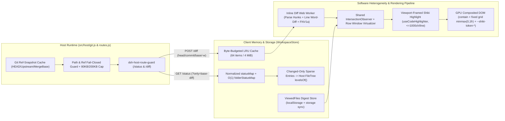

# CT-Batch-1：[DNEE] 审阅可视化与高性能渲染底座升级设计

> 功能簇: `CT-Batch-1：[DNEE] 审阅可视化与高性能渲染底座升级（Copy T3CODE Batch-1）`
> 讨论日期: `2026-11-21`
> 讨论者: `[业主]`、Antigravity Architect
> 关联调查报告:
> - [copy-t3code-initial-assessment.md](./copy-t3code-initial-assessment.md)
> - [code-mining-report.md](../../../.temp/copy-t3code/code-mining-report.md)
> - [DESIGN.md](../dsh-nano-ui/DESIGN.md)
> - [dsh-nano-explorer-extra/AGENTS.md](../../../dsh-nano-explorer-extra/AGENTS.md)
> 关联 QNA / 决策登记:
> - 本设计第 9.1 节（`CT-B1-Q1` 至 `CT-B1-Q5`，待 `[业主]` 冻结）
> 文档状态: `draft`

---

## 0. 背景与前置约束

在完成 [copy-t3code-initial-assessment.md](./copy-t3code-initial-assessment.md) 社区调研，并对 `context/t3code`（`c1464d6`）与 `[dsh]` 宿主源码（`0.2.2-rc.2`）展开逐行代码挖掘（归档于 [code-mining-report.md](../../../.temp/copy-t3code/code-mining-report.md)）后，`[DNEE]`（`dsh-nano-explorer-extra`）进入 **CT（Copy T3CODE）第一批次（Batch-1）** 的方案设计与落地规划阶段。

- **项目定位回顾**：`[DNEE]` 是 `[dsh-nano]` 中负责接管 `[dsh工作台]`「文件」侧栏与仓库 Git 可视化状态的双半侧（Host + Client）平台中立插件，当前 `HEAD` 为 `30ca969`。
- **本次讨论的前置共识（[业主] 7 项核心心智模型 `MM1`–`MM7`）**：
  - **[MM1] 严格范围锁定 `[DNEE]`**：所有设计、代码改造与性能治理严格限制在 `dsh-nano-explorer-extra` 自身内部，**不得向 `[DNPR]` 或其他插件扩展职责**。
  - **[MM2] 以 Orca 为反面教材**：坚决拒绝将 `[DNEE]` 或 `[dsh]` 演化为多标签代码编辑器、重型侧栏堆叠或内置运行面板的巨无霸 IDE 形态。
  - **[MM3] 聚焦高价值审阅能力**：本次聚焦吸收 `t3code` 在**文件变更聚焦视图、Git 历史/基线比对、Diff 审阅体验与视觉质感**方面的工程精华，并为 Batch-3 PR 集成预留干净边界。
  - **[MM4] 深度贴合 `[dsh]` 原生栈与 `DESIGN.md`**：所有 UI 升级优先使用宿主原生原语（`ui-sidebar-files` / `dsh-client-ui-primitives` / `ui-theme`），其次 `dsh-nano-ui`；严禁新增破坏宿主结构脆弱性的 DOM 嫁接选择器。
  - **[MM5] 视觉质感与零卡顿体验并重**：开发者高频切换改动文件、滚动长 Diff、开启筛选或打开历史提交时，不得出现主线程卡顿、列表跳动、整树重建闪烁或空白等待。
  - **[MM6] 缓存、软件异构与 GPU/WebGPU 诚实评估**：系统性运用多级缓存、Web Worker 异构计算、浏览器虚拟化与 GPU 合成层加速；同时从一性原理诚实甄别 WebGPU 文本渲染与 DOM GPU Compositor 的边界，拒绝为了技术名词牺牲原生可读性与文本交互。
  - **[MM7] 源码实证驱动**：所有性能借鉴点均直接溯源自 `context/t3code` 的真实提交记录与前端渲染代码，以及 `context/deepseek-harness` 与 `[DNEE]` 现有实现的精确 `file:line`。
- **本设计必须回答的问题**：
  1. 如何在不替换宿主 `FileTree` 的前提下，根治 49k 文件仓库下的渲染抖动，并在 `[DNEE]` 顶栏落地「仅看改动（Changed-Only）」+ 即时筛选？
  2. 如何把 `CommitDrawer` 与 `HistoryRail` 从“纯单次 HEAD 原生 `<pre>` 文本”升级为支持「当前工作区 / 相对 Base 分支 / 历史单提交」的三视角高颜值审阅器？
  3. 如何通过**双界 LRU 缓存 + Web Worker 异步 Diff 解析 + 视口窗口虚拟化 + 宿主 `useCodeHighlighter` 分帧着色 + CSS GPU 合成层隔离**，实现大 Diff 与多文件切换的 `60fps` 丝滑滚动？
  4. 针对需要扩大已有只读路由参数（`POST /diff`、`GET /status?only=base-diff`）的合约边界，哪些必须提前提交 `[业主]` 在 9.1 节冻结决策？
- **显式排除的讨论范围**：
  - Batch-2 本地 Git 写操作扩展（分文件 `/stage`、`/unstage`、`/discard`、`/stash`、`/branch-create`、`/worktree`、`/init` 等新增路由）。
  - Batch-3 外部 GitHub/GitLab 平台集成（调用 `gh` / `glab` CLI 获取 PR 与 CI Check 状态）。
  - 任何涉及 `[DNPR]`、`[DNMS]`、`[DNT]`、`[DNN]`、`[DNCS]`、`[DNK]` 内部代码的修改或跨插件专有侧载通道。

---

## 1. 讨论对象

### 1.1 功能簇定义

- **名称**：`CT-Batch-1：[DNEE] 审阅可视化与高性能渲染底座升级（Copy T3CODE Batch-1）`
- **一句话定义**：在不新增任何本地 Git 写命令与外部 CLI 依赖的前提下，用「渲染热点根治 + 树内改动过滤 + 三视角只读 Diff 审阅 + 缓存/Worker/虚拟化渲染管线」全面重构 `[DNEE]` 的开发者代码审阅体验与视觉帧率。
- **边界描述**：这个功能簇**包含**文件树引用稳态修复与 `O(1)` 文件夹状态预计算、树顶栏「仅看改动」与内存态文件名筛选、`CommitDrawer` 三视角切换（工作区 / `vs Base` / 历史提交直看 Diff）、异步 Worker Diff/Word-Diff 解析引擎、宿主 `useCodeHighlighter` + `--shiki-token-*` / `--dsw-alias-file-diff-*` 视觉重构、窗口虚拟化与共享 `IntersectionObserver`、双界（条目数+字节数）客户端 LRU 与宿主 Ref-Snapshot 缓存、`Mark as Viewed` 摘要感知已读折叠、右键「查看差异」无 Forge 自动降级；**不包含**任何工作区/分支/Worktree 写操作路由、外部 PR/CI 网络轮询、编辑器态实时改写磁盘代码、`[DNPR]` 改造以及 WebGPU 取代浏览器 DOM 文本排版。
- **关键术语对齐**：

| 术语 | 定义 | 备注 |
|---|---|---|
| `CT` | Copy T3CODE 的简称，指本阶段参考 `t3code` 高口碑交互与渲染工程体系对 `[DNEE]` 实施的分批升级 | 当前处于 `CT-Batch-1` 设计阶段 |
| `Changed-Only` | 「仅看改动」文件树过滤模式，直接消费前端已有 `ws.git.files` 构建稀疏改动树并自动展开祖先目录 | 零后端 `/list` 请求 |
| `vs Base / Merge-Base` | 相对于默认主干基准分支（如 `origin/main` 与当前 `HEAD` 的 `merge-base`）的累计净差异视角 | 用于验收 Agent 多轮提交后的整支成果 |
| `Mark as Viewed` | 单文件审阅完成标记，绑定当前文件状态与差异内容摘要（FNV-1a digest），文件后续再变动则自动失效 | 先行复用 `forge` 的 `viewed` 状态模型但独立键空间 |
| `Byte-Budgeted LRU` | 同时受「最大条目数」和「最大 UTF-8 字节预算」双重约束的近期最少使用缓存（参考 `t3code` `LRUCache`） | 防止大 Diff 长期驻留拖垮标签页内存 |
| `Diff Worker Pipeline` | 将统一差异解析与 Myers/词级行内 Diff 从 React 主线程剥离至内联 Web Worker 的异步流水线 | 不支持 Blob Worker 的受限 CSP 环境自动降级为时间切片微任务 |
| `Viewport-Framed Highlighting` | 在视口可视区 + overscan 窗口内按 `requestIdleCallback` / 帧预算调用宿主 `useCodeHighlighter` 的分帧语法着色策略 | 单行 `>1000` 字符自动退化为纯文本 |
| `CSS Containment / GPU Compositor` | 通过 `contain: layout style paint`、`overflow-anchor: none`、`translate3d` 合成层隔离与定高几何减少重排重绘 | 本设计中 GPU 加速的真实正统落点 |
| `DiffRendererAdapter` | 隔离“Diff 状态流/事件”与“具体 Diff 渲染器”的内部薄抽象接口 | 首版接自研虚拟化高亮渲染器，未来可平滑切换 WASM 引擎 |
| `UI 宿主优先` | 遵循 [DESIGN.md](../dsh-nano-ui/DESIGN.md) 的三层回退原则：宿主原语 → `dsh-nano-ui` → 插件内 `nano-ui-exempt` | 严禁新增宿主 DOM 嫁接规则 |

### 1.2 参考调查报告

- [copy-t3code-initial-assessment.md](./copy-t3code-initial-assessment.md) — 社区口碑调研、Rank 1–8 价值矩阵与 Batch 0–3 分期策略。
- [code-mining-report.md](../../../.temp/copy-t3code/code-mining-report.md) — `t3code` Worker 池、增量树协调、250 行虚拟化、双界 LRU、`render-metrics.ts` 及 `[dsh]` / `[DNEE]` 源码实证。
- [DESIGN.md](../dsh-nano-ui/DESIGN.md) — `[dsh]` 插件 UI 分层纪律、宿主 `ui-theme` 令牌规范、文件树已批准例外清单与禁止事项。
- [dsh-nano-explorer-extra/AGENTS.md](../../../dsh-nano-explorer-extra/AGENTS.md) — `[DNEE]` 安装态、路由前缀、20 条现有路由声明及行为约束合同。

---

## 2. 在 `[dsh-nano]` / `[dsh]` 生态中的定位

### 2.1 角色

- **系统角色**：在 `[dsh-nano]` 中，`CT-Batch-1` 是 `[DNEE]` 内部的**前端渲染性能基座与只读代码审阅增强层**——负责把原本分散、卡顿的“树着色 + 原生 `<pre>` 文本 diff + 不可点击历史文件列表”收拢为高帧率、低延迟、零切窗的开发者审阅闭环。
- **服务对象**：直接服务使用 `[dsh工作台]` 进行 AI 辅助编码审查的开发者，并为后续 Batch-2/3 提供可直接复用的 Diff 查看器、基线解析缓存与性能基线工具。
- **上游依赖**：依赖 `[dsh]` 宿主 `ui-sidebar-files` 提供的 `sidebar.files.tree` 工厂槽位、`dsh-client-ui-primitives` 导出的 `useCodeHighlighter` 与表单/微件原语、`ui-theme` 全局 CSS Token、`dsh-host-route-guard` 路由注册库以及宿主机器 `git` 可执行文件。
- **下游依赖**：通过保持现有 `nxe` 插件公共动作语义稳定，保证工作台现有终端联动（`[DNT]`）、复制到草稿本（`[DNN]`）以及未来可选协作的实验性 `client-ui-forge` 均零破坏继续工作。

### 2.2 与其他功能簇的交互矩阵

| 相邻模块 / 功能簇 | 交互方向 | 耦合强度 | 说明 |
|---|---|---|---|
| `[dsh]` `ui-sidebar-files` (`FileTree`) | `[DNEE]` → 宿主（传入稳定 `factoryOptions`） | 强 | 通过已注册槽位 `sidebar.files.tree` 驱动树与行尾 Accessory，不破坏宿主接口或新增 DOM 嫁接 |
| `[dsh]` `dsh-client-ui-primitives` & `ui-theme` | `[DNEE]` 消费宿主（引用与样式变量） | 强 | 复用 `useCodeHighlighter`、`languageForPath`、`Checkbox`、`SegmentedControl`、`Tooltip`、`--shiki-token-*`、`--dsw-alias-file-diff-*` |
| `dsh-nano-ui` | `[DNEE]` 消费共享包 | 中 | 补齐宿主未导出的轻量滚动容器/微交互，避免在插件内重复造轮子 |
| `dsh-host-route-guard` & `dsh-performance-review` | `[DNEE]` Host/Client 向其注册 | 强 | 全量沿用现有路由守卫与全进程性能埋点机制；Batch-1 补齐 `declaration.json` 合同一致性并增加前端 render/diff span |
| `client-ui-forge`（宿主实验包） | `[DNEE]` 条件探测调用（不强依赖） | 弱 | 右键「查看差异」优先尝试打开 `forge-changes`；未启用 Forge 时静默降级至 `[DNEE]` `CommitDrawer` 审阅视图 |
| `[DNT]` / `[DNN]` / `[DNCS]` | 通过现有 `nxe` 动作 / Cordis 懒服务触发 | 弱 | 完全保持现状，不在 Batch-1 新增任何跨插件协议或服务调用 |
| `[DNPR]`（进度视图） | **零交互** | **无** | 严格遵守 `[MM1]`，不向 `[DNPR]` 扩展任何功能或共享渲染组件 |

### 2.3 一句话定位陈述

> "在 `[dsh-nano]` 里，`CT-Batch-1` 是 **`[DNEE]` 的只读审阅视觉与性能内核**，负责 **在不增加重型 IDE 外壳和本地写突变的前提下实现大仓秒级改动聚焦与 `60fps` 多视角 Diff 审阅**，对上游依托 **宿主原生 `FileTree`/`ui-primitives` 契约与受控只读 Git 路由**，对下游（开发者与后续 Batch-2/3）输出 **稳定不闪烁的树渲染基座、统一可复用的 Worker Diff 管线与可度量性能回归防线**。"

---

## 3. 架构稳定性与未来扩展策略

### 3.1 精简点（哪里可以砍）

| 被砍项 | 参考来源 / 诱因 | 砍的理由 | 未来是否可能回补 / 重评条件 |
|---|---|---|---|
| **多标签编辑器 / 内置终端分屏** | Orca 竞品 ([MM2]) | 破坏 `[dsh]` 聊天+轻量工作台定位，与 `[DNT]` 职责重叠且急剧膨胀内存 | **永不回补**（Orca 属于战略负参考） |
| **WebGPU / Canvas2D 替代代码与树文本渲染** | [MM6] / 误区排查 | 破坏浏览器的原生 Ctrl+F 查找、选区复制、字体亚像素抗锯齿及无障碍读屏；`t3code` 实证本身也未将其用于 Diff/文件树 | **仅在千级节点提交图谱/Minimap 场景下单独重评** |
| **Batch-1 强制引入 `@pierre/diffs` + WASM `highlights` 全家桶** | `t3code` `apps/web/package.json` | 会向 `[DNEE]` 单包注入较大第三方依赖体量与阴影 DOM CSS 变量覆盖债务，且 `[dsh]` 已全局预置 `--shiki-token-*` | 若单文件超过 5,000 行且 Shiki 分帧仍达不到 `<16ms` 时在 Batch-2+ 通过 `DiffRendererAdapter` 重评 |
| **全仓递归文件系统搜索** | 大仓文件查找诉求 | 49k+ 仓前端/后端遍历磁盘易击穿主机 I/O 与路由超时预算；宿主已有独立检索路径 | Batch-1 仅做内存态已加载层级 + `ws.git.files` 即时过滤；若后端引入 `rg` 索引服务再单独重评 |
| **Batch-1 内新增 Git 写操作或 `gh` CLI PR 拉取** | 初始报告 Rank 1/3/4 | 需要新权限枚举、危险确认弹窗与外部认证降级链路，会拖慢高确定性的视觉/性能落地 | 明确留作后续独立 Batch-2（本地 Git 闭环）与 Batch-3（外部 PR 平台） |

### 3.2 接口保留点（哪里要留扩展空间）

| 扩展点 | 表现形式 | 第一版行为 | 未来可能的演进方向 |
|---|---|---|---|
| `DiffRendererAdapter` | `src/client/diff-renderer.js` 组件契约 (`{ patch, viewPrefs, reviewed, onToggleViewed, lineAnnotations? }`) | 接入 `[DNEE]` 自研 Worker + 虚拟化高亮视图 | 未来可无缝替换为 WASM/Pierre 渲染器或支持 `split` 双栏对照视图，不改上层抽屉状态 |
| `ReviewScope` 枚举 | `'working' \| 'base' \| 'commit'`（预留 `'pr'`） | 仅启用工作区、`vs Base`、历史提交三种只读视角 | Batch-3 接入 GitHub/GitLab PR 差异对比时仅需新增 `'pr'` 分支与数据源 |
| `POST /diff` 只读请求荷载 | `{ sessionId, path, untracked?, commit?, base?, ignoreWhitespace? }` | 默认不传 `commit`/`base`/`ignoreWhitespace` 时 100% 兼容现有 `HEAD` 行为 | Batch-3 查看 PR `base..head` 或多范围 diff 可直接复用同一端点与 LRU 键结构 |
| `folderStatusMap` 与 `WorkspaceStore` | 派生索引字段预计算映射表 | `statusMap` 每次刷新时 `O(statusMap.size)` 生成祖先目录状态图，供树行 `O(1)` 读取 | Batch-2 支持局部暂存 (`staged` vs `unstaged` 双状态角标) 时，只扩充地图值结构不改查找方式 |
| `GraphRenderer` 提交图抽象 | `src/client/history-graph.js`（SVG 保真，接口隔离） | 沿用现有轻量多车道彩色 SVG 提交图 | 若未来需要渲染 `500+` 提交的超大历史流并出现 DOM 瓶颈，可原地替换为 OffscreenCanvas / WebGPU 实例化绘制 |

### 3.3 完全解耦点（哪里必须独立）

- **Diff 引擎与抽屉外壳解耦**：`DiffViewer` / `DiffWorker` 仅消费规范化后的 `ParsedDiff` 与纯回调，不读取 `BranchDrawer`/`CommitDrawer` 私有 React Context；同一组件未来可直接用于右栏独立 Diff Tab 或弹出窗口。
- **「已审阅（Viewed）」状态存储与 Git 状态轮询解耦**：`ViewedFilesStore` 独立维护于 `localStorage['dsh-nano-explorer-extra:viewed.v1:<repoKey>']`，仅以文件 `path` + 差异摘要哈希关联；`WorkspaceStore` 刷新时不重置 UI 状态，而是通过纯函数比对 digest 自动判断保持已读还是回退为 `changed`。
- **右键「查看差异」与实验性 Forge 解耦**：`openDiff` 先异步尝试宿主 `forge-changes` 资源路由，一旦异常（未安装/未开启）则无缝回退打开 `[DNEE]` 自身的 `CommitDrawer` 并高亮定位该文件，彻底消除跨包强假设。

### 3.4 聚合点（哪里要刻意收敛）

- **树渲染派生状态聚合入 `WorkspaceStore`**：过去分散在 `body.js` 每次 render 中现场计算的 `folderStatusOf` 循环扫描与动态 `Accessory` 闭包，全部收口到随 `ws.git` 数据更新而单次生成的不可变衍生快照（`folderStatusMap`、`changedEntryList`），遵守 `AGENTS.md`「单一真源」原则。
- **客户端 Patch 缓存聚合为单一 `ByteBudgetLruCache`**：无论是当前未提交、相对 `base` 分支还是历史单提交的文件 Diff，全部共用同一个按 `sessionId + cwd + scope + base + commit + path + ignoreWhitespace` 寻址的双界 LRU 实例（64 条 / 4 MiB），统一控制内存上限并在仓储指纹（`git` 刷新计数 / HEAD SHA）变动时按键精准失效。
- **宿主安全校验与 Ref-Snapshot 缓存聚合于 `src/host/git.js`**：所有新增 `commit` / `base` 参数的校验正则、防 flag 注入（禁止 `-` 开头）、fail-closed `realpath` 检查，以及跳过无 remote 检查、`HEAD`/upstream 单次快照缓存，集中写在 `src/host/git.js` 工具原语中，路由层 `routes.js` 不得各自复制粘贴分支校验逻辑。

---

## 4. 参考实现与 precedent 对比

### 4.1 `t3code` 的做法（基于 `context/t3code` 实证）

- **实现概要**：以 React + Effect Atom + `@pierre/diffs` + `@pierre/trees` + `@legendapp/list` 为核心架构；前端大量采用多核 Web Worker 池与 WASM 词法引擎（`highlights`），后端通过 Ref 快照复用（`c1464d6`、`67933a2`、`a0ca0bf`、`220a2b8`）压缩 Git 子进程调用次数，并配套了 Vitest React Fiber 渲染计量回归工具（`scripts/render-metrics.ts`）。
- **亮点与值得借鉴**：
  1. `DiffWorkerPoolProvider` + `tokenizeMaxLineLength: 1_000` 防超长 minified 代码卡死词法分析器；
  2. `LRUCache(maxEntries, maxMemoryBytes)` 以字节预算代替简单条数限制；
  3. `observeIntersection.ts` 全局按 `(root, rootMargin, threshold)` 复用的 `IntersectionObserver`；
  4. `ChangedFilesTree.tsx` `VIRTUALIZE_AFTER_ROWS = 250` 轻量自研窗口虚拟化，兼顾键盘焦点行不丢失与 `rAF` 滚动节流；
  5. `StyledDiffCodeView.tsx` 通过 `--diffs-code-grid: ... minmax(0, 1fr)` 防止行文本撑大网格导致的虚拟列表反复校正 `scrollTop`；
  6. 服务端用 ref snapshot 指纹缓存 `mergeBase` 并在无 remote 时短路远端检查。
- **不打算照抄的地方**：
  - 不在 Batch-1 引入外部 `@pierre/diffs`（避免与宿主 `ui-theme` 阴影 DOM 风格打架以及新增大型构建依赖）；
  - 不照抄全套 `Effect` 响应式原子图与独立 Electron 多面板窗口状态系统（保持 `[DNEE]` 现有轻量 `WorkspaceStore` + 纯 React hooks）。

### 4.2 `[dsh]` 宿主原生实现的做法（基于 `context/deepseek-harness` 实证）

- **实现概要**：`ui-sidebar-files` 提供了 `FileTree = memo(FileTreeView)` 与自带祖先目录合成的 `levelsOf()` 及内置 `highlight` 子串加亮；`dsh-client-ui-primitives` 已直接导出 `useCodeHighlighter`（Shiki JS-regex 单例，支持 58 种语言懒加载且同样带 `1000` 字符单行保护）；`ui-theme` 已在全局样式里提供了全套 `--shiki-token-*` 和 `--dsw-alias-file-diff-*` 令牌；实验性的 `client-ui-forge` 则已趟平了 `PatchCache`（UTF-8 字节预算 LRU）、`ViewedFiles`（digest + 跨 tab `storage` 同步）与 `SectionReach` 模式。
- **亮点与值得借鉴**：最大化吃透宿主已送进内存和 CSSOM 的 Token 与高亮单实例，几乎 **0 新增主题 CSS 维护成本** 即可让 `[DNEE]` 的 Diff 视觉质感与聊天区代码块、`client-ui-forge` 浑然一体。
- **不打算照抄的地方**：不可直接 runtime `import` `client-ui-forge`（因为它在宿主中属于可选实验包，可能未开启）；不可直接使用 `ui-primitives` 里的 `DiffBlock` 作为主审阅器（因为它目前只做 `DEFAULT_DIFF_MAX_LINES = 16` 无高亮无虚拟化的简单结构化补丁展示）。

### 4.3 Orca（负参考）与 Herdr（轻量化正参考）的对比

- **Orca（负参考）**（[x-orca-1.jpg](../../../.temp/copy-t3code/x-orca-1.jpg)、[x-orca-2.jpg](../../../.temp/copy-t3code/x-orca-2.jpg)）：拥有极强的多审阅微交互（忽略空白、路径复制、Uncommitted 过滤器），但其把终端、多栏文件编辑器、Diff 审阅全都硬塞在一个类 VS Code 巨型壳体里，挤压聊天空间且视觉噪音过重。我们只吸收它的 **“Uncommitted/Changed-Only 快速过滤 + 忽略空白开关 + 路径微操作”**，绝不引入其重型多编辑器壳体。
- **Herdr（正参考）**：极度克制的单面板边栏心智模型，不抢焦点、按需展开，证实了工作区上下文必须轻量且快速收放。

### 4.4 横向对比速查表

| 维度 | `t3code` | `[dsh]` 宿主原生 (`ui-primitives` / `forge`) | Orca（负参考） | `[DNEE]` CT-Batch-1 倾向 |
|---|---|---|---|---|
| **树组件性能** | `@pierre/trees`（增量协调）+ 250 行自研窗口虚拟化 | `FileTree = memo(...)` 但无虚拟化 | Electron 重型自定义全量树 | **修稳 `FileTree` props/Accessory 引用 + 预计算 `O(1)` 状态 + `Changed-Only` 稀疏过滤** |
| **Diff 解析与异构** | `@pierre/diffs` + 2–6 Worker 池 | 主线程同步切分；`forge` `SectionReach` | 原生桌面多线程解析 | **轻量内联 Web Worker 解析 Hunk + Word-Diff（CSP 受限平滑降级分片）** |
| **语法高亮方案** | WASM `highlights`（主攻速度） | 全局注入 `--shiki-token-*` + `useCodeHighlighter` 同步 Shiki | 重型 IDE 语义高亮（LSP） | **复用宿主 `useCodeHighlighter`（视口按帧/空闲分批着色 + 单行 `>1000ch` 降级）** |
| **Diff 缓存模型** | `LRUCache(entries, bytes)` + FNV-1a 内容版本 | `PatchCache` 按字节驱逐 | 本地持久化全量快照 | **客户端 64 条 / 4 MiB 双界 LRU + 宿主 Ref-Snapshot 缓存** |
| **GPU / WebGPU 策略** | **0 WebGPU**；依靠 DOM 虚拟化 + 网格 `minmax(0,1fr)` 防抖 | CSS 标准层排版 | 桌面 GPU 全屏幕渲染 | **DOM 虚拟化 + CSS `contain` / `overflow-anchor` + GPU 合成层，不画 Canvas/WebGPU 文本** |
| **UI 风格与包重量** | Tailwind 桌面独立应用栈 | `[dsh]` 原生原子组件 + `--dsw-*` tokens | 独立厚重壳体 | **100% 遵循 `DESIGN.md` 宿主原语优先，新增 bundle 体积极克制** |

---

## 5. In-Scope / Out-of-Scope 判断

### 5.1 In-Scope（本设计确认要支持）

- **[S1] 文件树渲染热点与重绘震荡根治** — 当前每轮状态更新重建 `Accessory` 组件与全表线性扫描导致 `FileTree` 的 `memo` 失效，这是让任何上层树功能都不卡顿的必修复基石。
- **[S2] 文件树顶栏「仅看改动（Changed-Only）」与树内即时文件名过滤** — 解决 49k 文件大型仓库找改动难的核心痛点，零后端查询，同时完整保留 `[DNEE]` 右键打开 `[DNT]`/`[DNN]`/右侧工作台的联动能力。
- **[S3] `CommitDrawer` 三视角审阅与 `HistoryRail` 历史文件直看 Diff** — 补齐 AI Agent 多轮自动提交后无法直接在 `[dsh]` 内验收 `vs Base` 净改动及历史某一提交内单文件差异的重大断层。
- **[S4] 高性能高颜值 Diff 渲染管线（缓存 + Worker 异构 + 虚拟化 + 分帧高亮 + GPU 合成）** — 直接消除万字原生 `<pre>` 卡死与无色彩问题，落地 `Mark` 与 `--shiki-token-*` / `--dsw-alias-file-diff-*` 视觉跃迁。
- **[S5] 审阅闭环增强（`Mark as Viewed` 摘要折叠 + 右键「查看差异」无 Forge 降级）** — 解决多文件审阅被打断丢失进度、以及未开实验插件 `forge` 时右键「查看差异」报死错的问题。
- **[S6] 宿主 Git 读取缓存与无远端优化** — 吸收 `t3code` 近期高频 perf 提交精髓，减少阻塞 Git 子进程开销，控制 `vs Base` 增量读取成本。
- **[S7] 性能埋点基线与 `declaration.json` 合同对齐** — 对接现有 `dsh-performance-review` 体系，量化验证 Batch-1 的帧率与渲染次数改善并顺手补齐缺失的路由声明。

### 5.2 Out-of-Scope（本设计确认不做）

- **[O1] 本地 Git 写操作路由（分文件暂存 `/stage`、`/unstage`、`/discard`、`/stash`、`/branch-create`、`/worktree`、`/init`）** — 涉及破坏性写操作安全边界与路由表扩展，须经 `[业主]` 单独冻结；重评条件：进入 `CT-Batch-2` 设计。
- **[O2] 外部 GitHub / GitLab PR 与 CI 状态集成（`gh`/`glab`）** — 引入外部 CLI 探测、鉴权与 TTL 后台状态机；重评条件：进入 `CT-Batch-3` 设计。
- **[O3] WebGPU / Canvas 2D 重绘代码行文本与文件树文字** — 摧毁浏览器原生文本查找、选中复制、字体亚像素渲染与读屏无障碍；重评条件：仅当未来提交图超过千级节点出现 SVG SVGDOM 帧率跌破 `30fps` 时，在 `HistoryRail` 图谱局部重评。
- **[O4] 引入 `@pierre/diffs` / `@pierre/trees` 外部 UI 包** — 避免双套设计语言冲突与 bundle 膨胀；重评条件：当自研窗口虚拟化+Shiki 分帧无法稳定应对单文件 `>5,000` 行 Diff 时通过 `DiffRendererAdapter` 重评。
- **[O5] 全仓递归文件搜索（搜索未展开且未改动的 49k 磁盘路径）** — 会击穿大仓 `/list` 预算与 I/O 护栏；重评条件：宿主侧推出独立文件检索服务。
- **[O6] 跨插件改动（如 `[DNPR]` 任务流改造）** — 违背 `[MM1]`；重评条件：永不打破插件边界。

### 5.3 边界清单（容易混淆的灰色地带）

| 项目 | 判定 | 理由 | 后续落点 |
|---|---|---|---|
| **Diff 分栏模式（Split Side-by-Side）** | `defer`（留口） | `[dsh工作台]` 侧栏默认宽度较窄（通常 `320px–480px`），分栏单行空间极局促；Unified 模式+行内 Word-Diff 在窄面板阅读效率最高 | 在 `ParsedDiff` 与 `DiffRendererAdapter` 中预留行对齐元数据口子；仅当用户显式拉宽或进入全宽预览模式时于后续按需打开 |
| **Diff 行内评论（Inline Comment）** | `out-of-scope` | 与 Batch-3 PR Review 强耦合，Batch-1 无提交去向 | `DiffRow` 组件预留只读 `annotationSlot`，Batch-1 置空 |
| **单子目录链折叠（如 `src/client/utils` 合并显示）** | `out-of-scope`（Q3 待定） | 宿主 `FileTree` 的 `levelsOf()` 当前按标准层级展开目录；强制拼接文件夹路径文本需验证是否影响展开态缓存键 | 作为 `CT-B1-Q3` 交 `[业主]` 在 9.1 节决断 |
| **超大补丁（`> 80KB`）行为** | `in-scope`（流式截断+显式提示） | 沿用 `DIFF_PATCH_CAP` 安全上限防 OOM，但明确区分「截断提示条」而非静默丢失内容；按需单独打开单文件 Diff 时允许扩至安全上限（如 `256KB`）并给出「仅展示前 X 行 / 点击显示全文（最大 1MB）」选项 | 在 `F4` 与 `F6` 中写明 |
| **补齐 `src/perf/declaration.json` 与清理本地旧 `.tgz`** | `in-scope` | 原先列入 Batch-0 的纯零风险小债（`dnee.diff` / `dnee.paste-image` 漏列），顺手随 Batch-1 性能埋点更新一并闭合 | 在 `F7` 中纳入（亦通过 `CT-B1-Q5` 请 `[业主]` 确认） |

---

## 6. Tradeoff 辩证分析与价值判断

### 6.1 核心取舍

1. **取舍 1：Diff 解析异构 + 语法高亮路径**
   - 我们选择 **`轻量内联 Web Worker（解析 Patch 与行内 Word-Diff）+ 宿主 useCodeHighlighter（视口窗口内按帧调度 Shiki 着色并直接消费全局 --shiki-token-*）`** 而不是 **`首版捆绑引入 @pierre/diffs + WASM highlights 多 Worker 池`**。
   - **为什么**：`[dsh]` 宿主已经在前端内存里预置了 `useCodeHighlighter`（且自带 58 种语言按需加载与 `1000` 字符长行熔断）和全套深浅双色 `--shiki-token-*` / `--dsw-alias-file-diff-*` CSS Token。把最耗 CPU 的文本切分、LCS/Myers 词级差异与哈希计算放进一个零第三方依赖的轻量 Web Worker，再只对可见区附近 `±40` 行在主线程空闲帧调用宿主 Shiki，既能把包体积压缩到极致，又能实现 100% 视觉同源与零闪烁体验。
   - **我们接受的代价**：不能直接使用 `@pierre/diffs` 自带的内置快捷键查找面板与 WASM 语言包，需在 `[DNEE]` 内维护约 200 行的 Diff Worker 解析器与 `IntersectionObserver` 虚拟化包装层。
   - **未来重评条件**：若 `[DNEE]` 实测连续打开 `5,000+` 行超大型单文件 Diff 时，宿主 Shiki 的 JS-regex 单行分词仍引起 `>16ms` 掉帧，则通过 `DiffRendererAdapter` 接入手写 WASM lexer 或 `@pierre/diffs`。

2. **取舍 2：GPU / WebGPU 加速与前端渲染载体选择**
   - 我们选择 **`原生 DOM 虚拟化渲染 + CSS Layout/Paint Containment (contain: content) + GPU 合成层滚动隔离（仅给未来超长 Commit Graph 预留 Canvas/WebGPU 接口）`** 而不是 **`使用 WebGPU / WebGL / Canvas 2D 绘制文件树与 Diff 代码正文`**。
   - **为什么**：通过本次对 `t3code` 源码的实证核查，**`t3code` 前端并未使用 WebGPU 渲染 Diff 或树文字**。对于代码审阅面板，强行绕过浏览器 TextLayout Engine 用 WebGPU/Canvas 画字形会导致：无法使用 `Cmd+F` 页内查找、拖选跨行代码复制极易错位、高分屏缩放亚像素渲染劣化、无障碍标签失效以及高昂的图集显存（Glyph Atlas）管理成本。把 GPU 用在浏览器擅长的 **合成层滚动（Compositor-thread scrolling，零主线程 Paint 重绘）**、用 `min-width: 0` / 定高行锁死避开 Layout Thrashing，才是一性原理下的最优解。
   - **我们接受的代价**：单屏最大可见区域内仍保留几十个语义化 DOM 行节点，不具备 WebGPU 同屏绘制十万粒子的炫技指标。
   - **未来重评条件**：当 `BranchDrawer` 内的提交拓扑图需要一次性可视渲染 `> 1,000` 个并行多车道分支交叉节点且 SVG DOM 合成时间超过 `16ms` 时，针对图谱轨单独启用 OffscreenCanvas / WebGPU 实例化渲染后端。

3. **取舍 3：文件树架构演进路径**
   - 我们选择 **`修复传入宿主 FileTree 的引用稳定性 + 消费其内置 levelsOf() 与 highlight 属性落地「仅看改动」和「即时筛选」`** 而不是 **`废弃宿主 FileTree 槽位，在插件内自建虚拟化树或搬入 @pierre/trees`**。
   - **为什么**：`DESIGN.md` 第 8 节明确要求遵循「UI 宿主优先」，且经过代码审查，宿主 `FileTree` 原生就用 `React.memo` 包裹、支持自动为稀疏文件列表补全缺失父目录（`levelsOf`）以及关键词高亮（`highlight`）。当前卡顿并非宿主 `FileTree` 天生慢，而是 `body.js` 每次轮询重新生成 `Accessory` 函数身份与全表扫描 `folderStatusOf` 击穿了 `React.memo`。
   - **我们接受的代价**：文件树视图仍受限于宿主每次展开节点后的最大显示行数（未做底层全仓数万行虚拟列表），因此在“全部文件”视图下仍需保持按需目录懒展开及 `Changed-Only` 降维聚焦。
   - **未来重评条件**：当用户在「仅看改动」下一次性需要审查 `> 2,000` 个同时变动的扁平文件时，再协商宿主侧升级 `ui-sidebar-files` 底层接入窗口虚拟化。

4. **取舍 4：`vs Base` 分支对比的数据拉取时机**
   - 我们选择 **`默认只做轻量化状态提示，仅当用户打开或切换到 CommitDrawer 的「vs Base」分页时按需请求 GET /status?only=base-diff（带客户端/服务端缓存）`** 而不是 **`塞入每 5 秒轮询一次的默认 GET /status 荷载中`**。
   - **为什么**：`git diff --numstat <mergeBase>..HEAD` 在大历史分支上可能带来额外 git 进程与 I/O，绝不能拖慢后台正常文件树心跳轮询（守住 `declaration.json` 对 `git-poll` 的性能预算）。
   - **我们接受的代价**：首次从“未提交”切到“vs Base”分页会有一次异步加载等待（通常几十到两百毫秒，展示原生骨架占位行）。
   - **未来重评条件**：若后续 `[业主]` 要求底部状态栏常驻显示相对主干分支的总改动文件数，可单独增加极轻量的 ref-cached `--shortstat` 采样。

5. **取舍 5：右键「查看差异」跨模块联动策略**
   - 我们选择 **`优先尝试打开宿主 forge-changes 原生 tab，探测不可用时立即静默回落打开 [DNEE] CommitDrawer 并定位该文件`** 而不是 **`完全屏蔽 Forge 或在 Forge 关闭时继续弹出失败错误`**。
   - **为什么**：既尊重安装并开启了实验性 Forge 用户的既有习惯（零侵入），又彻底解决未开启 Forge 用户右键点击「查看差异」直接报错的糟糕体验。
   - **我们接受的代价**：保留一次快速的资源路由尝试调用与 `catch` 分支。
   - **未来重评条件**：若未来 `[dsh]` 宿主正式下线 `client-ui-forge` 或将其合入正式组件，直接切换为对应唯一入口即可。

### 6.2 风险与缓解

| 风险 | 触发条件 | 影响 | 缓解方案 |
|---|---|---|---|
| **Inline Blob Worker 被严格 CSP 策略拦截** | 特定宿主部署启用禁止 `blob:` Worker 的 CSP 头 | Diff 解析管线初始化抛 SecurityError，文件 Diff 白屏 | `DiffWorkerClient` 构造时带同步 `try/catch` 与超时降级守卫：Worker 启动失败自动无缝切至主线程 `MessageChannel`/`requestIdleCallback` 分块异步解析（每批最多 200 行让渡帧控制权），对外接口完全透明 |
| **超长单行（如压缩 JS / Lockfile / SVG）卡死 Word-Diff 或 Shiki** | 单行长度 `> 1000` 字符或整文件超过万行 | 正则高亮或 Myers diff 占用百毫秒甚至卡死 Worker | 解析器预处理检查：单行 `> 1000` 字符强制跳过行内 Word-Diff 与 Shiki Tokenize 直接纯文本渲染（对齐 `t3code` 与宿主 `highlight.ts` 阈值）；单 hunk 超过 500 变更行跳过逐词 diff，只保留整行加减底色 |
| **宿主 `useCodeHighlighter` 首次冷启动或语言包异步下载返回晚于滑出视口** | 用户快速滑动浏览混合多语言（Rust/Go/Py）大变更集 | 先看到无色源码，几十毫秒后局部闪烁跳色，或已滑出可视区的行做无效状态更新 | 仅对挂载在虚拟窗口内且可见的元素挂载高亮订阅；携带递增代际编号 `highlightEpoch` 回调防竞态；语言切换完成时通过批量状态刷新合并重绘 |
| **49k 仓库下开启「仅看改动」仍出现卡顿或丢失刚修改的文件** | 仓库短期内产生 `>1,500` 个未提交改动（如误删 `dist` 或 `node_modules` 未 ignore） | 前端 `levelsOf()` 构建成千上万目录行，无虚拟化的宿主 `FileTree` 渲染卡顿 | 对 `Changed-Only` 视图设置前端安全上限提示（例如超过 800 个改动文件时在过滤栏下给出一键收起全部目录或提示先检查 `.gitignore` 截断条，优先按已展开/根目录排序）；平时严格复用稳定引用保证不重复计算 |
| **`POST /diff` 新增 `commit` / `base` 参数引入 Git Flag 注入或越权读漏洞** | 恶意构造 `--output=/tmp/x`、`-f` 或包含 `..` 路径的 `commit`/`base`/`path` | Git CLI 解析为参数标志甚至泄露仓外文件 | 复用 `src/host/git.js` 严格校验：`commit` 与 `base` 禁止 `-` 开头、禁止 `..` 与控制字符（`commit` 须匹配 `^[0-9a-fA-F]{4,40}$`，`base` 须通过 `git check-ref-format` 白名单校验且命令参数强制使用 `--` 分隔符）；`path` 延续 fail-closed `realpath` + 禁止 `.git` 路径段 |
| **`localStorage` 已审阅摘要缓存无限增长** | 开发者长期在数十个仓库高频打开数千个文件审阅 | 挤占浏览器 `localStorage` 5MB 配额导致 `[DNEE]` 偏好写入异常 | `ViewedFilesStore` 对 `dsh-nano-explorer-extra:viewed.v1` 设置仓库 LRU 上限（最多保留最近 12 个活跃仓库，单仓库最多 500 条最近记录，按时间 LRU 淘汰）；`prefs.v2` 独立写入且容错保护 |

### 6.3 本次 tradeoff 能带来的价值

- **对开发者**：不需要切换 IDE、不需要忍受大仓展开卡顿或看黑白难读的 `<pre>` 补丁，直接在 `[dsh工作台]` 原地实现「只看改动 → 相对基线/单提交查 Diff → 勾选已审阅」的流畅审阅闭环。
- **对 `[DNEE]` 的长期演进**：通过确立 `WorkspaceStore` 衍生态聚合、`DiffRendererAdapter`、`ByteBudgetLruCache` 和 Worker 管线，后续 Batch-2 的精准分文件 Stage/Discard 与 Batch-3 的 PR Diff Tab 可以 **0 返工直接挂接**在这套审阅引擎上。
- **对 `[dsh]` 生态与性能标杆**：建立插件级可量化的 React 渲染次数控制与大文件虚拟化示范模板，同时严守 `DESIGN.md` 零 DOM 嫁接规范与包体克制原则，证明“轻量插件也能拥有比肩桌面客户端的渲染质感”。

---

## 7. In-Scope 功能详细列表

### 7.1 功能清单

| 编号 | 功能名 | 描述 | 一句话收口目标 |
|---|---|---|---|
| F1 | 文件树渲染稳态与 `O(1)` 状态映射 | 消除 `createAccessory` 身份重建与 `folderStatusOf` 二次遍历，修复宿主 `FileTree` `React.memo` 失效 | ✅ 任意后台 `statusMap` 无变化轮询或单文件变动下，未受影响目录与文件行 Accessory 零重新挂载、`folderStatusOf` 复杂度降至 `O(1)` |
| F2 | 顶栏「仅看改动（Changed-Only）」与树内即时过滤 | 在文件区顶栏新增改动计数开关与可收放 `/` 快捷键路径过滤条，完全在客户端驱动宿主 `FileTree` | ✅ 49k 文件测试仓开启或切换「仅看改动」耗时 `<16ms`、发送 `0` 次 `/list` 请求，且匹配行原生高亮并保留全部右键动作 |
| F3 | `CommitDrawer` 三视角审阅与 `HistoryRail` 直看 Diff | 扩展 `CommitDrawer` 支持「工作区 / vs Base / 历史提交」，支持 `HistoryRail` 点击提交文件即开 Diff，受控扩展只读后端接口 | ✅ 开发者可在 `CommitDrawer` 流畅切看工作区未提交、`merge-base..HEAD` 整支净差异及任意历史 Commit 内单文件 Diff，且通过参数安全单测 |
| F4 | 缓存-异构-虚拟化-GPU 合成 Diff 渲染管线 | 构建 `ByteBudgetLruCache` → Inline Worker（Hunk + Word-Diff）→ `IntersectionObserver` 行窗口虚拟化 → 宿主 `useCodeHighlighter` 分帧着色与 CSS 合成层 | ✅ 1,000 行 Diff 首屏可交互 `<50ms`、`60fps` 丝滑滚动、无缝适配 `[dsh]` 深浅双色 Token 且支持 `-w` 忽略空白与超长行自动防卡死熔断 |
| F5 | 审阅闭环升级（`Mark as Viewed` + 右键降级修复） | 为每个 Diff 文件头提供基于内容 digest 的已审阅勾选折叠（含跨标签同步），并修复无 Forge 时右键「查看差异」失效 | ✅ 文件内容未再变动时刷新/切换标签保持「已审阅」折叠并计数进度，再次改动自动解锁；无 `client-ui-forge` 时右键「查看差异」自动落入 `[DNEE]` Diff 视图 |
| F6 | 宿主 Git 读取 Ref-Snapshot 缓存与无远端提速 | 吸收 `t3code` 后端 perf 成果：无 remote 跳过远端查检、基于本地 Ref 快照复用 `merge-base` 解析并流式守住字节cap | ✅ 仓库无远端或 ref 未变动时，重复读 status 与切换 `vs Base` / 同分支多次 `/diff` 显著降低 Git 子进程启动次数 |
| F7 | 性能观测指标对齐与渲染回归基线 | 补齐 `declaration.json` 路由合同缺失，新增 `diff-parse`/`diff-render`/`tree-filter` perf span，建立客户端渲染次数测试 | ✅ `declaration.json` 覆盖全量 20 条路由，`?perf-review=1` 可采集完整前端耗时，单元测试覆盖核心纯逻辑与安全校验全绿 |

### 7.2 详细阐述

#### F1: 文件树渲染稳态与 `O(1)` 状态映射

- **输入**：`WorkspaceStore` 推送的 `ws.git.statusMap`、`ws.tree.levels`、`prefs` 与当前激活会话路径。
- **输出**：稳定的 `folderStatusMap`（`Map<relDir, GitStatusSummary>`）以及身份跨轮询保持不变的 `Accessory` 组件与 `FileTree` 属性对象。
- **主要调用者**：`dsh-nano-explorer-extra/src/client/body.js` 与 `accessory.js`。
- **核心逻辑**：
  1. 在 `WorkspaceStore` 更新 `statusMap` 的单次副作用中（或 `useMemo([statusMap])`），仅执行一趟 `O(statusMap.size)` 向上冒泡扫描，将每个受影响文件的状态与最高优先级聚合写入 `folderStatusMap`（例如冲突 `U` > 删 `D` > 改 `M` > 增 `A` > `?`）；组件渲染期目录行仅做 `folderStatusMap.get(dir)` 常数查找。
  2. 将 `body.js` 中 `createAccessory(...)` 从闭包捕获每次都会变化的 `statusOf` / `ignoredOf` 改为 **读取不可变 `Store` Ref / `useSyncExternalStore` 订阅单个条目路径**（仅当该行自身 `path` 状态或全局显示开关变动时触发单行更新），从而让传给宿主 `FileTree` `factoryOptions.Accessory` 的组件函数引用在会话生命周期内保持完全稳定。
  3. 同步用 `useCallback` / `useMemo` 固定 `onToggle`、`onOpen`、`canOpen`（常量函数）、`rowTriggerProps` 及 `entries` 数组映射，使宿主 `FileTree = memo(FileTreeView)` 真正生效。
- **边界情况**：
  - 当工作区路径 `cwd` 或会话 `sessionId` 切换时，立即重置 `folderStatusMap` 与行订阅，防止上一仓库残影闪烁；
  - 幽灵删除/冲突条目仍遵循 `AGENTS.md` 规则，不产生孤立无效红点。
- **一句话收口目标**：✅ **任意无关轮询或单文件变更发生时，宿主 `FileTree` 保持零全量重渲染，目录着色复杂度从 `O(dirs × statusMap)` 降为 `O(statusMap)` 一次性预计算 + `O(1)` 查询。**

#### F2: 顶栏「仅看改动（Changed-Only）」与树内即时过滤

- **输入**：`ws.git.files`（包含路径、状态码、`additions`/`deletions` numstat）、`ws.tree.levels`（当前已加载展开层级）、工具栏点击或 `/` 快捷键输入的 `filterQuery`。
- **输出**：经过筛选的稀疏 `TreeEntry[]`、自动补齐/展开的 `expanded` 目录列表、传递给宿主 `FileTree` 的 `highlight` 关键字与统计角标。
- **主要调用者**：`body.js` 顶栏工具条及文件树渲染层。
- **核心逻辑**：
  1. 顶栏新增宿主 `Button`/`Tag` 风格的「仅看改动」切换按钮（显示未提交文件数，如 `改动 12`），以及可点击或按 `/`（焦点在文件区时）展开的轻量 `Input` 搜索框（含一键清空）。
  2. 当仅启用「仅看改动」且无 `filterQuery` 时：直接把 `ws.git.files` 中的受控文件路径（排除因权限或配置隐藏的系统条目）转为 `TreeEntry[]`，直接交给宿主 `FileTree.tsx` 内置的 `levelsOf()` 自动合成所有中间祖先目录，并自动计算所有祖先路径加入受控 `changedExpanded` 列表使改动一目了然（不覆盖用户切回「全部文件」时原本的折叠记忆）。
  3. 当存在 `filterQuery`（大小写不敏感子串模糊匹配）时：若处于「全部文件」，仅扫描当前前端内存里已加载的 `ws.tree.levels` 和 `ws.git.files`；若处于「仅看改动」，仅过滤 `ws.git.files`。匹配到的条目传给宿主 `FileTree` 的 `highlight={filterQuery}` 属性原生高亮匹配字符。
  4. 右键菜单、拖拽/图片粘贴与单击预览逻辑与「全部文件」共享同一套选中项回调，保证在精简树上同样可「在终端中打开」「在右侧工作台打开」「复制到 `[DNN]`」「查看差异」。
- **边界情况**：
  - 仓库瞬时存在大量未忽略改动（`> 800` 条）开启「仅看改动」时，默认仅展开最浅两级或提示折叠引导条，避免一次性撑爆无虚拟化 DOM；
  - 当正在对话框输入框输入内容时，按 `/` 绝不抢占聊天框焦点。
- **一句话收口目标**：✅ **49k 大仓开启「仅看改动」及输入路径过滤耗时 `<16ms`、发送 `0` 次后端 `/list` 请求，匹配项原生高亮且右键跨插件动作全部可用。**

#### F3: `CommitDrawer` 三视角审阅与 `HistoryRail` 历史文件直看 Diff

- **输入**：`BranchDrawer` 内的 `HistoryRail` 历史提交文件点击事件、`CommitDrawer` 顶部分段控制器选择（`工作区` / `vs Base` / `提交 #<shortSha>`），以及可选 `ignoreWhitespace` 布尔开关。
- **输出**：对应视角的文件列表（含新增/删除统计及重命名信息）与按需拉取的单文件补丁文本。
- **主要调用者**：`drawers.js`（`CommitDrawer` 与 `HistoryRail`）、`host/routes.js`、`host/git.js`。
- **核心逻辑**：
  1. **UI 视角切换**：利用宿主 `SegmentedControl` 将 `CommitDrawer` 上方原单一列表区升级为清晰的审阅视角切换器：
     - **工作区（Working Tree）**：沿用现有 `staged / unstaged / untracked / conflicted` 分组，行尾带 `+N -M` 轻量指示与行内「打开预览」跳转；
     - **相对基线（vs Base）**：首次切入时按需请求 `GET /nano-explorer-extra/status?sessionId=...&only=base-diff`（可选传 `base=<branch>`），展示 `merge-base(HEAD, baseRef)..HEAD` 的净改动文件列表（并显示对比目标徽章如 `vs origin/main`）；
     - **历史提交（Commit `#sha`）**：当用户在 `HistoryRail` 展开某条提交并点击其中文件行时，平滑切换或聚焦至 `CommitDrawer` 的对应提交文件视角并立即载入该提交相对于其首父节点的补丁（支持点击列表内同提交其他文件连续审阅，与右侧按钮切回工作区一键退出）。
  2. **只读后端路由扩充与严格安全围栏**：
     - `GET /status` 新增 `only=base-diff`（与已有 `only=stats` 并列，不改变默认 `GET /status` 响应体积与轮询节奏），基于本地/Repo配置基线分支计算 `mergeBase` 与 `git diff --numstat -M -z <mergeBase>..HEAD`。
     - `POST /diff` 维持原路径与 `POST` 契约，扩展可选参数：`{ sessionId, path, untracked?, commit?, base?, ignoreWhitespace? }`：
       - `commit` 与 `base` **互斥**，均不可与 `untracked: true` 同用；
       - 严格参数校验：`commit` 必须匹配 `/^[0-9a-fA-F]{4,40}$/`；`base` 禁止 `-` 开头、禁止 `..` 与控制字符/换行且必须经 `git rev-parse --verify --end-of-options <base>^{commit}` 校验存在；
       - 执行 `git diff` 时一律传入 `--no-ext-diff --unified=3` 与可选 `-w`（当 `ignoreWhitespace === true`），并以 `-- <rel>` 隔离路径，路径仍强制经 `resolveSafePath`（fail-closed `realpath` + 禁止 `.git` 段）；
       - 若为初始根提交（`commit` 无 parent），优雅回退 `git show --format= --unified=3 -- <rel>`。
- **边界情况**：
  - Detached `HEAD` 或无任何远端分支时，`vs Base` 自动探测本地默认分支 (`main`/`master`)，若均不存在则明确提示“无默认对比基线，可在仓库设置指定（或仅查看工作区与历史提交）”，不报错阻塞面板；
  - 二进制文件改动返回明确类型标记与体积提示，不尝试输出乱码补丁。
- **一句话收口目标**：✅ **开发者可在不离开 `[dsh工作台]` 的前提下无缝在工作区未提交、`merge-base..HEAD` 累计差异与历史提交单文件 Diff 之间自由切看，且新增只读参数全数通过 Git Flag/路径注入负例单测。**

#### F4: 缓存-异构-虚拟化-GPU 合成 Diff 渲染管线（核心性能与视觉升级）

- **输入**：`POST /diff` 返回的统一补丁文本（`patch`）、文件路径（用于推导语言 `languageForPath(path)`）、主题模式（自动继承 `[dsh]` `light/dark`）、视图配置（`ignoreWhitespace`、`expandContext`）。
- **输出**：高对比度、语法高亮 + 行内词级差异着色、流畅滚动且带工具栏微交互的 Diff DOM 视图。
- **主要调用者**：`DiffViewer` 组件（挂接于 `DiffRendererAdapter` 后）。
- **核心逻辑（五级流水线）**：
  1. **L1 双界客户端缓存（`ByteBudgetLruCache`）**：
     - 参考 `t3code` `LRUCache`，以 `JSON.stringify([sessionId, cwd, scope, refOrBase, path, ignoreWhitespace])` 为键，容量上限设为 **`maxEntries = 64`、`maxMemoryBytes = 4 * 1024 * 1024`（4 MiB UTF-8）**；缓存结构化解析后的 `ParsedPatch` 及每文件 FNV-1a 内容摘要 `contentHash`，切换回头看过的文件达到 `<5ms` 零后端请求瞬间复现（当检测到工作区对应文件 Git 状态/时间戳变化或切换提交时，键失效或覆盖刷新）。
  2. **L2 软件异构（Inline Web Worker + Fallback）**：
     - 将统一补丁解析（拆分 `hunks`、分离新旧行号、`@@` context 头解析、总增删行统计）、FNV-1a digest 生成以及 **行内 Word-Diff（基于相邻单删/单增行或等量删增块计算字符/Token 级变更片段 `changedRanges`）** 封装入零外部依赖的 Inline Blob Worker（单实例复用，带请求 `requestId` 取消过期任务）。
     - 若宿主机环境因严格 CSP 禁用 `blob:` Worker，自动平滑降级为每帧 `200` 行的 `requestAnimationFrame`/微任务分片解析器，绝不白屏失败。
     - **防卡死护栏**：对单行长度 `> 1000` 字符或单一 hunk 变更行数 `> 500` 的极值区块，在 Worker 阶段即标为 `plainOnly: true` 并跳过 Word-Diff，直接保护主线程。
  3. **L3 共享 `IntersectionObserver` + 轻量行窗口虚拟化**：
     - 参考 `t3code` `observeIntersection.ts` 建立按容器节点复用的单一 `IntersectionObserver` 句柄池；
     - 当单个打开文件解析后总行数 `<= 250` 行时直接完整渲染（消除测量成本）；当 `> 250` 行时启用固定行高估算 + 动态高度校准的窗口虚拟化（`ROW_OVERSCAN = 12` 行，滚动测量经 `rAF` 合批），**始终保持当前有键盘焦点的行挂载**，确保不丢焦点与选区。
  4. **L4 视口分帧语法高亮与视觉 Token 对齐**：
     - 不在 Worker 内打包第二套庞大的 Shiki/WASM 语法表；在主线程利用宿主导出 `useCodeHighlighter(languageForPath(path))` 拿到全局单例 Shiki 实例；
     - 仅针对「当前虚拟窗口内 + 上下 20 行缓冲」尚未着色的行，通过 `requestIdleCallback` / `rAF` 预算队列每帧着色不超过 4ms（约 30–60 行），着色结果缓存于 WeakMap/数组片段内；未轮到或单行超 1000 字符的行先以等宽主色立即渲染保证 **零阻塞白屏**，随后无感知渐进上色。
     - **视觉升级（100% 原生 Token 对齐）**：直接消费 `[dsh]` `ui-theme` 全局 CSS 变量：
       - 代码语法令牌：`--shiki-token-keyword` / `string` / `function` / `comment` / `constant` / `parameter` / `punctuation` / `link`；
       - Diff 底色与左槽指示条：`--dsw-alias-file-diff-added-{bg,gutter,marker}`、`--dsw-alias-file-diff-deleted-{bg,gutter,marker}`、`--dsw-alias-code-diff-{added,deleted}`；
       - 行内 Word-Diff 加深高亮胶囊叠加 `color-mix(in srgb, var(--dsw-alias-file-diff-added-marker) 22%, transparent)` 与删除侧对称配色，双栏行号采用 `tabular-nums` 固定列宽，并配套工具条（「复制路径」「`-w` 忽略空白」「折叠上下文」）。
  5. **L5 CSS Containment 与 GPU Compositor 加速**：
     - 滚动外层容器声明 `contain: strict` / `overflow-anchor: none`（配合明确高度）与 `will-change: scroll-position` 提示；每块代码行区域使用 `contain: layout style paint` 隔绝局部高度重排向整个侧栏扩散；
     - 显式锁死双列行号区宽度与正文区域 `minmax(0, 1fr)`（借鉴 `t3code` `StyledDiffCodeView.tsx` 经验），消除因某行含长代码引发水平网格宽跳动与虚列表滚动抖动；
     - Diff 文件头部粘性吸顶仅用独立合成层（`transform: translateZ(0)`）配合宿主 `var(--dsw-alias-bg-layer-*)` 透明背景模糊，避免滚动全页重绘（Repaint）。
- **边界情况**：
  - 当连续快速点击不同文件切换 Diff 时，通过 `requestId` 立即作废前一文件尚未完成的高亮空闲队列与 Worker 解析回包，防止错行串味；
  - 二进制、图片改动或超过 `DIFF_PATCH_CAP`（默认 80KB，单文件点击深看放宽至 200KB 并在文件尾加截断通知条）直接渲染原生风格提示态。
- **一句话收口目标**：✅ **1,000 行混合语言 Diff 首屏可交互 `<50ms`、快速滑动无闪烁且维持近 `60fps`，双主题颜色与宿主聊天代码块完全一致，万字压缩单行零卡死。**

#### F5: 审阅闭环升级（`Mark as Viewed` + 右键「查看差异」降级修复）

- **输入**：用户点击 Diff 文件头部宿主 `Checkbox`「已审阅」、外部工作区轮询推送的最新文件摘要/状态、右键菜单点击「查看差异」。
- **输出**：更新后的文件已审阅集合（按仓持久化且跨标签同步）、顶部统计进度（如 `已审阅 4/12`）、或自动滑入定位对应文件的 `CommitDrawer`。
- **主要调用者**：`drawers.js`、`body.js`、`viewed-store.js`（新建）。
- **核心逻辑**：
  1. **摘要感知 `Mark as Viewed`**：每个文件在当前视角计算出 FNV-1a 内容摘要（工作区未提交复用 `status + untracked/patchHash`，`vs Base` 复用 `baseSha + headSha + patchHash`）。点击勾选「已审阅」后，把 `{ digest, viewedAt }` 写入 `localStorage['dsh-nano-explorer-extra:viewed.v1']` 中对应 `repoKey` 槽位，自动将该文件折叠为紧凑单行（呈现弱化透明度 + 绿色已读徽章，再点可展开查看）。
  2. **自动失效与跨标签同步**：后台轮询若发现某已勾选文件的内容 digest 发生变化（例如 Agent 刚刚又改了一版该文件），UI 自动将其标为「已更新（重新待审）」并恢复展开高亮提示，防止漏看新增修改；通过监听 `window.addEventListener('storage', ...)` 自动同步多窗口/多页签状态。
  3. **修复右键「查看差异」无 Forge 断链**（`dsh-nano-explorer-extra/src/client/body.js:389-401`）：保留优先调用 `dsh-resource://forge-changes/...` 的分支；当捕获不可用错误时，**不再死板弹窗报错**，而是调用 `[DNEE]` 状态动作 `openCommitDiff(path)` —— 自动展开 `CommitDrawer`、切至合适视角（若该文件有未提交改动切至「工作区」，否则若有分支差异切至「vs Base」）、高亮并自动触发加载该文件 Diff。
- **边界情况**：
  - `localStorage` 不可用（隐私模式配额为 0）时静默退回纯内存 `Map`，绝不抛错影响核心功能；
  - 单文件右键点击「查看差异」时若该文件恰好已被标记为「已审阅」，自动临时展开其预览区域。
- **一句话收口目标**：✅ **多文件审阅过程中打断重启或开新页签仍保留精确进度且文件二次修改自动提醒；无 `client-ui-forge` 环境下右键「查看差异」100% 可用。**

#### F6: 宿主 Git 读取 Ref-Snapshot 缓存与无远端提速

- **输入**：`GET /status`（含新增 `only=base-diff`）与 `POST /diff`（含可选 `base`/`commit`）。
- **输出**：带毫秒级快照命中的 Git 元数据与最小化子进程执行次数。
- **主要调用者**：`dsh-nano-explorer-extra/src/host/git.js`、`src/host/routes.js`。
- **核心逻辑**（直采自 `t3code` 提交 `c1464d6`、`2c01259`、`a0ca0bf`、`0dc32b5`）：
  1. **无远端快捷短路（`c1464d6`）**：在 `readRepoStatus` 读取 `git remote` 为空时，跳过后续所有远端追踪与 ahead/behind 查询流程；
  2. **合并头信息单次采样（`2c01259`）**：避免同一刷新周期内重复 spawn `git rev-parse HEAD`、`git symbolic-ref` 等多次零碎子进程；
  3. **Ref 快照缓存 `mergeBase`（`a0ca0bf` & `0fd4822`）**：在宿主 `git.js` 模块维护一个按 `(cwd, headSha, baseBranchSha)` 键控的小型内存缓存（最多 32 个仓库），只要 `HEAD` 与目标基线提交 SHA 未变，所有对 `GET /status?only=base-diff` 和各单文件 `POST /diff { base }` 请求直接复用同一个已解析好的 `mergeBaseSha`；
  4. **未跟踪文件快速 Diff（`0dc32b5`）**：当对单个未跟踪文件执行 `git diff --no-index` 时使用零索引环境变量配置，避免 Git 读取大型 `.git/index`。
- **边界情况**：
  - 空仓库（`HEAD` 尚无首次提交，Unborn HEAD）直接跳过 `merge-base` 计算与 `vs Base` 查询，返回明确空集而不是 stderr 报错。
- **一句话收口目标**：✅ **无 remote 仓库与稳定分支下的高频 status / 连续点击多个 `vs Base` 单文件 diff，显著降低后端 Git 子进程并发与总耗时。**

#### F7: 性能观测指标对齐与渲染回归基线

- **输入**：`dsh-performance-review` 采样机制、`node:test` 运行器、UI 规范检查脚本。
- **输出**：完整的性能埋点 span、对齐的路由宣言、安全与核心算法单测集。
- **主要调用者**：`src/perf/declaration.json`、`src/client/`、`src/host/`、`tests/`。
- **核心逻辑**：
  1. 补齐 `src/perf/declaration.json` 的 `contract` 数组中缺失的 `dnee.diff` 与 `dnee.paste-image`，使 20 条路由 100% 对齐 `lib/bindings.js`。
  2. 在 `declaration.json` 的 `keys.spans` 新增 `diff-parse`、`diff-render`、`tree-filter`，并在客户端关键路径用既有的零成本包装函数 `markSpan` 打点（默认恒等，仅开启 `?perf-review=1` 时上报耗时与缓存命中率）。
  3. 新增无浏览器 DOM 依赖的 `node:test` 测试：验证 `ByteBudgetLruCache` 字节/条目双驱逐、`diff-worker` 核心 parser/word-diff 正确性与 1000 字符截断保护、`Changed-Only` 路径合成算法、`folderStatusMap` 复杂度验证、以及 `POST /diff` 的 `commit`/`base` Flag 注入与越界路径负例校验；保留纯逻辑性能计数断言（参考 `t3code` `scripts/render-metrics.ts` 思路）。
- **边界情况**：
  - 所有 perf 包装不得在未开启 `perf-review` 时分配对象或触发序列化开销（严守 `dsh-nano-explorer-extra/AGENTS.md` 前置条第 6 项）。
- **一句话收口目标**：✅ **`declaration.json` 路由合同 20/20 完整覆盖，新增前端渲染与 Worker span 在关闭监测时 0 额外内存分配，新增单元与安全负例测试 100% 通过。**

---

### 7.3 非功能性要求与验证策略

- **性能目标**：
  - **大仓树视图（49k+ 仓）**：开启/关闭「仅看改动」或输入过滤词单次前端交互耗时 **`< 16ms`**（1 帧预算内），且**触发 `0` 次后端 `/list` HTTP 请求**；无关后台 `statusMap` 轮询期间，未变动文件树行的 Accessory 重挂载次数 **`= 0`**。
  - **Diff 渲染与滚动**：`1,000` 行混合代码 Diff 从点击加载至首屏可交互（含 Worker 解析与视口着色）**`< 50ms`**；连续快速滚动长 Diff 帧率稳态保持 **`~60fps`**，不发生可视列宽水平跳动。
  - **缓存命中响应**：LRU 命中的回头切换文件渲染耗时 **`< 5ms`**；单客户端 Diff 缓存峰值严格不超过 **`4 MiB` / `64` 条**。
  - **极限防卡死**：单行超过 **`1,000`** 字符、单个 Hunk 超过 **`500`** 变更行时 `100%` 自动熔断 Word-Diff 与语法高亮，主线程不产生 **`> 50ms` Long Task**。
- **可观测性要求**：沿用 `dsh-performance-review` 既有架构，通过 `?perf-review=1` 与 `DSH_PERF_REVIEW=1` 导出 `diff-parse`、`diff-render`、`tree-filter` 耗时及宿主 `git-status` span。
- **稳定性要求**：Inline Web Worker 失败自动降级为主线程时间切片解析；`localStorage` 异常降级内存存储；无远端/空仓库/无 `client-ui-forge` 全链路 **零未捕获异常**。
- **安全 / 权限要求**：严格执行 `dsh-host-route-guard` Origin/Host 围栏；`POST /diff` 新增 `commit`/`base` 参数必须防 Git `-` Flag 注入并经过 `--` 隔断；所有 `path` 参数持续执行 fail-closed `realpath` + `.git` 路径段拒收；`localStorage` 不存任何敏感凭据或 Token。
- **测试覆盖与验证策略**：
  - 运行现有全量单测套件并新增涵盖 LRU 双驱逐、Diff Worker/Fallback 解析器、`folderStatusMap`、`Changed-Only` 稀疏生成、以及 `POST /diff` 新参数正负例的单测；
  - 运行仓库 UI 合规门禁检查（确认零新增禁止 DOM 嫁接选择器，遵守 [DESIGN.md](../dsh-nano-ui/DESIGN.md)）；
  - 通过构建后包接入 `[dsh]` Web 宿主进行真人/无头真实仓库对比演练（打开大仓测试 `Changed-Only` 切屏、切 `vs Base`、点击 `HistoryRail`、触发无 Forge 降级以及开启 `?perf-review=1` 读 span 耗时）。

---

## 8. 可借鉴的代码位置清单

### 8.1 来自 `context/t3code`（`HEAD = c1464d6`）

| 文件 / 提交 | 内容 | 借鉴点 | 备注 |
|---|---|---|---|
| `context/t3code/apps/web/src/lib/lruCache.ts` | `LRUCache<T>(maxEntries, maxMemoryBytes)` | 条目数 + 字节上限双驱动 LRU 驱逐实现 | 直接指导 `F4` 的 64 条 / 4 MiB 缓存 |
| `context/t3code/apps/web/src/lib/observeIntersection.ts` | 按 `(root, rootMargin, threshold)` 复用的 `IntersectionObserver` 池 | 消除每文件一个 Observer 带来的句柄膨胀 | 直接用于 `F4` 虚拟化与预取 |
| `context/t3code/apps/web/src/components/chat/ChangedFilesTree.tsx` | 250 行阈值轻量窗口虚拟化 + 焦点保留 + `rAF` 滚动节流 | 不引入重型表库即可优雅承接中等规模行窗口 | 指导 `F4` Diff 行虚拟化器（250 行门槛与 `OVERSCAN`） |
| `context/t3code/apps/web/src/components/diffs/StyledDiffCodeView.tsx` | `--diffs-code-grid: ... minmax(0, 1fr)` 定宽技巧与 `itemMetrics` | 解决变长文本引起列宽抖动、从而导致虚拟列表 scrollTop 跳变的问题 | 直接应用至 `[DNEE]` Diff 行 Grid 样式 |
| `context/t3code/apps/web/src/components/DiffWorkerPoolProvider.tsx` | `tokenizeMaxLineLength: 1_000` 与 `applyDiffWorkerTheme` 原地换肤 | 超长压缩行防卡死阈值设定 + 主题变化不卸载渲染容器 | 与宿主 `highlight.ts` 阈值不谋而合 |
| `context/t3code/apps/web/src/lib/diffRendering.ts` | `buildFileDiffContentVersion`（per-file FNV-1a 内容摘要） | 精准判定单文件是否变动，保护已审阅与缓存命中 | 用于 `F5` `Mark as Viewed` digest 计算 |
| `context/t3code/apps/web/src/components/diffs/useReviewFilePatches.ts` | `INITIAL_FILE_COUNT = 4` + 滚动按批增量请求 | 大评审集不一口气塞满网络并发与主线程内存 | 指导 `vs Base` 多文件列表打开按需加载策略 |
| `context/t3code` Git Commits `c1464d6` / `2c01259` / `a0ca0bf` / `0dc32b5` / `0fd4822` | 跳过无远端查询、合并读取 HEAD/upstream、Ref 快照缓存 `mergeBase`、零索引未跟踪 Diff | 减少后端 Git 子进程开销的核心真传 | 指导 `F6` `host/git.js` 提速改造 |
| `context/t3code/scripts/render-metrics.ts` | Vitest React Fiber `commits` / `renders` / `components` 计量比较 | 防止性能优化改来改去越改越慢的自动化度量思路 | 指导 `F7` 性能验证思维 |

### 8.2 来自 `context/deepseek-harness`（`v0.2.2-rc.2`）

| 文件:行 | 内容 | 借鉴点 | 备注 |
|---|---|---|---|
| `packages/client/ui-sidebar-files/src/client/FileTree.tsx:160-217,318` | `levelsOf()` 稀疏祖先自动合成、`Name` 的 `highlight` 字符高亮、`FileTree = memo(FileTreeView)` | **零额外成本落地 `Changed-Only` 与即时筛选**的核心宿主能力 | 只要修复 `body.js` props 抖动就能完全激活它 |
| `packages/client/ui-primitives/src/index.ts:92-93` & `markdown/highlight.ts` | 导出 `useCodeHighlighter`、`languageForPath`（Shiki JS-regex 58 语言懒加载 + `TOKENIZE_MAX_LINE_LENGTH = 1000`） | 无需在插件另打包 Shiki 语法文件即可享受到宿主全套语言高亮 | 唯一注意在主线程视口内做时间分帧 |
| `packages/client/ui-theme/src/styles/shiki.css:1-30` & `design-platform.css:279-436` | `--shiki-token-*` 与 `--dsw-alias-file-diff-{added,deleted}-{bg,gutter,marker}` 全局变量 | 视觉质感升级与宿主深浅主题自适应的最直接源头 | 确保 `[DNEE]` 零硬编码色值 |
| `packages/experimental/client-ui-forge/src/patch-cache.ts:1-73` & `viewed-files.ts:1-178` & `section-reach.ts:1-61` | 宿主实验仓已验证过的字节预算 LRU、`localStorage` `ViewedFiles` 协议、`1200px` 视口加载边界 | 与 `[dsh]` 团队设计心智高度同源的模式参照 | 只学模式不 import 实验包源码 |

### 8.3 来自 `context/herdr` 与社区参考

| 来源 | 内容 | 借鉴点 | 备注 |
|---|---|---|---|
| [gh-hero.webp](../../../.temp/copy-t3code/gh-hero.webp) & [x-asuka-1.jpg](../../../.temp/copy-t3code/x-asuka-1.jpg) | T3 Code 侧栏收拢变动树、清晰分支与差异状态展示 | 控制卡片信息密度与留白秩序，保持右侧高信噪比 | 已存档于 `.temp/copy-t3code/` |
| [x-orca-1.jpg](../../../.temp/copy-t3code/x-orca-1.jpg) & [x-orca-2.jpg](../../../.temp/copy-t3code/x-orca-2.jpg) | Orca 的 `All \| Uncommitted` 过滤条与 `-w` 忽略空白/复制路径按钮 | 仅吸收高频筛选微交互，反面戒备其重型多编辑器壳体 | 契合 `[MM2]` 约束 |

### 8.4 本仓 `[DNEE]` 现有源码与待消灭反例

| 文件:行 | 问题 / precedent | 我们借鉴或消灭的原因 |
|---|---|---|
| [`body.js:930-999`](../../../dsh-nano-explorer-extra/src/client/body.js#L930-L999) | **反例**：`createAccessory` 依赖随轮询变更的 `statusOf` 重建组件函数，连带内联回调一起击穿 `FileTree` `React.memo` | `F1` 重点消灭目标：改用订阅单行路径与稳定闭包引用 |
| [`body.js:913-928`](../../../dsh-nano-explorer-extra/src/client/body.js#L913-L928) | **反例**：`folderStatusOf` 在每个目录行遍历全量 `statusMap`（`O(dirs × statusMap)`） | `F1` 改为单趟预计算 `folderStatusMap` + `O(1)` 查表 |
| [`body.js:389-401`](../../../dsh-nano-explorer-extra/src/client/body.js#L389-L401) | **反例**：`openDiff` 仅调 `dsh-resource://forge-changes/...`，未装 Forge 就报 `copy.viewDiffUnavailable` | `F5` 增加优雅降级落入 `[DNEE]` `CommitDrawer` |
| [`drawers.js:1108-1117`](../../../dsh-nano-explorer-extra/src/client/drawers.js#L1108-L1117) | **反例**：`(diff.patch ?? '').split('\n').map(...)` 主线程全量原生 `<pre>` 渲染，无着色无虚拟化 | `F4` 用五级缓存/Worker/虚拟化/分帧高亮/合成层彻底替换 |
| [`drawers.js:408-416`](../../../dsh-nano-explorer-extra/src/client/drawers.js#L408-L416) | **反例**：`HistoryRail` 提交下的文件仅渲染不可点击的静态 `<li>` | `F3` 升级为可点击按钮并联动加载该提交单文件 Diff |
| [`git.js:614-626`](../../../dsh-nano-explorer-extra/src/host/git.js#L614-L626) & [`routes.js:469-484`](../../../dsh-nano-explorer-extra/src/host/routes.js#L469-L484) | `readPathDiff` 仅支持 `untracked` 或 `HEAD` 且无 Ref 快照复用的当前实现 | 在现有安全路径校验 precedent 上扩展受控 `commit`/`base`/`ignoreWhitespace` 与 Ref 快照 |
| [`declaration.json:34-53`](../../../dsh-nano-explorer-extra/src/perf/declaration.json#L34-L53) | **小债**：漏录 `dnee.diff` 与 `dnee.paste-image` | `F7` 对齐 [bindings.js](../../../dsh-nano-explorer-extra/lib/bindings.js) 全量 20 条路由 |

---

## 9. QNA / 决策登记与设计收口

### 9.1 需要冻结的 `[业主]` / Architect 决策

> 下列 5 项决策涉及既有只读路由参数扩约、引擎选型与持久化键位，遵循 `AGENTS.md`「不得擅自扩约」与「单一真源」原则，需经 `[业主]` 审阅确认并在进入 Action-Plan 前冻结为 `frozen`：

| 决策 ID | 问题 | 影响范围 | 当前建议 | 状态 | 答复来源 |
|---|---|---|---|---|---|
| `CT-B1-Q1` | 是否批准对已有路由做**向后兼容的只读参数扩展**：`POST /diff` 增加 `{ commit?, base?, ignoreWhitespace? }`，以及 `GET /status` 增加 `only=base-diff`（不新增路由数量与写能力）？ | `host/routes.js`、`host/git.js`、`dsh-nano-explorer-extra/AGENTS.md` | **批准扩展**（均严格只读，完全兼容原有无新参调用；路由表仍是 20 条，无需改动宿主权限结构） | `open` | 待 `[业主]` 确认 |
| `CT-B1-Q2` | Diff 语法高亮是采用**方案 A（Worker 解析 + 宿主 `useCodeHighlighter` 视口分帧 + `--shiki-token-*`）**，还是直接打包 `@pierre/diffs` + WASM `highlights`（方案 B）？ | `src/client/` 包体、Worker 架构与 CSS 视觉耦合度 | **推荐方案 A**，并通过 `DiffRendererAdapter` 为未来切换方案 B 留口，兼顾轻量与 100% 原生视觉契合 | `open` | 待 `[业主]` 确认 |
| `CT-B1-Q3` | 「仅看改动」树视图下，对只有唯一子文件夹的空链目录（如 `a/b/c/file.ts`）保持宿主 `FileTree` `levelsOf()` 标准逐级展开，还是仿效 `forge` 在客户端做单链路径拼接？ | `body.js` 与宿主 `FileTree` 折叠记忆兼容性 | **建议 Batch-1 先用宿主原生 `levelsOf()` 自动全展开祖先**，不自篡路径名以避开展开键混淆；后续视反馈决定是否加单链压缩 | `open` | 待 `[业主]` 确认 |
| `CT-B1-Q4` | `Mark as Viewed` 已读进度持久化到 `localStorage`（按仓库 LRU 12 仓，关掉浏览器下次打开仍在），还是仅存 `sessionStorage`？ | `viewed-store.js`、跨标签页同步与清理周期 | **推荐 `localStorage`**（参考 `forge` `ViewedFiles`，支持多开标签页协同审阅且防长审阅任务误关闭丢失） | `open` | 待 `[业主]` 确认 |
| `CT-B1-Q5` | 原初始评估里的 **Batch-0 工程小债**（补全 `declaration.json` 两条路由声明、更新旧 README/清理陈旧 `.tgz`）是否直接并入本 Batch-1 一起收口执行？ | 仓根及插件文档/构建干净度 | **建议并入 Batch-1 收口阶段**一并完成，免得单独切一次变更 | `open` | 待 `[业主]` 确认 |

### 9.2 设计完成标准

本设计进入 `frozen` 并解锁 Action-Plan 前必须满足：
1. `[业主]` 对上述 `CT-B1-Q1` 至 `CT-B1-Q5` 给出明确拍板（或修订意见）并更新至 `frozen`；
2. 不存在任何指向 `[DNPR]` 或其他插件的跨界依赖，且不触犯 `[MM2]` Orca IDE 化禁忌；
3. 新增/修改前端界面原语与 CSS 选择器列表经确认符合 [DESIGN.md](../dsh-nano-ui/DESIGN.md)（零新建宿主 DOM 嫁接）；
4. 如果 `CT-B1-Q1` 获批，将对应只读参数规则纳入后续实施中对 [dsh-nano-explorer-extra/AGENTS.md](../../../dsh-nano-explorer-extra/AGENTS.md) 路由表的同步更新计划。

### 9.3 下一步行动

- **可解锁的 action-plan**：`docs/specs/dsh-nano-explorer-extra/CT-batch-1-action-plan.md`（待 `[业主]` 冻结 9.1 决策后生成精确分阶段代码任务表）。
- **需要同步更新的文档**：[dsh-nano-explorer-extra/AGENTS.md](../../../dsh-nano-explorer-extra/AGENTS.md)（`POST /diff`、`GET /status?only=base-diff` 契约及新增 `viewed.v1` `localStorage` 键说明）、[docs/specs/dsh-nano-explorer-extra/README.md](./README.md)。
- **需要进入决策台账的问题**：`CT-B1-Q1` ~ `CT-B1-Q5`（当前内置于本文第 9.1 节单一真源，不另设多余文件）。

---

## 10. 综述总结与 Value Verdict

### 10.1 功能簇画像

`CT-Batch-1` 是 `[DNEE]` 从「能看见目录、能凑合看单行未提交文本」迈向「桌面级流畅度代码审阅台」的关键一跃。它以**不触碰本地 Git 写突变、不引入重型 IDE 多编辑器外壳、不外呼 `gh` CLI** 的极致克制边界，集中攻克当前源码中最拖累帧率与审阅体验的几块短板：前端修复 `FileTree` 引用抖动与二次状态扫描并引入 `Changed-Only` 稀疏树聚焦，Diff 渲染引入「字节上限 LRU → 内联 Worker 异步解析+词级 Diff → 共享视口窗口虚拟化 → 宿主 `useCodeHighlighter` 分帧着色的 GPU 合成层管线」，交互上拉通「工作区 / `vs Base` / 历史提交」三视角、`Mark as Viewed` 已读进度与无 Forge 降级。复杂度主要可控地收敛在无外部依赖的 `diff-worker` 增量状态切换与浏览器跨行/超长行熔断上。

### 10.2 Value Verdict

| 评估维度 | 评级 (1–5) | 一句话说明 |
|---|---|---|
| 对 `[dsh-nano]` / `[DNEE]` 核心定位的贴合度 | `5` | 死守文件树与 Git/Diff 边界，零跨界侵入 `[DNPR]` / `[DNT]`，完全摒弃 Orca 巨无霸外壳 |
| 第一版（Batch-1）落地的性价比 | `5` | **零新增路由数、零重型外部依赖、零写风险**，几乎吃满宿主现有原语与全局 Token 红利 |
| 对未来 Batch-2/3 长期演进的杠杆作用 | `5` | 产出的 `DiffRendererAdapter`、`ByteBudgetLruCache`、`RefSnapshot` 直接成为分文件暂存与 PR Diff 页的现成底座 |
| 对开发者自身的高频日用友好度 | `5` | 解决“49k 大仓找改动难”、“Agent 多轮提交看不了整支 Net Diff”、“Diff 无配色且滚动卡顿”、“无 Forge 查看差异报死错”四大日用卡点 |
| 工程与安全风险可控程度 | `4` | Worker CSP 自动回退、单行 `1000ch` 熔断、严格 Git Ref 正则隔离+`realpath` 围栏完整兜底（仅 `Q1` 只读参数扩约须 `[业主]` 确认） |
| **综合价值** | **`5`（强烈推荐立即冻结 Q1–Q5 后投入实施）** | **以最小系统增量撬动接近 `t3code` 主力亮点的体感帧率与审阅视觉水准** |

---

## 附录

### A. 讨论记录摘要

- **分歧 1：是否应该用 WebGPU 重写文件树或 Diff 代码渲染以响应极致性能诉求？**
  - **A 方观点**：`t3code` 前端速度口碑极佳，开发者对卡顿零容忍，引入 WebGPU 绘制全部代码字符可彻底绕过 DOM 数量限制。
  - **B 方观点**：实证 grep `context/t3code` 全仓 `apps/web/src` 与 `package.json` 证实 **0 处 WebGPU/WebGL 调用**；且浏览器代码审阅核心依赖原生 `Cmd+F` 搜索、拖拽划词复制、等宽字体连字/亚像素渲染与无障碍读屏，强行切换 WebGPU Canvas 会造成严重体验退化与高昂字形图集维护债；DOM 瓶颈的正确解是 **Web Worker 剥离计算 + 行窗口虚拟化 + CSS Containment/Compositor 合成层隔离**。
  - **最终共识**：主正文 Diff 与文件树坚持 **DOM 虚拟化 + 合成层优化 + Worker 异构 + 宿主 Shiki 分帧**；`GraphRenderer` 接口保留未来超大规模提交拓扑使用 OffscreenCanvas/WebGPU 的可插拔退路。

- **分歧 2：Diff 高亮引擎是直接照搬 `t3code` 依赖 `@pierre/diffs` + WASM `highlights`，还是走 Worker + 宿主 `useCodeHighlighter`？**
  - **A 方观点**：直接复用 `@pierre/diffs` + WASM `highlights` 可复用开源成熟代码，词法分析更快。
  - **B 方观点**：`[dsh]` 宿主已经在 `dsh-client-ui-primitives` 导出全套 58 语言 `useCodeHighlighter`（已带 1000 字符防卡保护）并在 `ui-theme` 全局加载 `--shiki-token-*`；直接照搬 `@pierre/diffs` 的 Shadow DOM 样式体系会引入多处 CSS 变量覆写对抗和较大外部包体。
  - **最终共识**：Batch-1 优先落地 **Worker 解析/Word-Diff + 视口分帧调用宿主 Shiki**（零额外视觉撕裂、包体极轻量），同时封装 `DiffRendererAdapter` 留出未来无痛切换 WASM 引擎的接口。

### B. 版本历史

| 版本 | 日期 | 修改者 | 主要变更 |
|---|---|---|---|
| `v0.1` | `2026-11-21` | Antigravity | 完成 `t3code` / `[dsh]` / `[DNEE]` 三方代码实证挖掘并输出 CT-Batch-1 完整设计初稿 |
